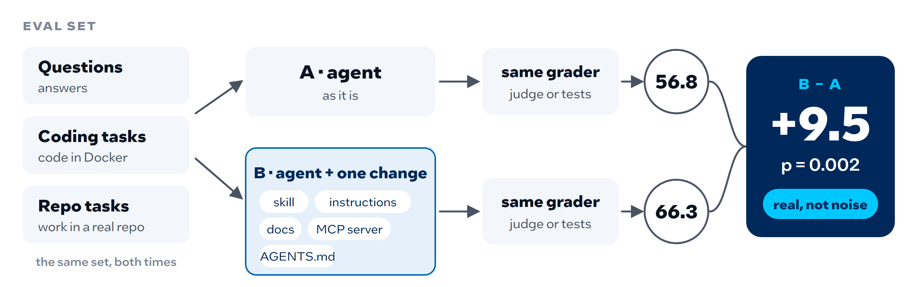
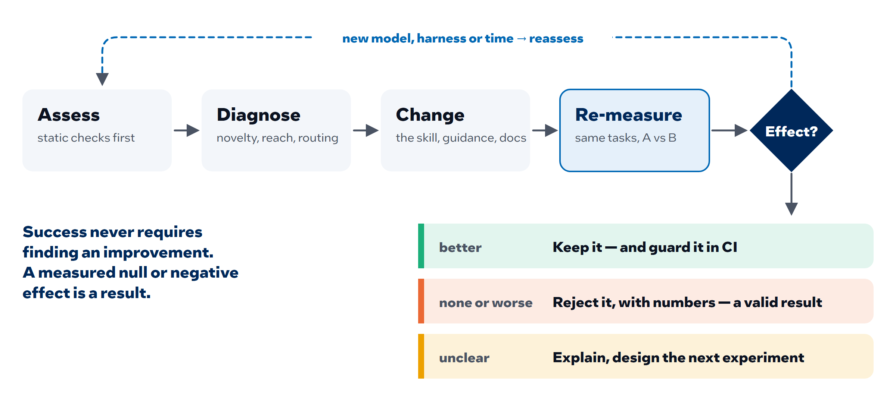
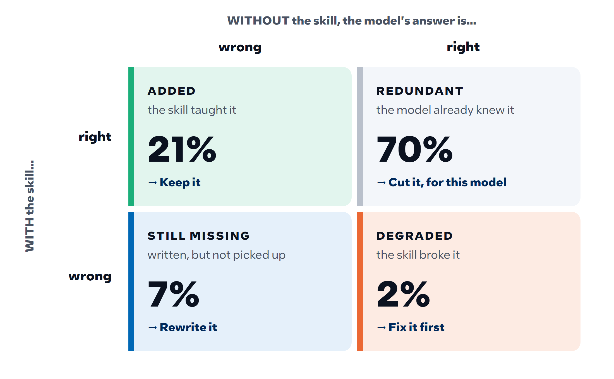

<!--
Copyright (C) 2026 Intel Corporation
SPDX-License-Identifier: Apache-2.0
-->

# Dokimi — A/B testing for agent context

[](https://intel.github.io/dokimi/)
[](https://codecov.io/gh/intel/dokimi)
[](https://scorecard.dev/viewer/?uri=github.com/intel/dokimi)

Find out whether your agent's skills, documentation and repository instructions improve its work. Dokimi runs the same questions or coding tasks under different context conditions, compares the outcomes, and helps you investigate the difference.



Read the measured delta, uncertainty and task-level evidence together; one passing example does not establish a general benefit.



## What can you find out?

| Your question | What to inspect |
|---|---|
| Does this context help? | [Controlled arms, models, harnesses and cost](dokimi/docs/features/experiments.md) |
| Which parts of a skill matter? | [Knowledge probes, annotated passages, bundles and shortening](dokimi/docs/features/skills.md) |
| Will the agent use it? | [Discovery, routing, tool preference and instruction loading](dokimi/docs/features/discovery.md) |
| Does repository guidance work? | [Static claims, scopes, executable tasks and rule evidence](dokimi/docs/features/repositories.md) |
| Do the tests cover the work? | [Task creation, coverage and grader controls](dokimi/docs/features/eval-design.md) |
| Can the grades be trusted? | [Scoring methods, judge checks and grounding](dokimi/docs/features/judging.md) |
| What did the agent do? | [Context use, execution paths and process contracts](dokimi/docs/features/traces.md) |
| Will it keep working? | [Reports, baselines, CI and development directions](dokimi/docs/features/continuous-evaluation.md) |

**[Full feature tree: 39 individual cards](dokimi/docs/features/README.md)** · **[Documentation](https://intel.github.io/dokimi/)**

Each card states what works today and where it stops. Open PRs, partial workflows and research directions are included, with links, so they are discoverable without being advertised as released functionality.

**Which parts of a skill help: novelty.** Dokimi asks the model about each claim in a skill twice, without the skill and with it, and a different model grades both answers. Every claim lands in one of four outcomes, per model ([more](dokimi/docs/skill-novelty.md)):



## Choose your starting point

[Skill author or reviewer](dokimi/docs/start/skills.md) · [Repository maintainer](dokimi/docs/start/repositories.md) · [Evaluator or researcher](dokimi/docs/start/experiments.md) · [Agent / CI operator](dokimi/docs/start/automation.md) · [Contributor](dokimi/docs/start/contributors.md)

## Start with a free check

From a checkout, with Python 3.11 or newer:

```bash
cd dokimi
pip install -e .
dokimi repo scan /path/to/your/repository
```

Replace the path with the repository you want to inspect. This static scan does not call an LLM. To check a skill collection instead:

```bash
dokimi catalog check --root /path/to/your/catalog --kind skills
```

Then follow [reviewing a skill or repository](dokimi/docs/reviewing.md) for the next step and its cost. Agent experiments need the selected provider or logged-in harness; executable coding tasks also need their supported container environment. Check [harness support](dokimi/docs/coding-harnesses.md) before choosing a runner.

## Read the evidence

A skill can teach something new without improving a task, and an instruction can exist without being loaded. Dokimi separates these questions. Knowledge novelty suggests edits to test; it does not mean familiar content is safe to delete. Grader controls help expose blind spots; they do not prove a verifier is infallible.

For methods and recorded studies, see [what Dokimi measures](dokimi/docs/what-it-measures.md), [methodology](dokimi/docs/methodology.md) and [skill novelty evidence](dokimi/docs/skill-novelty-evidence.md). Results belong to the evaluated artifact, task set, model, harness and grader.

**Coding agents:** use [reviewing.md](dokimi/docs/reviewing.md) to evaluate content, and [AGENTS.md](AGENTS.md) to change Dokimi. See also [contributing](CONTRIBUTING.md), [the CLI reference](https://intel.github.io/dokimi/reference/cli/) and [the project vision](VISION.md).

## License

Licensed under the [Apache License, Version 2.0](LICENSE); see [NOTICE](NOTICE) for attribution.
