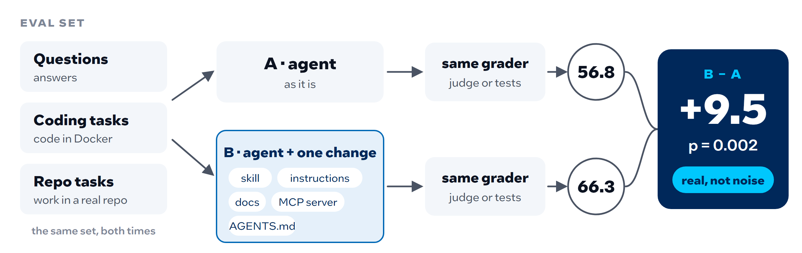
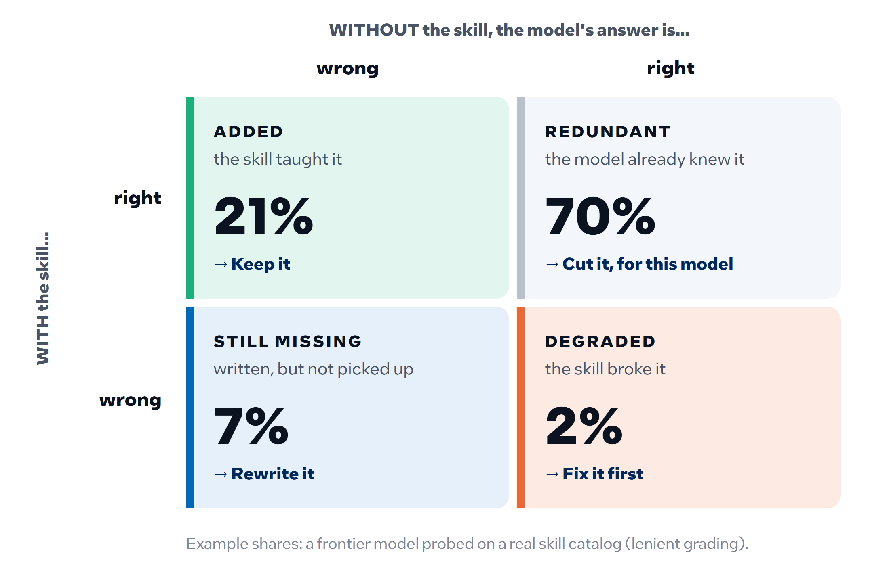
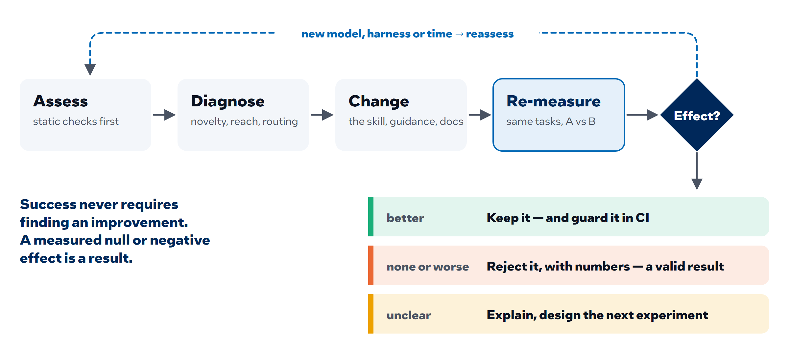

<!--
Copyright (C) 2026 Intel Corporation
SPDX-License-Identifier: Apache-2.0
-->

# Dokimi — A/B testing for agent context

[](https://intel.github.io/dokimi/)
[](https://codecov.io/gh/intel/dokimi)
[](https://scorecard.dev/viewer/?uri=github.com/intel/dokimi)

**Dokimi measures whether the context you give an AI agent actually helps it.**



<sub>Illustrative numbers. Change one thing, hold the model, eval set, grader
and harness fixed, report the delta with its p-value.</sub>

**Documentation: <https://intel.github.io/dokimi/>**

## What it is

An AI agent is its model plus the context it is given: skills, instructions,
product docs, MCP servers, a repository's own `AGENTS.md`. All of that is cheap
to write and easy to over-claim, and marketplaces rank it by popularity, which
buries niche expert tooling such as HPC and numerical libraries.

Dokimi treats context like an experiment. It runs the same questions, coding
tasks or repository tasks with and without one change, grades both the same
way (an LLM judge for answers, tests in Docker for code), and reports the
difference with paired statistics, per model. An artifact ships with the
scorecard that earned it.

> **dokimi** — Greek *δοκιμή*, "test, proof". An artifact does not get trusted
> because it was written or because it is popular; it gets trusted because it
> passed a test that could have failed.


## Which parts help: novelty

A single delta says whether a skill helps, not which of its parts do. Dokimi
splits the skill (or any document, such as an `AGENTS.md`) into individual
claims and asks the model about each one twice: without the skill and with
it. A different model grades both answers. Every claim lands in one of four
outcomes:



The four outcomes are the direction to optimize in, claim by claim:

- **Added** — the skill's real value. Keep it, and protect it when shortening.
- **Redundant** — the model already knew it. Cut it to save context, for this model only.
- **Still missing** — written but not picked up. Rewrite it: clearer, earlier, or as an exact value.
- **Degraded** — the skill made the answer worse. Fix this first.

Dokimi maps the outcomes back onto the skill's own text and proposes shorter
versions that drop redundant claims while keeping the added ones and the
safety clauses. Re-measure the edited skill and the loop closes:



More: [content novelty](dokimi/docs/skill-novelty.md).

## What measuring shows

From the studies so far ([evidence](dokimi/docs/skill-novelty-evidence.md)):

- **Much of a skill repeats what the model already knows.** For a frontier
  model under lenient grading, 70% of what a skill says the model already
  produces unprompted. Under strict grading, which also checks exact values,
  38% is still missing even with the skill in context.
- **Models believe their context, even when it is wrong.** A plausible wrong
  value planted in a skill is repeated 94% of the time.
- **Value depends on the model.** What a small model needs, a frontier model
  may already know, so every verdict is per model.

## Get started

```bash
cd dokimi
pip install -e .
```

Vendor-neutral: any model reachable through LiteLLM, any docs, skills or tasks.

| To… | Read |
|---|---|
| Review a skill or a repository's agent setup, cheapest step first | [Reviewing a skill or a repository](dokimi/docs/reviewing.md) |
| See everything Dokimi measures (arms, novelty, repositories) | [What Dokimi measures](dokimi/docs/what-it-measures.md) |
| Run an evaluation end to end | [Quickstart](dokimi/docs/quickstart.md) |
| Point it at your own questions, tasks and skills | [External content](dokimi/docs/external-content.md) |
| Understand why the project exists | [`VISION.md`](VISION.md) |

All code, tests and CI live in [`dokimi/`](dokimi/); its
[README](dokimi/README.md) covers development. Evaluation content (skills,
tasks, question sets) lives in its own repositories and is passed in by path.

## License

Licensed under the [Apache License, Version 2.0](LICENSE); see [NOTICE](NOTICE)
for attribution.
