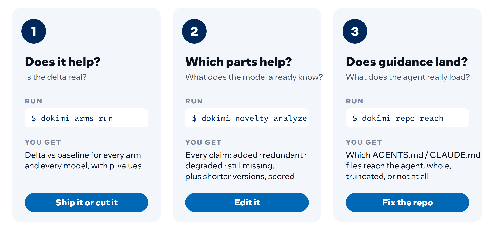
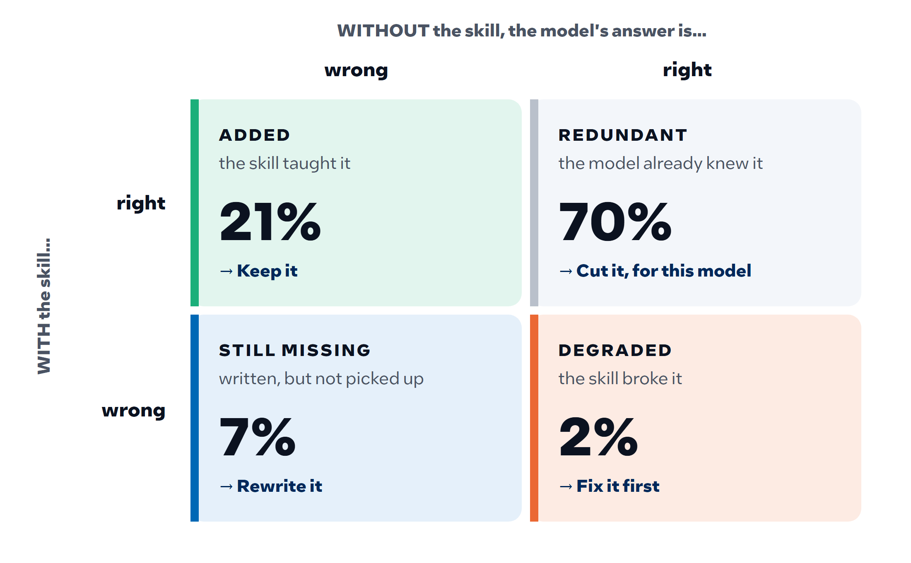

<!--
Copyright (C) 2026 Intel Corporation
SPDX-License-Identifier: Apache-2.0
-->

# Dokimi — A/B testing for agent context

[](https://intel.github.io/dokimi/)
[](https://codecov.io/gh/intel/dokimi)
[](https://scorecard.dev/viewer/?uri=github.com/intel/dokimi)

### Proof, not popularity: find out whether your agent's skills, docs and `AGENTS.md` actually work.


**Documentation: <https://intel.github.io/dokimi/>** — the full tour, with every figure.

## What it is

Skills, instructions, docs, MCP servers and a repository's `AGENTS.md` are cheap
to write and easy to over-claim. Dokimi runs the same questions or coding tasks
with and without one change, grades both the same way, and reports the
difference with its p-value, per model. Then it shows which parts of a skill
the model already knew, which it added and which it broke, and proposes a
shorter version that keeps what matters.

> **dokimi** — Greek *δοκιμή*, "test, proof". An artifact gets trusted because
> it passed a test that could have failed, not because it is popular.



**Which parts help: novelty.** Dokimi asks the model about each claim in a
skill twice, without the skill and with it, and a different model grades both
answers. Every claim lands in one of four outcomes
([more](dokimi/docs/skill-novelty.md)):



What measuring shows so far ([evidence](dokimi/docs/skill-novelty-evidence.md)):
most of a skill repeats what a frontier model already knows; a plausible wrong
value planted in a skill is repeated 94% of the time; and what a small model
needs, a large one may not, so every verdict is per model.

## Start here

```bash
cd dokimi && pip install -e .     # installs the `dokimi` command
```

| You want to… | Start with | Then read |
|---|---|---|
| Check a skill | `dokimi catalog scan --root <catalog> --kind skills` (free) | [Reviewing a skill](dokimi/docs/reviewing.md#a-skill) |
| Check a repository's agent setup | `dokimi repo scan <repo>` (free) | [Reviewing a repository](dokimi/docs/reviewing.md#a-repositorys-agent-setup) |
| See which parts of a skill help | `dokimi novelty analyze --artifact skill:<dir> --tier triage --estimate-only` (free estimate) | [Content novelty](dokimi/docs/skill-novelty.md) |
| Compare with and without a change | `dokimi arms run --arms baseline,skill:<dir> …` | [Quickstart](dokimi/docs/quickstart.md) |
| Write evals you can trust | the [`dokimi-design-evals`](dokimi/data/skills/dokimi-design-evals/SKILL.md) skill | [External content](dokimi/docs/external-content.md) |

Every step lists its cost; the free ones come first.

**Coding agents.** Asked to "use dokimi to review this skill" or "this
repository's agent setup"? Follow [reviewing.md](dokimi/docs/reviewing.md) step
by step: it says which command to run, what each costs, and how to read the
result. `dokimi --help` lists every command. To change dokimi itself, read
[AGENTS.md](AGENTS.md).

**More:** [what Dokimi measures](dokimi/docs/what-it-measures.md) ·
[why it exists](VISION.md) · [contributing](CONTRIBUTING.md) ·
[CLI reference](https://intel.github.io/dokimi/reference/cli/)

## License

Licensed under the [Apache License, Version 2.0](LICENSE); see [NOTICE](NOTICE)
for attribution.
