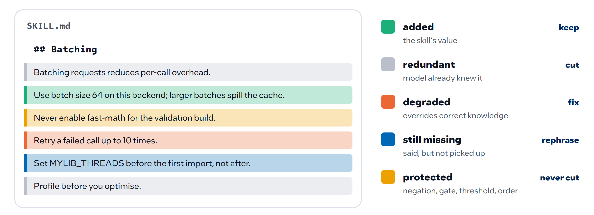
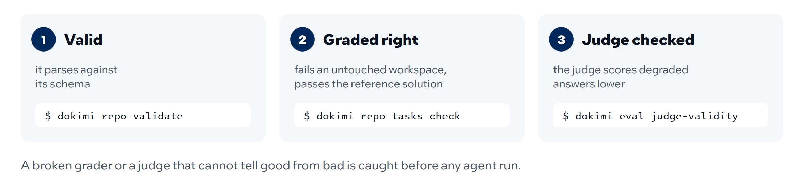
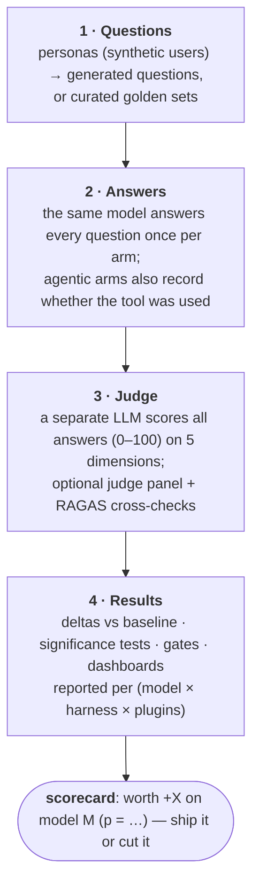
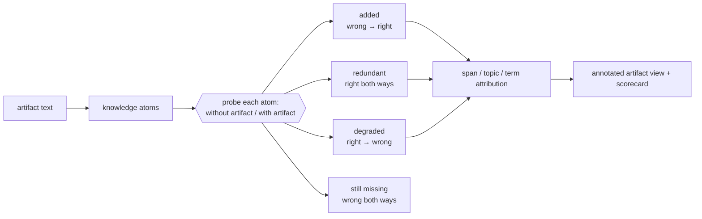

<!--
Copyright (C) 2026 Intel Corporation
SPDX-License-Identifier: Apache-2.0
-->

# Dokimi: measure what actually helps an agent

Source on GitHub: [intel/dokimi](https://github.com/intel/dokimi).

**Proof, not popularity: find out whether your agent's skills, docs and `AGENTS.md` actually work.**


## What it is

An AI agent is its model plus the context it is given: skills, instructions,
product docs, MCP servers, a repository's own `AGENTS.md`. All of that is cheap
to write and easy to over-claim, and marketplaces rank it by popularity, which
buries niche expert tooling such as HPC and numerical libraries.

Dokimi treats context like an experiment. It runs the same questions, coding
tasks or repository tasks with and without one change, grades both the same
way (an LLM judge for answers, tests in Docker for code), and reports the
difference with paired statistics, per model. An artifact ships with the
scorecard that earned it.

> **dokimi** — Greek *δοκιμή*, "test, proof". An artifact does not get trusted
> because it was written or because it is popular; it gets trusted because it
> passed a test that could have failed.


## Which parts help: novelty

A single delta says whether a skill helps, not which of its parts do. Dokimi
splits the skill (or any document, such as an `AGENTS.md`) into individual
claims and asks the model about each one twice: without the skill and with
it. A different model grades both answers. Every claim lands in one of four
outcomes:


The outcomes are painted back onto the skill's own text, so the author sees
what to keep, cut, rewrite and fix, line by line ([more on novelty](skill-novelty.md)):



## Shorten the skill without losing what matters

The same outcomes drive shortening. Dokimi proposes shorter versions of the
skill under different strategies (by value per token, or with every safety
clause pinned) and token budgets, and scores each candidate on tokens,
knowledge kept and safety clauses kept. Different strategies cut different
lines:


Pick a candidate, re-measure it on your tasks, and decide:


## Are the evals good enough?

A score is only as good as the evals behind it. Before any agent run, Dokimi
checks the eval set itself: that it parses, that each task's grader fails an
untouched workspace and passes the reference solution, and that an LLM judge
scores degraded answers lower.



**Where it is going:** mapping each claim in a skill to the tasks that
exercise it, so the claims no eval tests are listed next to the score.

## What measuring shows

From the studies so far ([evidence](skill-novelty-evidence.md)):

- **Much of a skill repeats what the model already knows.** For a frontier
  model under lenient grading, 70% of what a skill says the model already
  produces unprompted. Under strict grading, which also checks exact values,
  38% is still missing even with the skill in context.
- **Models believe their context, even when it is wrong.** A plausible wrong
  value planted in a skill is repeated in 85–94% of cases in a small study.
- **Value depends on the model.** What a small model needs, a frontier model
  may already know, so every verdict is per model.

## What can be compared (arms)

| Arm | What it tests |
|---|---|
| `baseline` | the bare model (control) |
| `docs:` / `mcp:` | injected documentation (local files, URL, Context7, real MCP server) |
| `skill:` | a skill (`SKILL.md`) injected as context |
| `profile:` | an agent persona system prompt |
| `agent:` / `skill-agent:` | **agentic** use — the model gets a tool and *decides* whether to fetch docs / load the skill |
| `skill-catalog:` | **selection** — every skill in a catalog is offered (a copy under a `template/` or `templates/` directory, a byte-identical mirror that loads under the same skill name, and anything under a vendored or VCS directory such as `.git`, `node_modules` or `.venv` are left out); scored on which one loads (`catalog trigger-set` builds the queries) |

Two fine-print notes:

- Plugins (e.g. `plugin:caveman`) are not arms — they go in via `--plugins`
  and apply to every arm in the run.
- Set `--judge-model` / `--judge-provider` to a different model than the
  answerer; the CLI defaults both to the same model, and self-judging
  inflates scores.

## Example results

One skill, four models, same golden question set. The numbers are
illustrative — the skill and question set they come from are evaluation content
and are not part of this repository; `cli.py arms run` produces the same table
for your own content (see [evaluating-treatments.md](evaluating-treatments.md)).

| Model | WITH skill | WITHOUT skill | Delta | p-value | Significant? |
|---|---|---|---|---|---|
| Haiku 4.5 | 66.3 | 56.8 | **+9.5** | 0.0024 | ✅ yes |
| Opus 4.7 | 78.5 | 73.6 | +4.9 | 0.0842 | ❌ |
| Sonnet 4.6 | 74.3 | 69.9 | +4.4 | 0.1797 | ❌ |
| Opus 4.8 | 80.8 | 78.1 | +2.7 | 0.1530 | ❌ |

What this table teaches:

- **Value depends on the model.** The same skill is worth +9.5 to a small
  model and +2.7 to a frontier one — stronger models already know more.
- **No p-value, no claim.** Three deltas are positive but not significant —
  at this sample size they may be judge noise.
- **The conclusion is targeted.** Ship this skill where it provably helps
  (smaller/cheaper models); gather more data for the rest.

*Where the stats come from:* every report path shares
`dokimi/eval/stats.py`, so the numbers cannot drift apart. The two-arm
(with/without) report and `report model-compare` each compute a paired t-test,
Wilcoxon signed-rank, Cohen's d_z, and a 95% CI on the deltas. The N-way
`arms run` report does the same for *every* arm against the one shared baseline,
then corrects the p-values for multiplicity across the arms (Holm-Bonferroni by
default, `--stats-correction bh` for FDR) and reports factorial-interaction
contrasts as a second, separately corrected family — see
[benchmarking-and-comparison.md](benchmarking-and-comparison.md#reading-the-significance-tables).
The full `benchmark run` pipeline also records a `question_set_hash` to prove
question-set reuse across runs.

## How the evaluation flows



Two more tracks back this up:

- **Static track** — LLM-free checks on the docs themselves: structure,
  freshness, readability, do the code examples run.
- **Executable task track** — Docker tasks supplied from an external content
  checkout ([external-content.md](external-content.md) covers how to point the
  framework at one): the agent must edit code, compile, and pass tests
  in Docker. A judge can be fooled by prose; a pytest verifier cannot. The
  [coding harnesses guide](coding-harnesses.md) explains how to run Codex,
  Claude Code, or any Harbor agent against these tasks and compare pass rate
  against a baseline harness; the task format itself is specified in
  [contributing-terminal-bench-task.md](contributing-terminal-bench-task.md).

## Asking a different question

Everything above answers *does this artifact help?* — one number per artifact,
with a p-value. Two tracks keep the same machinery and change the question.

### Content novelty: which parts help?

A skill is not homogeneous. One delta cannot tell you that 70% of a file is the
model's own prior knowledge written back at you, 21% is genuinely new, and 2% is
knowledge the model *had* and the file destroyed — but those three need opposite
edits. So each checkable claim in the artifact is probed twice against the same
model, once without the artifact and once with it, and a different model grades
both answers:



How an author uses it:

```bash
python cli.py novelty analyze --artifact skill:path/to/skill \
    --model <model under measurement> --judge-model <a different model> \
    --budgets 0.75 0.5
```

`analyze` says what the file is worth and where, and then (unless you pass
`--no-shorten`) proposes a smaller version at each budget and scores it on five
axes — tokens, knowledge, value, protection, routing — so cutting tokens cannot
quietly cut the safety clause. To shorten without probing, run the stages on
their own: `novelty atoms` writes `atoms.json`, and
`novelty shorten --atoms atoms.json` scores candidates from it. Two properties
to keep in mind: the result belongs to the (artifact, **model**) pair, so a file
that looks bloated against a frontier model may be correctly sized for a small
one; and the probes are paired, so trust the signs and the rankings, not the
second decimal. Guide: [skill-novelty.md](skill-novelty.md). The study behind the
defaults, with the caveat attached to every number:
[skill-novelty-evidence.md](skill-novelty-evidence.md).

### Repositories as subjects: does the repo's own guidance land?

Here the subject is not a document handed to the framework but a codebase, and
the material under test is what that codebase already tells agents — `CLAUDE.md`,
`AGENTS.md`, `.github/copilot-instructions.md`, contributor docs. The repository
declares what evaluating it means in a `repo-eval.yaml` manifest, and its tasks
and graders stay in **its** tree, so they can evolve with it instead of rotting
in a copy here.

```bash
python cli.py repo validate <dir | dir@rev | url@rev>   # is the manifest honest?
python cli.py repo reach   <source> --model <id>        # which guidance actually loads?
```

The reach probe exists because a harness's documented loading rules and its
behaviour are different things. It stands up a workspace holding the repo's
guidance files at their real paths, plants a head and a tail token in each, and
asks the agent which tokens it can see — so a file comes back `loaded`,
`truncated` (only one token: it was cut), `fetched` (seen only after the agent
opened it), `not_loaded`, or `error` (the scenario gave no usable answer).
Guidance nobody reads cannot help anyone, which makes this the cheapest check
to run first.
[repo-evaluation-contract.md](repo-evaluation-contract.md) is the interface a
repository codes against; the task-run and grading half is still being built,
and that document is marked PROPOSED until it lands.

## Why this matters

Marketplaces rank agent artifacts by popularity, which buries niche expert
tooling such as HPC and performance libraries (the bundled examples use
oneTBB, oneDAL and oneMKL).
Here, every shipped skill, doc source, or profile carries the **scorecard
that earned it**, built from the run that measured it. See the
[repository overview](../../README.md) for what this framework is and where the
content it measures comes from.

## Explore

- Get content to measure: [external-content.md](external-content.md) — point
  the framework at a checkout of a content repository.
- Run a comparison: [evaluating-treatments.md](evaluating-treatments.md) —
  `cli.py arms run` with any mix of arms.
- Full pipeline in one command: [quickstart.md](quickstart.md) — personas →
  questions → answers → judge → report, with cost estimates.
- Design rationale: [methodology.md](methodology.md) — model roles, question
  types, difficulty levels, judging, trust checks, and executable agent tasks.

---

# Documentation index

Start with the top-level [README](../README.md) for the project overview and
CLI surface. The files in this directory go deeper. They are also published at
<https://intel.github.io/dokimi/>, grouped as below, together with a
[CLI reference](https://intel.github.io/dokimi/reference/cli/) and an
[API reference](https://intel.github.io/dokimi/reference/api/dokimi/) generated from the
code.

## User journeys

- [user-journeys/README.md](user-journeys/README.md) — what users come to
  Dokimi to get done: fifteen journeys (J1–J15) from "check this" to "invoke
  one capability" and "turn a solved chat into a skill", who they are for, and where each one enters.
- [user-journeys/journeys.md](user-journeys/journeys.md) — the catalog: each
  journey's use cases and acceptance criteria, today's commands, and what is
  still proposed.
- [user-journeys/flow-map.md](user-journeys/flow-map.md) — how the journeys
  connect, current and proposed transitions told apart.
- [user-journeys/traceability.md](user-journeys/traceability.md) — how a
  criterion links to commands and tests, evidence kinds and stubs, and the
  coverage report `pytest --outcomes` generates.

## Using Dokimi

- [external-content.md](external-content.md) — **start here if you have no
  evaluation content yet**: the content this framework measures lives in a
  separate repository, and every location is an explicit flag
  (`--questions-root`, `--tasks-root`, `--repo-root`, `--registry`). Includes a
  pre-flight `catalog scan` and what each command does when a root is missing.
- [quickstart.md](quickstart.md) — end-to-end LLM evaluation pipeline:
  personas → questions → answers → judge → report. Includes troubleshooting
  and a cost estimate.
- [runs.md](runs.md) — what the runs have written: `cli.py runs list` lists
  every artifact under `results/` (or `DOKIMI_RUNS_DIR`) and counts what it
  skipped, `cli.py runs show` checks one against its schema. No LLM call.
- [user-flow.md](user-flow.md) — the canonical end-to-end path: pick a target,
  preflight, run, then pin the question set so runs stay comparable.
- [benchmarking-and-comparison.md](benchmarking-and-comparison.md) — how to
  run static benchmarks, LLM context benchmarks, fair multi-model comparisons,
  treatment-arm comparisons, dashboards, baselines, and comparison
  scripts.
- [adding-doc-source.md](adding-doc-source.md) — point the pipeline at local
  files, a single URL, a real MCP server, or a custom client.
- [evaluating-treatments.md](evaluating-treatments.md) — compare
  context-augmentation arms (docs, MCP, skills, agent persona prompts) with
  `cli.py arms run`.
- [tool-preference.md](tool-preference.md) — two equal tools per request: how
  much a name, wording or list position moves a model's choice
  (`cli.py tools preference`).
- [coding-harnesses.md](coding-harnesses.md) — run executable coding tasks
  through Codex, Claude Code, or terminal-bench/Harbor harnesses and compare
  verifier pass rate against a baseline.
- [answer-formats.md](answer-formats.md) — run Inspect AI, OpenAI evals,
  skill-creator and promptfoo answer-only sets on the answers track
- [subscription-backends.md](subscription-backends.md) — run the Q&A track through a
  logged-in coding-agent CLI (`--provider claude-cli`) instead of an API key
- [context-window.md](context-window.md) — read a run's context window from
  its Claude Code trace with `cli.py context trace`: start-up load, growth,
  compactions, tool-result weight. No LLM call.
- [session-prefilter.md](session-prefilter.md) — which AGENTS.md or CLAUDE.md rules
  the Claude Code session logs triggered, acted on and were corrected on, with
  `cli.py context prefilter`: candidates for ablation, not verdicts. No LLM call.
- [run-consistency.md](run-consistency.md) — repeated runs of one task with
  `cli.py context consistency`: result stability (pass^k), path stability
  (tool mix, order, actions, strategies), process-contract conformance.

- [what-it-measures.md](what-it-measures.md) — the three things Dokimi measures:
  enabled vs disabled arms, novel vs known content, and repositories.
- [reviewing.md](reviewing.md) — review a skill or a repository's agent setup,
  cheapest step first, with costs and how to read the results.

## Content novelty

- [skill-novelty.md](skill-novelty.md) — what a skill *adds* to a given model
  rather than what it scores: the added/redundant/degraded/still-missing 2×2 per
  knowledge atom, span/topic/term attribution with colour legend, and
  five-axis shortening. Authoring tool, usable standalone.
- [skill-novelty-walkthrough.md](skill-novelty-walkthrough.md) — the authoring path in
  order, one artifact and one model: can it be selected, what will measuring cost, triage,
  extract once and probe per model, read the span view, shorten, re-measure. Says at each
  step what the number refuses to claim.
- [skill-novelty-evidence.md](skill-novelty-evidence.md) — the 33-skill study
  the novelty numbers come from: method, K0 per model, the 2×2, need-graph
  statistics, content categories, shortening with measured behaviour, and the
  caveats each result carries.

## Repository evaluation

- [repo-evaluation-contract.md](repo-evaluation-contract.md) — *(proposed,
  partly implemented)* what a repository provides to be evaluated as a whole:
  `repo-eval.yaml`, `task.json`, the `grade` entry point and `grade.json`,
  harness profiles, and the guidance reach probe; and how to run its task
  self-check, agent runs, report and arm comparison (`repo tasks check`,
  `repo run`, `repo report`, `repo compare`). Tasks and graders stay in the scanned repository.
- [repo-evaluation-mergeability.md](repo-evaluation-mergeability.md) —
  *(proposed)* grading whether a maintainer would merge a test-passing change:
  `rubric.json` (blockers, non-blockers, scope), deterministic scope and
  test-integrity checks, the rubric judge, and the calibration gate a task
  must pass before it is admitted.
- [repo-evaluation-agent-modes.md](repo-evaluation-agent-modes.md) —
  *(proposed)* how a repository task states its agent mode, effort, perf
  protocol and team rules, split from the mergeability proposal (#67).
- [preparing-a-repository.md](preparing-a-repository.md) — what to put in a
  repository and its environment so coding agents build, test and review it
  well (runnable pinned commands, tool lines in `AGENTS.md`, true guidance, a
  complete compile database, review rules), and how to measure each change.
- [preparing-a-repository-evidence.md](preparing-a-repository-evidence.md) —
  the runs behind each figure on that page: task set, arms, model, cell count
  and raw count.

## Extending Dokimi

- [architecture.md](architecture.md) — module map and data flow across the
  static, LLM, and executable-task tracks.
- [contributing-metric.md](contributing-metric.md) — add a new static
  documentation metric (module + spec + tests + docs).
- [contributing-terminal-bench-task.md](contributing-terminal-bench-task.md)
  — the executable task format (directory layout, `task.toml` fields, verifier
  and oracle contract) that tasks in the external content repository follow.
- [releasing.md](releasing.md) — version numbers, changelog fragments, cutting
  a release, and the PyPI and conda-forge path.

## Methodology

- [methodology.md](methodology.md) — operational methodology: model roles,
  question types, difficulty levels, answer generation, judging, trust checks,
  and executable agent tasks.
- [difficulty-rubric.md](difficulty-rubric.md) — the difficulty/level rubric
  used to grade performance-skill questions and tasks.
- [example-execution.md](example-execution.md) — how the `example_pass_rate`
  metric extracts and runs fenced code examples in isolation.
- [ingestion-docling.md](ingestion-docling.md) — ingesting non-Markdown
  documents (PDF, HTML, …) via Docling, installed with the optional `ocr` extra.
- [research-register.md](research-register.md) — the register of Dokimi's own
  ideas, experiments (negative ones included), findings and decisions.
