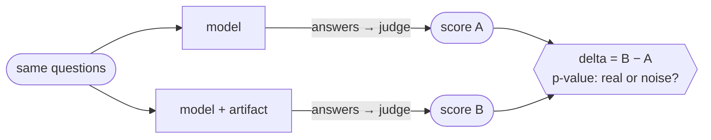
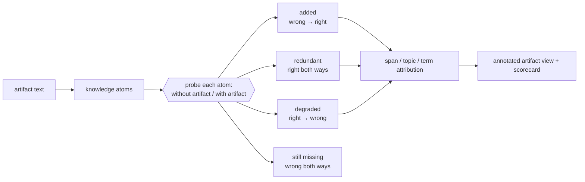

<!--
Copyright (C) 2026 Intel Corporation
SPDX-License-Identifier: Apache-2.0
-->

# Dokimi: measure what actually helps an agent

*Dokimi* — Greek δοκιμή, "test, proof" ([why the name](../../README.md)).

Source on GitHub: [intel/dokimi](https://github.com/intel/dokimi).

The idea in three points:

- An agent is more than its model. It is **model + the context you give it**:
  docs, skills, MCP servers, system prompts (agent profiles), plugins.
- All of that is cheap to write — and easy to over-claim. Does it really help,
  or does it just add tokens?
- So we test it like an experiment: **change one thing, keep everything else
  fixed, measure the delta — and check it is statistically significant.**



## What can be compared (arms)

| Arm | What it tests |
|---|---|
| `baseline` | the bare model (control) |
| `docs:` / `mcp:` | injected documentation (local files, URL, Context7, real MCP server) |
| `skill:` | a skill (`SKILL.md`) injected as context |
| `profile:` | an agent persona system prompt |
| `agent:` / `skill-agent:` | **agentic** use — the model gets a tool and *decides* whether to fetch docs / load the skill |
| `skill-catalog:` | **selection** — every skill in a catalog is offered; scored on which one loads (`catalog trigger-set` builds the queries) |

Two fine-print notes:

- Plugins (e.g. `plugin:caveman`) are not arms — they go in via `--plugins`
  and apply to every arm in the run.
- Set `--judge-model` / `--judge-provider` to a different model than the
  answerer; the CLI defaults both to the same model, and self-judging
  inflates scores.

## Example results

One skill, four models, same golden question set. The numbers are
illustrative — the skill and question set they come from are evaluation content
and are not part of this repository; `cli.py arms run` produces the same table
for your own content (see [evaluating-treatments.md](evaluating-treatments.md)).

| Model | WITH skill | WITHOUT skill | Delta | p-value | Significant? |
|---|---|---|---|---|---|
| Haiku 4.5 | 66.3 | 56.8 | **+9.5** | 0.0024 | ✅ yes |
| Opus 4.7 | 78.5 | 73.6 | +4.9 | 0.0842 | ❌ |
| Sonnet 4.6 | 74.3 | 69.9 | +4.4 | 0.1797 | ❌ |
| Opus 4.8 | 80.8 | 78.1 | +2.7 | 0.1530 | ❌ |

What this table teaches:

- **Value depends on the model.** The same skill is worth +9.5 to a small
  model and +2.7 to a frontier one — stronger models already know more.
- **No p-value, no claim.** Three deltas are positive but not significant —
  at this sample size they may be judge noise.
- **The conclusion is targeted.** Ship this skill where it provably helps
  (smaller/cheaper models); gather more data for the rest.

*Where the stats come from:* every report path shares
`dokimi/eval/stats.py`, so the numbers cannot drift apart. The two-arm
(with/without) report and `report model-compare` each compute a paired t-test,
Wilcoxon signed-rank, Cohen's d_z, and a 95% CI on the deltas. The N-way
`arms run` report does the same for *every* arm against the one shared baseline,
then corrects the p-values for multiplicity across the arms (Holm-Bonferroni by
default, `--stats-correction bh` for FDR) and reports factorial-interaction
contrasts as a second, separately corrected family — see
[benchmarking-and-comparison.md](benchmarking-and-comparison.md#reading-the-significance-tables).
The full `benchmark run` pipeline also records a `question_set_hash` to prove
question-set reuse across runs.

## How the evaluation flows


Two more tracks back this up:

- **Static track** — LLM-free checks on the docs themselves: structure,
  freshness, readability, do the code examples run.
- **Executable task track** — Docker tasks supplied from an external content
  checkout ([external-content.md](external-content.md) covers how to point the
  framework at one): the agent must edit code, compile, and pass tests
  in Docker. A judge can be fooled by prose; a pytest verifier cannot. The
  [coding harnesses guide](coding-harnesses.md) explains how to run Codex,
  Claude Code, or any Harbor agent against these tasks and compare pass rate
  against a baseline harness; the task format itself is specified in
  [contributing-terminal-bench-task.md](contributing-terminal-bench-task.md).

## Asking a different question

Everything above answers *does this artifact help?* — one number per artifact,
with a p-value. Two tracks keep the same machinery and change the question.

### Content novelty: which parts help?

A skill is not homogeneous. One delta cannot tell you that 70% of a file is the
model's own prior knowledge written back at you, 21% is genuinely new, and 2% is
knowledge the model *had* and the file destroyed — but those three need opposite
edits. So each checkable claim in the artifact is probed twice against the same
model, once without the artifact and once with it, and a different model grades
both answers:



How an author uses it:

```bash
python cli.py novelty analyze --artifact skill:path/to/skill \
    --model <model under measurement> --judge-model <a different model> \
    --budgets 0.75 0.5
```

`analyze` says what the file is worth and where, and then (unless you pass
`--no-shorten`) proposes a smaller version at each budget and scores it on five
axes — tokens, knowledge, value, protection, routing — so cutting tokens cannot
quietly cut the safety clause. To shorten without probing, run the stages on
their own: `novelty atoms` writes `atoms.json`, and
`novelty shorten --atoms atoms.json` scores candidates from it. Two properties
to keep in mind: the result belongs to the (artifact, **model**) pair, so a file
that looks bloated against a frontier model may be correctly sized for a small
one; and the probes are paired, so trust the signs and the rankings, not the
second decimal. Guide: [skill-novelty.md](skill-novelty.md). The study behind the
defaults, with the caveat attached to every number:
[skill-novelty-evidence.md](skill-novelty-evidence.md).

### Repositories as subjects: does the repo's own guidance land?

Here the subject is not a document handed to the framework but a codebase, and
the material under test is what that codebase already tells agents — `CLAUDE.md`,
`AGENTS.md`, `.github/copilot-instructions.md`, contributor docs. The repository
declares what evaluating it means in a `repo-eval.yaml` manifest, and its tasks
and graders stay in **its** tree, so they can evolve with it instead of rotting
in a copy here.

```bash
python cli.py repo validate <dir | dir@rev | url@rev>   # is the manifest honest?
python cli.py repo reach   <source> --model <id>        # which guidance actually loads?
```

The reach probe exists because a harness's documented loading rules and its
behaviour are different things. It stands up a workspace holding the repo's
guidance files at their real paths, plants a head and a tail token in each, and
asks the agent which tokens it can see — so a file comes back `loaded`,
`truncated` (only one token: it was cut), `fetched` (seen only after the agent
opened it), `not_loaded`, or `error` (the scenario gave no usable answer).
Guidance nobody reads cannot help anyone, which makes this the cheapest check
to run first.
[repo-evaluation-contract.md](repo-evaluation-contract.md) is the interface a
repository codes against; the task-run and grading half is still being built,
and that document is marked PROPOSED until it lands.

## Why this matters

Marketplaces rank agent artifacts by popularity, which buries niche expert
tooling such as HPC and performance libraries (the bundled examples use
oneTBB, oneDAL and oneMKL).
Here, every shipped skill, doc source, or profile carries the **scorecard
that earned it**, kept alive as models and docs change. See the
[repository overview](../../README.md) for what this framework is and where the
content it measures comes from.

## Explore

- Get content to measure: [external-content.md](external-content.md) — point
  the framework at a checkout of a content repository.
- Run a comparison: [evaluating-treatments.md](evaluating-treatments.md) —
  `cli.py arms run` with any mix of arms.
- Full pipeline in one command: [quickstart.md](quickstart.md) — personas →
  questions → answers → judge → report, with cost estimates.
- Design rationale: [methodology.md](methodology.md) — model roles, question
  types, difficulty levels, judging, trust checks, and executable agent tasks.

---

# Documentation index

Start with the top-level [README](../README.md) for the project overview and
CLI surface. The files in this directory go deeper. They are also published at
<https://intel.github.io/dokimi/>, grouped as below, together with a
[CLI reference](https://intel.github.io/dokimi/reference/cli/) and an
[API reference](https://intel.github.io/dokimi/reference/api/dokimi/) generated from the
code.

## Using Dokimi

- [external-content.md](external-content.md) — **start here if you have no
  evaluation content yet**: the content this framework measures lives in a
  separate repository, and every location is an explicit flag
  (`--questions-root`, `--tasks-root`, `--repo-root`, `--registry`). Includes a
  pre-flight `catalog scan` and what each command does when a root is missing.
- [quickstart.md](quickstart.md) — end-to-end LLM evaluation pipeline:
  personas → questions → answers → judge → report. Includes troubleshooting
  and a cost estimate.
- [user-flow.md](user-flow.md) — the canonical end-to-end path: pick a target,
  preflight, run, then pin the question set so runs stay comparable.
- [benchmarking-and-comparison.md](benchmarking-and-comparison.md) — how to
  run static benchmarks, LLM context benchmarks, fair multi-model comparisons,
  treatment-arm comparisons, dashboards, baselines, and comparison
  scripts.
- [adding-doc-source.md](adding-doc-source.md) — point the pipeline at local
  files, a single URL, a real MCP server, or a custom client.
- [evaluating-treatments.md](evaluating-treatments.md) — compare
  context-augmentation arms (docs, MCP, skills, agent persona prompts) with
  `cli.py arms run`.
- [tool-preference.md](tool-preference.md) — two equal tools per request: how
  much a name, wording or list position moves a model's choice
  (`cli.py tools preference`).
- [coding-harnesses.md](coding-harnesses.md) — run executable coding tasks
  through Codex, Claude Code, or terminal-bench/Harbor harnesses and compare
  verifier pass rate against a baseline.
- [context-window.md](context-window.md) — read a run's context window from
  its Claude Code trace with `cli.py context trace`: start-up load, growth,
  compactions, tool-result weight. No LLM call.

## Content novelty

- [skill-novelty.md](skill-novelty.md) — what a skill *adds* to a given model
  rather than what it scores: the added/redundant/degraded/still-missing 2×2 per
  knowledge atom, span/topic/term attribution with colour legend, and
  five-axis shortening. Authoring tool, usable standalone.
- [skill-novelty-walkthrough.md](skill-novelty-walkthrough.md) — the authoring path in
  order, one artifact and one model: can it be selected, what will measuring cost, triage,
  extract once and probe per model, read the span view, shorten, re-measure. Says at each
  step what the number refuses to claim.
- [skill-novelty-evidence.md](skill-novelty-evidence.md) — the 33-skill study
  the novelty numbers come from: method, K0 per model, the 2×2, need-graph
  statistics, content categories, shortening with measured behaviour, and the
  caveats each result carries.

## Repository evaluation

- [repo-evaluation-contract.md](repo-evaluation-contract.md) — *(proposed,
  partly implemented)* what a repository provides to be evaluated as a whole:
  `repo-eval.yaml`, `task.json`, the `grade` entry point and `grade.json`,
  harness profiles, and the guidance reach probe; and how to run its task
  self-check, agent runs, report and arm comparison (`repo tasks check`,
  `repo run`, `repo report`, `repo compare`). Tasks and graders stay in the scanned repository.
- [repo-evaluation-mergeability.md](repo-evaluation-mergeability.md) —
  *(proposed)* grading whether a maintainer would merge a test-passing change:
  `rubric.json` (blockers, non-blockers, scope), deterministic scope and
  test-integrity checks, the rubric judge, and the calibration gate a task
  must pass before it is admitted.
- [repo-evaluation-agent-modes.md](repo-evaluation-agent-modes.md) —
  *(proposed)* how a repository task states its agent mode, effort, perf
  protocol and team rules, split from the mergeability proposal (#67).
- [preparing-a-repository.md](preparing-a-repository.md) — what to put in a
  repository and its environment so coding agents build, test and review it
  well (runnable pinned commands, tool lines in `AGENTS.md`, true guidance, a
  complete compile database, review rules), and how to measure each change.
- [preparing-a-repository-evidence.md](preparing-a-repository-evidence.md) —
  the runs behind each figure on that page: task set, arms, model, cell count
  and raw count.

## Extending Dokimi

- [architecture.md](architecture.md) — module map and data flow across the
  static, LLM, and executable-task tracks.
- [contributing-metric.md](contributing-metric.md) — add a new static
  documentation metric (module + spec + tests + docs).
- [contributing-terminal-bench-task.md](contributing-terminal-bench-task.md)
  — the executable task format (directory layout, `task.toml` fields, verifier
  and oracle contract) that tasks in the external content repository follow.
- [releasing.md](releasing.md) — version numbers, changelog fragments, cutting
  a release, and the PyPI and conda-forge path.

## Methodology

- [methodology.md](methodology.md) — operational methodology: model roles,
  question types, difficulty levels, answer generation, judging, trust checks,
  and executable agent tasks.
- [difficulty-rubric.md](difficulty-rubric.md) — the difficulty/level rubric
  used to grade performance-skill questions and tasks.
- [example-execution.md](example-execution.md) — how the `example_pass_rate`
  metric extracts and runs fenced code examples in isolation.
- [ingestion-docling.md](ingestion-docling.md) — ingesting non-Markdown
  documents (PDF, HTML, …) via Docling, installed with the optional `ocr` extra.
