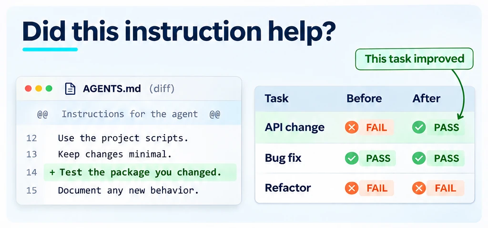

<!--
Copyright (C) 2026 Intel Corporation
SPDX-License-Identifier: Apache-2.0
-->

# Dokimi: measure what actually helps an agent

Source on GitHub: [intel/dokimi](https://github.com/intel/dokimi).

**Proof, not popularity: find out whether your agent's skills, docs and `AGENTS.md` actually work.**

[Explore the feature tree](features/README.md): one card per capability, with working paths, boundaries and links to detailed guides. Examples in the cards are fictional visual explanations, not recorded runs or runnable configuration.

## What it is

Dokimi compares questions and coding tasks under controlled context conditions: skills, catalogs, docs, MCP sources, profiles and repository guidance. It reports task outcomes and diagnostic evidence so you can decide what to change and what to test again.

## Which parts help: novelty

Novelty probes separate added, redundant, degraded and still-missing knowledge per model. The source annotation helps locate passages to investigate; it does not establish a causal value for each sentence. [See the cards](features/skills.md) and [the full guide](skill-novelty.md).

## Shorten the skill without losing what matters

Compare candidates across tokens, knowledge, value, protection and routing. Familiar knowledge may still serve a procedural or routing purpose. Retest the selected candidate on tasks before adopting it. [Shortening guide](skill-novelty-walkthrough.md).

## Are the evals good enough?

Validate the task inputs, check null and oracle controls, and challenge the verifier or judge. Existing need-space coverage uses a frozen graph and explicit labels; model-estimated skill-to-check mapping is a separate development feature. [Eval design cards](features/eval-design.md) and [judge cards](features/judging.md) explain the boundary.

## What measuring shows

Use [the recorded novelty studies](skill-novelty-evidence.md) for empirical claims, including their model, grading rule and sample limits. The visual examples on this site are not additional experimental evidence.

## What can be compared (arms)

See [what Dokimi measures](what-it-measures.md) for the supported context types and [evaluating treatments](evaluating-treatments.md) for arm syntax. Injecting content, offering a tool and letting the agent select a skill are different conditions. Not every treatment works with every harness.

## Example results

Read each comparison with its baseline, paired task outcomes, missing cells, uncertainty and experimental conditions. An inconclusive comparison is not proof of no effect. The fictional task outcomes in the illustrations explain the report shape; they do not establish a model ranking or a treatment benefit.

For statistical details, see [reading the significance tables](benchmarking-and-comparison.md#reading-the-significance-tables). Inspect the report path you use rather than assuming all tracks have identical statistics. Configure answerer and judge roles deliberately and review [methodology](methodology.md) for the chosen path.

## How the evaluation flows

Choose the subject and tasks, validate the inputs and controls, run matched conditions, then inspect the report and decide on the next experiment. [Quickstart](quickstart.md) covers the question-answering path; [coding harnesses](coding-harnesses.md) covers executable tasks. Tests can also have blind spots: a deterministic verifier is not automatically an infallible grader.

## Asking a different question

### Content novelty: which parts help?

[Skill cards](features/skills.md) connect atom-level outcomes, source attribution, bundle analysis and shortening to task-level confirmation. [Discovery cards](features/discovery.md) ask whether the agent can find and choose the content at all.

### Repositories as subjects: does the repo's own guidance land?

Repository validation, static scanning, reach, task execution, reports and comparisons are implemented. The [repository contract](repo-evaluation-contract.md) documents these working paths and their limits; separate extensions remain proposed. [Repository cards](features/repositories.md) provide the visual entry points.

## Why this matters

Popularity does not establish usefulness for your workload. Keep evidence attached to the artifact and conditions that produced it, and re-evaluate when those conditions change. [Continuous evaluation](features/continuous-evaluation.md) distinguishes existing baseline workflows from the broader development lifecycle.

## Explore

- [Feature tree](features/README.md) — the complete capability map.
- [Does the context help?](features/experiments.md) — arms, harnesses and cost.
- [Which parts of a skill matter?](features/skills.md) — diagnostics and checks.
- [Will the agent use it?](features/discovery.md) — discovery, selection and reach.
- [Does repository guidance work?](features/repositories.md) — repository evaluation.
- [Do the tests cover the work?](features/eval-design.md) — task creation and controls.
- [Can the grades be trusted?](features/judging.md) — scoring and judge validity.
- [What did the agent do?](features/traces.md) — context and execution evidence.
- [Will it keep working?](features/continuous-evaluation.md) — reports, CI and development.

---

# Documentation index

Start with the top-level [README](../README.md) for the project overview and
CLI surface. The files in this directory go deeper. They are also published at
<https://intel.github.io/dokimi/>, grouped as below, together with a
[CLI reference](https://intel.github.io/dokimi/reference/cli/) and an
[API reference](https://intel.github.io/dokimi/reference/api/dokimi/) generated from the
code.

## User journeys

- [user-journeys/README.md](user-journeys/README.md) — what users come to
  Dokimi to get done: fifteen journeys (J1–J15) from "check this" to "invoke
  one capability" and "turn a solved chat into a skill", who they are for, and where each one enters.
- [user-journeys/journeys.md](user-journeys/journeys.md) — the catalog: each
  journey's use cases and acceptance criteria, today's commands, and what is
  still proposed.
- [user-journeys/flow-map.md](user-journeys/flow-map.md) — how the journeys
  connect, current and proposed transitions told apart.
- [user-journeys/traceability.md](user-journeys/traceability.md) — how a
  criterion links to commands and tests, evidence kinds and stubs, and the
  coverage report `pytest --outcomes` generates.

## Using Dokimi

- [external-content.md](external-content.md) — **start here if you have no
  evaluation content yet**: the content this framework measures lives in a
  separate repository, and every location is an explicit flag
  (`--questions-root`, `--tasks-root`, `--repo-root`, `--registry`). Includes a
  pre-flight `catalog check` and what each command does when a root is missing.
- [quickstart.md](quickstart.md) — end-to-end LLM evaluation pipeline:
  personas → questions → answers → judge → report. Includes troubleshooting
  and a cost estimate.
- [runs.md](runs.md) — what the runs have written: `cli.py runs list` lists
  every artifact under `results/` (or `DOKIMI_RUNS_DIR`), one run's together,
  and counts what it skipped, `cli.py runs show` checks one against its schema
  or lists one run. No LLM call.
- [user-flow.md](user-flow.md) — the canonical end-to-end path: pick a target,
  preflight, run, then pin the question set so runs stay comparable.
- [benchmarking-and-comparison.md](benchmarking-and-comparison.md) — how to
  run static benchmarks, LLM context benchmarks, fair multi-model comparisons,
  treatment-arm comparisons, dashboards, baselines, and comparison
  scripts.
- [adding-doc-source.md](adding-doc-source.md) — point the pipeline at local
  files, a single URL, a real MCP server, or a custom client.
- [evaluating-treatments.md](evaluating-treatments.md) — compare
  context-augmentation arms (docs, MCP, skills, agent persona prompts) with
  `cli.py arms run`.
- [tool-preference.md](tool-preference.md) — two equal tools per request: how
  much a name, wording or list position moves a model's choice
  (`cli.py tools preference`).
- [coding-harnesses.md](coding-harnesses.md) — run executable coding tasks
  through Codex, Claude Code, or terminal-bench/Harbor harnesses and compare
  verifier pass rate against a baseline.
- [answer-formats.md](answer-formats.md) — run Inspect AI, OpenAI evals,
  skill-creator and promptfoo answer-only sets on the answers track
- [subscription-backends.md](subscription-backends.md) — run the Q&A track through a
  logged-in coding-agent CLI (`--provider claude-cli`) instead of an API key
- [context-window.md](context-window.md) — read a run's context window from
  its Claude Code trace with `cli.py trace inspect`: start-up load, growth,
  compactions, tool-result weight. No LLM call.
- [session-prefilter.md](session-prefilter.md) — which AGENTS.md or CLAUDE.md rules
  the Claude Code session logs triggered, acted on and were corrected on, with
  `cli.py trace prefilter`: candidates for ablation, not verdicts. No LLM call.
- [run-consistency.md](run-consistency.md) — repeated runs of one task with
  `cli.py trace consistency`: result stability (pass^k), path stability
  (tool mix, order, actions, strategies), process-contract conformance.

- [what-it-measures.md](what-it-measures.md) — the three things Dokimi measures:
  enabled vs disabled arms, novel vs known content, and repositories.
- [reviewing.md](reviewing.md) — review a skill or a repository's agent setup,
  cheapest step first, with costs and how to read the results.

## Content novelty

- [skill-novelty.md](skill-novelty.md) — what a skill *adds* to a given model
  rather than what it scores: the added/redundant/degraded/still-missing 2×2 per
  knowledge atom, span/topic/term attribution with colour legend, and
  five-axis shortening. Authoring tool, usable standalone.
- [skill-novelty-walkthrough.md](skill-novelty-walkthrough.md) — the authoring path in
  order, one artifact and one model: can it be selected, what will measuring cost, triage,
  extract once and probe per model, read the span view, shorten, re-measure. Says at each
  step what the number refuses to claim.
- [skill-novelty-evidence.md](skill-novelty-evidence.md) — the 33-skill study
  the novelty numbers come from: method, K0 per model, the 2×2, need-graph
  statistics, content categories, shortening with measured behaviour, and the
  caveats each result carries.

## Repository evaluation

- [repo-evaluation-contract.md](repo-evaluation-contract.md) — implemented core with scoped extensions: what a repository provides to be evaluated as a whole:
  `repo-eval.yaml`, `task.json`, the `grade` entry point and `grade.json`,
  harness profiles, and the guidance reach probe; and how to run its task
  self-check, agent runs, report and arm comparison (`eval check`,
  `repo run`, `repo report`, `repo compare`). Tasks and graders stay in the scanned repository.
- [reach-matrix.md](reach-matrix.md) — the reach conformance suite: fixture
  repositories, what each harness's vendor documentation says they load, the
  `scripts/reach_conformance.py` run and merge that produce the agent × version
  matrix, and the nightly workflow that publishes it.
- [repo-evaluation-mergeability.md](repo-evaluation-mergeability.md) —
  *(proposed)* grading whether a maintainer would merge a test-passing change:
  `rubric.json` (blockers, non-blockers, scope), deterministic scope and
  test-integrity checks, the rubric judge, and the calibration gate a task
  must pass before it is admitted.
- [repo-evaluation-agent-modes.md](repo-evaluation-agent-modes.md) —
  *(proposed)* how a repository task states its agent mode, effort, perf
  protocol and team rules, split from the mergeability proposal (#67).
- [preparing-a-repository.md](preparing-a-repository.md) — what to put in a
  repository and its environment so coding agents build, test and review it
  well (runnable pinned commands, tool lines in `AGENTS.md`, true guidance, a
  complete compile database, review rules), and how to measure each change.
- [preparing-a-repository-evidence.md](preparing-a-repository-evidence.md) —
  the runs behind each figure on that page: task set, arms, model, cell count
  and raw count.
- [rule-ledger.md](rule-ledger.md) — one row per guidance rule: its
  hypothesis, the replay or executable cases of the failures it prevents, and
  the review date; `repo compare --ledger` gives each rule a keep, review or
  insufficient-evidence verdict. The cut decision stays with a person.

## Extending Dokimi

- [architecture.md](architecture.md) — module map and data flow across the
  static, LLM, and executable-task tracks.
- [contributing-metric.md](contributing-metric.md) — add a new static
  documentation metric (module + spec + tests + docs).
- [contributing-terminal-bench-task.md](contributing-terminal-bench-task.md)
  — the executable task format (directory layout, `task.toml` fields, verifier
  and oracle contract) that tasks in the external content repository follow.
- [releasing.md](releasing.md) — version numbers, changelog fragments, cutting
  a release, and the PyPI and conda-forge path.

## Methodology

- [methodology.md](methodology.md) — operational methodology: model roles,
  question types, difficulty levels, answer generation, judging, trust checks,
  and executable agent tasks.
- [difficulty-rubric.md](difficulty-rubric.md) — the difficulty/level rubric
  used to grade performance-skill questions and tasks.
- [example-execution.md](example-execution.md) — how the `example_pass_rate`
  metric extracts and runs fenced code examples in isolation.
- [ingestion-docling.md](ingestion-docling.md) — ingesting non-Markdown
  documents (PDF, HTML, …) via Docling, installed with the optional `ocr` extra.
- [research-register.md](research-register.md) — the register of Dokimi's own
  ideas, experiments (negative ones included), findings and decisions.
