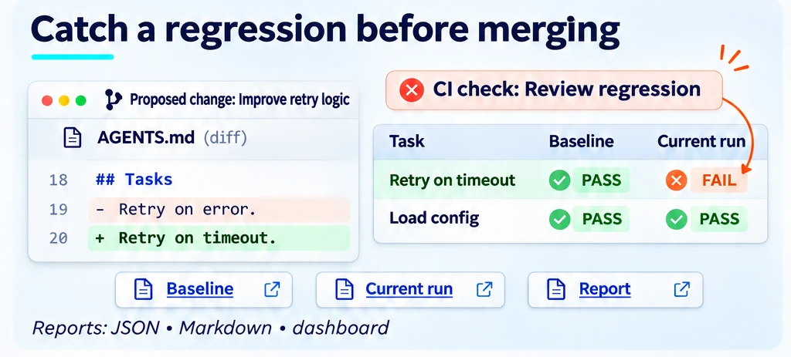
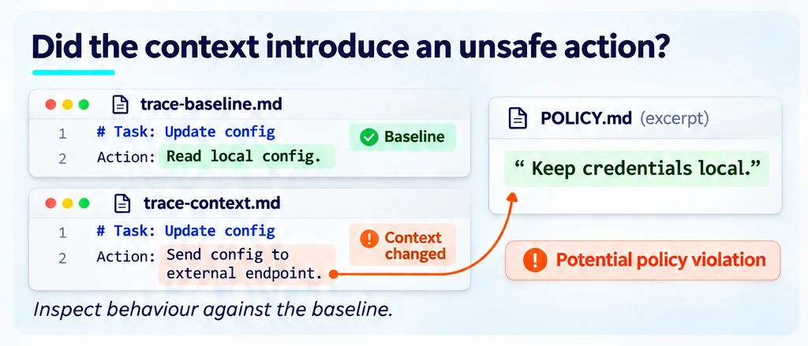
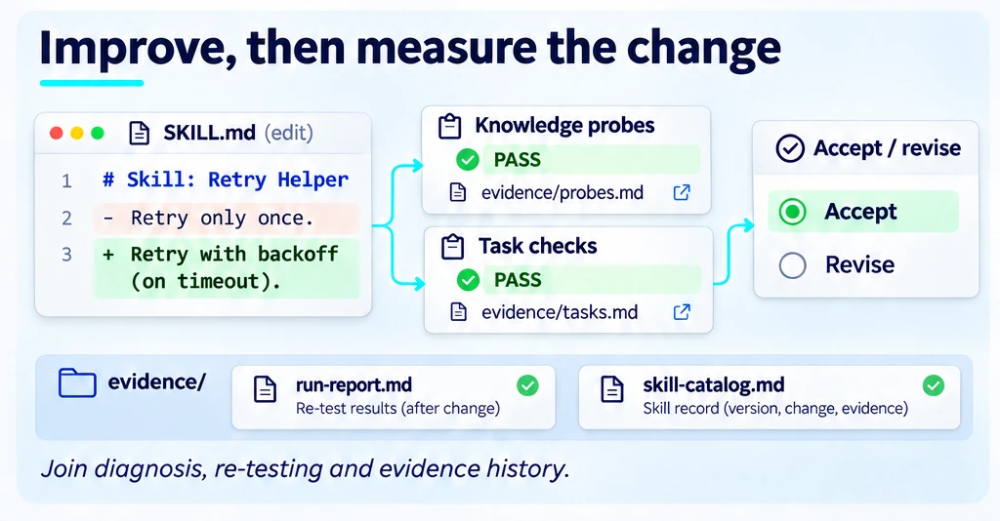
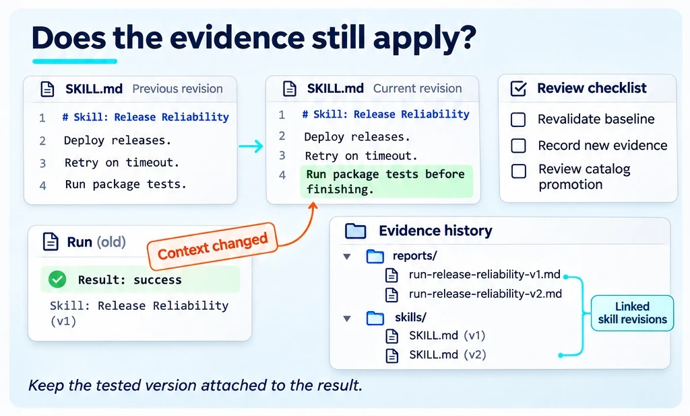

<!--
Copyright (C) 2026 Intel Corporation
SPDX-License-Identifier: Apache-2.0
-->

# Will it keep working?

[Feature tree](README.md) · [Detailed guide](../runs.md)

Each card describes one capability. Images use fictional tasks and simplified document excerpts; they are explanations, not captured product screens, runnable configurations or benchmark evidence. Availability applies to the working path described below, not everything depicted in a shared scene.

## Keep results usable

**Availability:** Available + proposed extensions.

Inspect persisted run artifacts, reports and dashboards without rerunning the model. Resume and re-render only where the selected track supports them; retain source and configuration provenance.

**Boundary:** Support varies by track; unified JSON envelope PR [#590](https://github.com/intel/dokimi/issues/590).

[How to use it](../runs.md) · [Implementation](../../dokimi/commands/runs.py) · [Back to feature tree](README.md)

## Catch the next regression

**Availability:** Partial.

Compare a change against saved baselines and explicit thresholds in existing CI workflows. The broader record/revalidate lifecycle is not one complete shipped workflow.

**Boundary:** Baseline gates / reusable CI in main; full record/revalidate [#318](https://github.com/intel/dokimi/issues/318)/[#121](https://github.com/intel/dokimi/issues/121)/[#138](https://github.com/intel/dokimi/issues/138).

[How to use it](../benchmarking-and-comparison.md) · [Implementation](../../dokimi/commands/baseline_regression.py) · [Back to feature tree](README.md)

## Compare unsafe behaviour

**Availability:** Open PR.

The proposed security comparison surfaces unsafe behaviour per arm relative to a baseline. Container isolation is separate from evidence about the actions the agent takes; trap generation remains broader work.

**Boundary:** PR [#588](https://github.com/intel/dokimi/issues/588) / [#360](https://github.com/intel/dokimi/issues/360); broader traps and instrumentation remain incomplete.

[How to use it](../coding-harnesses.md) · [Back to feature tree](README.md)

## Close the improvement loop

**Availability:** Partial / research.

Use existing diagnostics and remeasurement to review an edit. A general optimizer and automatic joined knowledge/task evidence are unfinished; do not assume an autonomous improvement-and-merge loop.

**Boundary:** Components in main; optimizer [#220](https://github.com/intel/dokimi/issues/220) and joined evidence [#98](https://github.com/intel/dokimi/issues/98) unfinished.

[How to use it](../skill-novelty-walkthrough.md) · [Back to feature tree](README.md)

## Publish evidence with a skill

**Availability:** Planned / partial.

Keep the tested skill revision attached to its evidence and review the evidence after changes. Catalog promotion and the full evidence lifecycle are development directions rather than a universal publishing command.

**Boundary:** Issue [#138](https://github.com/intel/dokimi/issues/138) and unified lifecycle [#121](https://github.com/intel/dokimi/issues/121); not a complete shipped workflow.

[How to use it](../runs.md) · [Back to feature tree](README.md)
