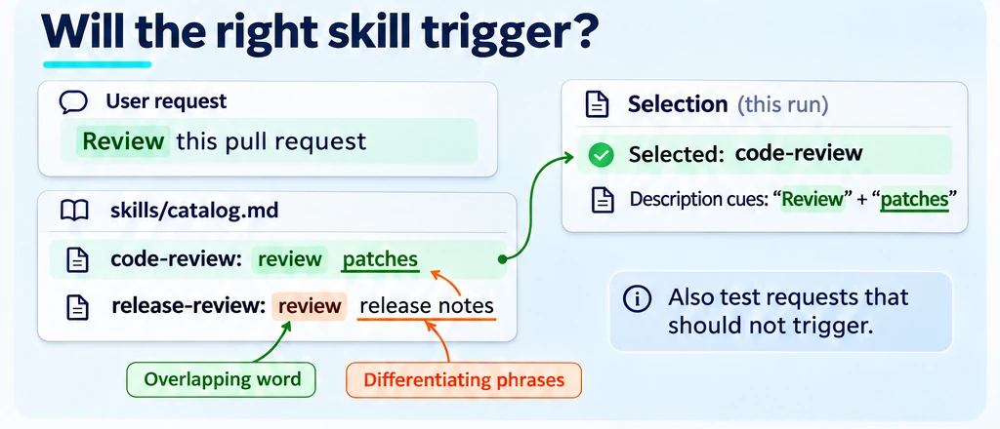
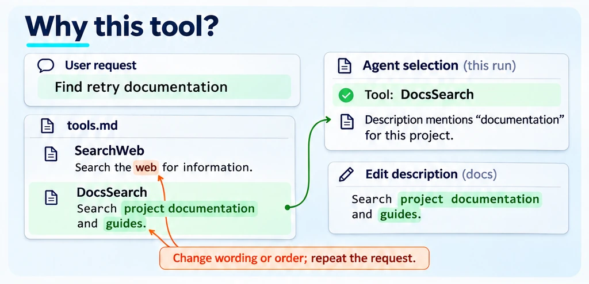
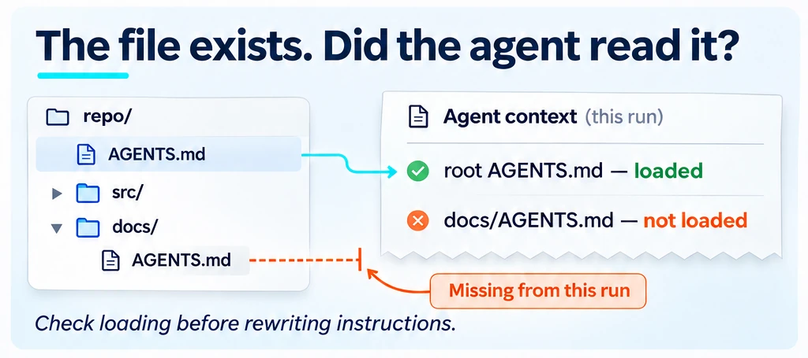
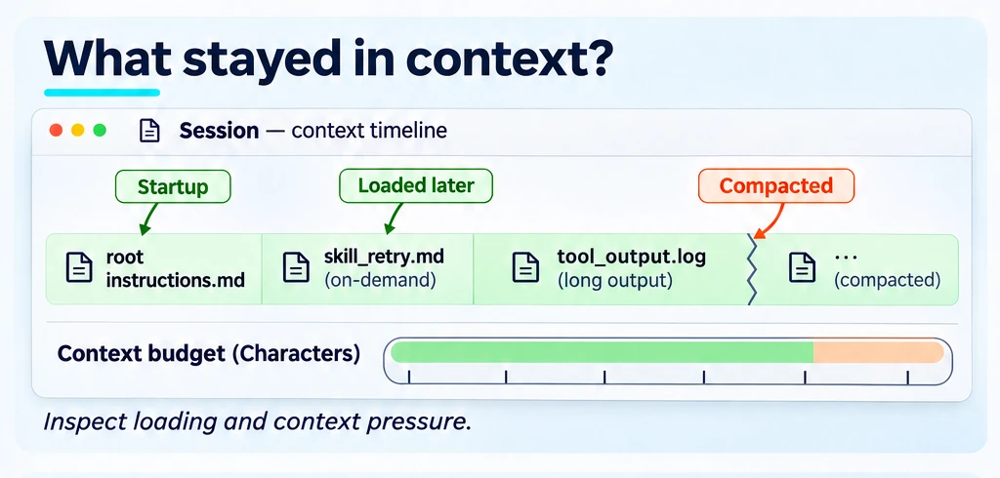
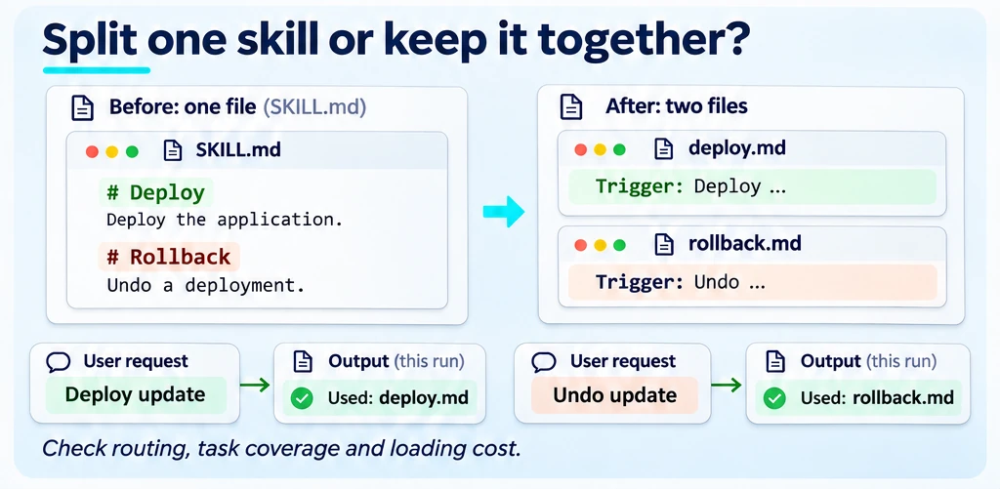
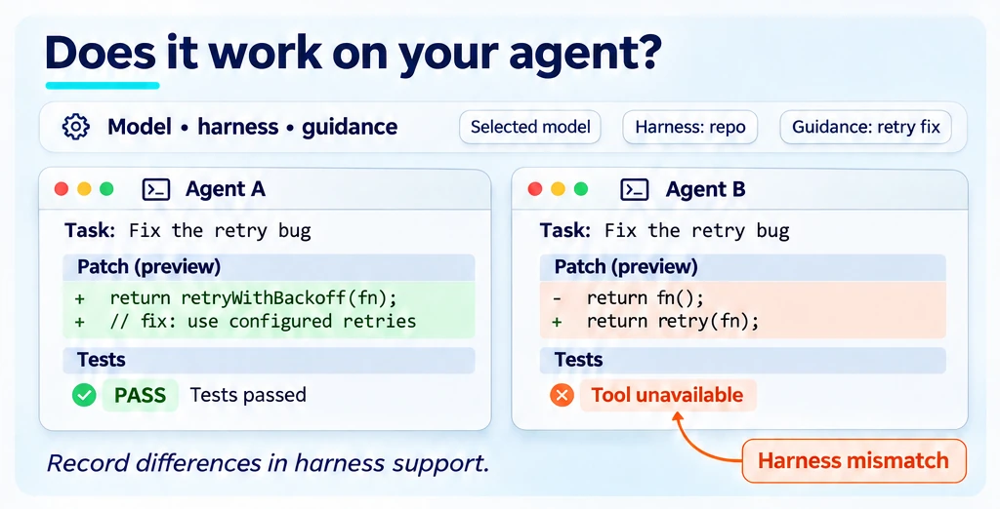

<!--
Copyright (C) 2026 Intel Corporation
SPDX-License-Identifier: Apache-2.0
-->

# Will the agent use it?

[Feature tree](README.md) · [Detailed guide](../reviewing.md)

Each card describes one capability. Images use fictional tasks and simplified document excerpts; they are explanations, not captured product screens, runnable configurations or benchmark evidence. Availability applies to the working path described below, not everything depicted in a shared scene.

## Will the agent discover it?

**Availability:** Available on main.

Probe skill placements under the intended harness. A file on disk is not necessarily listed to the agent, and a listed skill is not necessarily selected.

**Input:** Your context artifact, actual harness or catalog, and representative user requests.

**Scope and limits:** repo skill-reach; discovery depends on the harness.

**Result:** Discovery evidence under the selected loading condition.

**Next step:** Follow the linked guide for the exact command and output schema, then [interpret the result](../start/results.md).

[Usage guide](../what-it-measures.md) · [Implementation](../../dokimi/commands/repo_skill_reach.py) · [Back to feature tree](README.md)

## Will it choose the right skill?

**Availability:** Partial — implemented core with proposed extensions.

Test requests that should select a skill and requests that should not. Compare competing descriptions and inspect actual selection, not only keyword overlap.

**Input:** Your context artifact, actual harness or catalog, and representative user requests.

**Scope and limits:** Existing routing; CLI relocation in PR [#595](https://github.com/intel/dokimi/issues/595). Need relevance also matters.

**Result:** Routing outcomes against actual competing skills and user queries.

**Next step:** Follow the linked guide for the exact command and output schema, then [interpret the result](../start/results.md).

[Usage guide](../skill-novelty-walkthrough.md) · [Implementation](../../dokimi/commands/novelty.py) · [Back to feature tree](README.md)

## Why did it choose that tool?

**Availability:** Available on main.

Change tool wording or position while holding the request fixed. Repeat the trials to distinguish preference sensitivity from one random choice.

**Input:** Your context artifact, actual harness or catalog, and representative user requests.

**Scope and limits:** Tool preference experiments; control presentation changes.

**Result:** Tool-choice distributions under the tested naming/order conditions.

**Next step:** Follow the linked guide for the exact command and output schema, then [interpret the result](../start/results.md).

[Usage guide](../tool-preference.md) · [Implementation](../../dokimi/commands/tools.py) · [Back to feature tree](README.md)

## What instructions loaded?

**Availability:** Available on main.

Use reach probes and effective-instruction evidence to distinguish loaded, truncated, fetched, not-loaded and error outcomes. Keep the harness/version and scenario with the receipt.

**Input:** Your context artifact, actual harness or catalog, and representative user requests.

**Scope and limits:** Reach probes, receipts and matrices; expected vs observed loading.

**Result:** Evidence of guidance loading in the tested harness scenarios.

**Next step:** Follow the linked guide for the exact command and output schema, then [interpret the result](../start/results.md).

[Usage guide](../reach-matrix.md) · [Implementation](../../dokimi/commands/repo.py) · [Back to feature tree](README.md)

## Budget the context

**Availability:** Available on main.

Inspect startup, lazy and on-demand guidance volume before a paid run. The repository budget counts characters; it is not a token invoice or a complete runtime context trace.

**Input:** Your context artifact, actual harness or catalog, and representative user requests.

**Scope and limits:** Repository budget is measured in characters, not tokens.

**Result:** Context-size estimates or measurements for the selected path.

**Next step:** Follow the linked guide for the exact command and output schema, then [interpret the result](../start/results.md).

[Usage guide](../repo-evaluation-contract.md) · [Implementation](../../dokimi/commands/repo.py) · [Back to feature tree](README.md)

## Split or merge skills?

**Availability:** Research.

Compare a regrouped catalog against both the original and a wording-only control. This is a research direction: routing, cross-skill coverage and load cost must be measured together.

**Input:** Your context artifact, actual harness or catalog, and representative user requests.

**Scope and limits:** Issue [#424](https://github.com/intel/dokimi/issues/424); design / experiments, not a shipped optimizer.

**Result:** A research question about skill boundaries, not an automatic restructuring decision.

**Next step:** Read the linked proposal for progress and the related guide for existing components. This card is not a runnable end-to-end interface.

[Related existing workflow](../skill-novelty-walkthrough.md) · [Back to feature tree](README.md)

## Match the real harness

**Availability:** Partial.

Check the harness support matrix before treating an experiment as deployment evidence. Unsupported MCP, sidecars or verifier arrangements should remain explicit limitations.

**Input:** Your context artifact, actual harness or catalog, and representative user requests.

**Scope and limits:** Issues [#354](https://github.com/intel/dokimi/issues/354)/[#355](https://github.com/intel/dokimi/issues/355): harness fidelity, MCP / sidecars / verifier support gaps.

**Result:** Harness-specific evidence within the supported fidelity checks.

**Next step:** Follow the linked guide for the exact command and output schema, then [interpret the result](../start/results.md).

[Usage guide](../coding-harnesses.md) · [Back to feature tree](README.md)
