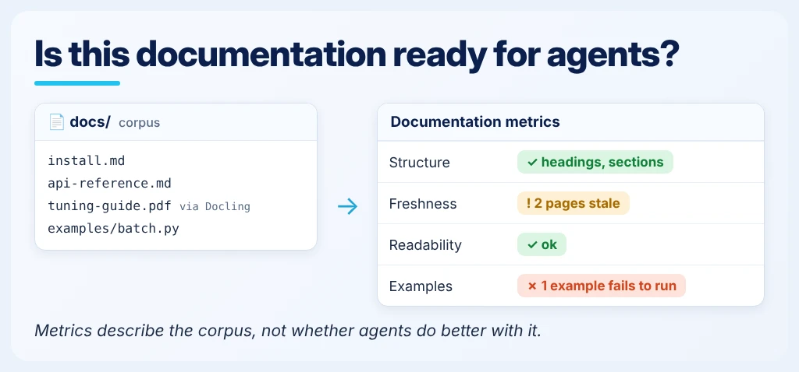

<!--
Copyright (C) 2026 Intel Corporation
SPDX-License-Identifier: Apache-2.0
-->

# Do the tests cover the work?

[Feature tree](README.md) · [Detailed guide](../external-content.md)

Each card describes one capability. Images use fictional tasks and simplified document excerpts; they are explanations, not captured product screens, runnable configurations or benchmark evidence. Availability applies to the working path described below, not everything depicted in a shared scene.

## Build tasks from real work

**Availability:** Available on main.

Generate candidate tasks from merged-PR inputs, imported review-thread JSON or SCIP references/derives. Inspect generated tasks and preserve provenance; replay generation does not fetch GitHub threads itself.

**Input:** The task, question set or coverage model you want to validate.

**Scope and limits:** --from prs / replay / graph; replay consumes JSON, not GitHub itself.

**Result:** Candidate tasks that still need validation and representative sampling.

**Next step:** Follow the linked guide for the exact command and output schema, then [interpret the result](../start/results.md).

[Usage guide](../repo-evaluation-contract.md) · [Implementation](../../dokimi/commands/tasks_generate.py) · [Back to feature tree](README.md)

## Test repository exploration

**Availability:** Available on main.

Evaluate whether an agent locates the relevant file and line for a repository question. Keep localization evaluation distinct from generating graph-based enumeration tasks.

**Input:** The task, question set or coverage model you want to validate.

**Scope and limits:** ExploreBench localization; separate from graph-generated tasks.

**Result:** Exploration-task outcomes for the configured repository and grader.

**Next step:** Follow the linked guide for the exact command and output schema, then [interpret the result](../start/results.md).

[Usage guide](../what-it-measures.md) · [Implementation](../../dokimi/commands/explore.py) · [Back to feature tree](README.md)

## Generate evaluation questions

**Availability:** Available on main.

Use source docs and personas to draft evaluation questions, then deduplicate and validate them. Generated questions still need review for relevance, ambiguity and answerability.

**Input:** The task, question set or coverage model you want to validate.

**Scope and limits:** Generation is a starting point; inspect the resulting checks.

**Result:** Generated questions that need review before becoming an evaluation set.

**Next step:** Follow the linked guide for the exact command and output schema, then [interpret the result](../start/results.md).

[Usage guide](../quickstart.md) · [Implementation](../../dokimi/commands/questions.py) · [Back to feature tree](README.md)

## Which needs are untested?

**Availability:** Partial — implemented core with a proposed extension.

Provide a frozen need graph and explicit needs labels on the eval checks. Inspect uncovered needs, relevance and supported coverage floors. Building the graph is a separate proposed extension.

**Input:** The task, question set or coverage model you want to validate.

**Scope and limits:** Basic eval coverage in main; graph builder PR [#594](https://github.com/intel/dokimi/issues/594); broader [#331](https://github.com/intel/dokimi/issues/331).

**Result:** Coverage gaps within the declared need-space model, not all possible user work.

**Next step:** Read the linked proposal for progress and the related guide for existing components. This card is not a runnable end-to-end interface.

[Related existing workflow](../repo-evaluation-contract.md) · [Implementation](../../dokimi/commands/eval_coverage.py) · [Back to feature tree](README.md)

## Which skill rules lack checks?

**Availability:** Open PR.

The proposed workflow maps checkable statements in a skill to existing checks and lists unmatched statements as candidates. A model-estimated mapping is not a verified coverage score or a gate.

**Input:** The task, question set or coverage model you want to validate.

**Scope and limits:** PR [#441](https://github.com/intel/dokimi/issues/441): LLM-estimated candidates, not a verified coverage score.

**Result:** A proposed rule-to-check mapping; consult the linked implementation status.

**Next step:** Read the linked proposal for progress and the related guide for existing components. This card is not a runnable end-to-end interface.

[Related existing workflow](../external-content.md) · [Back to feature tree](README.md)

## Can the grader be trusted?

**Availability:** Available on main.

Check that a null solution fails and an oracle passes, then challenge the verifier with adversarial controls. A successful control run does not prove that the grader cannot be fooled.

**Input:** The task, question set or coverage model you want to validate.

**Scope and limits:** Self-check and verifier red-team; controls cannot prove perfection.

**Result:** Control results exposing weaknesses in the tested grader.

**Next step:** Follow the linked guide for the exact command and output schema, then [interpret the result](../start/results.md).

[Usage guide](../repo-evaluation-contract.md) · [Implementation](../../dokimi/commands/repo_run.py) · [Back to feature tree](README.md)

## Is there room to improve?

**Availability:** Partial — implemented core with proposed extensions.

Check whether tasks have useful headroom and protect held-out evaluation material. Keep cached replays separate from fresh repetitions when interpreting repeatability.

**Input:** The task, question set or coverage model you want to validate.

**Scope and limits:** Headroom and run hygiene; replay provenance fix PR [#596](https://github.com/intel/dokimi/issues/596).

**Result:** Headroom diagnostics identifying cases with little room to distinguish variants.

**Next step:** Follow the linked guide for the exact command and output schema, then [interpret the result](../start/results.md).

[Usage guide](../methodology.md) · [Implementation](../../dokimi/commands/headroom.py) · [Back to feature tree](README.md)

## Assess documentation

**Availability:** Available on main.

Run documentation metrics and inspect structure, freshness, readability and examples. Optional Docling ingestion brings non-Markdown content into the workflow.

**Input:** The task, question set or coverage model you want to validate.

**Scope and limits:** Docling ingestion supports PDF / Office / HTML with optional dependencies.

**Result:** Documentation metrics within the selected metric's scope.

**Next step:** Follow the linked guide for the exact command and output schema, then [interpret the result](../start/results.md).

[Usage guide](../ingestion-docling.md) · [Implementation](../../dokimi/commands/ingest.py) · [Back to feature tree](README.md)
