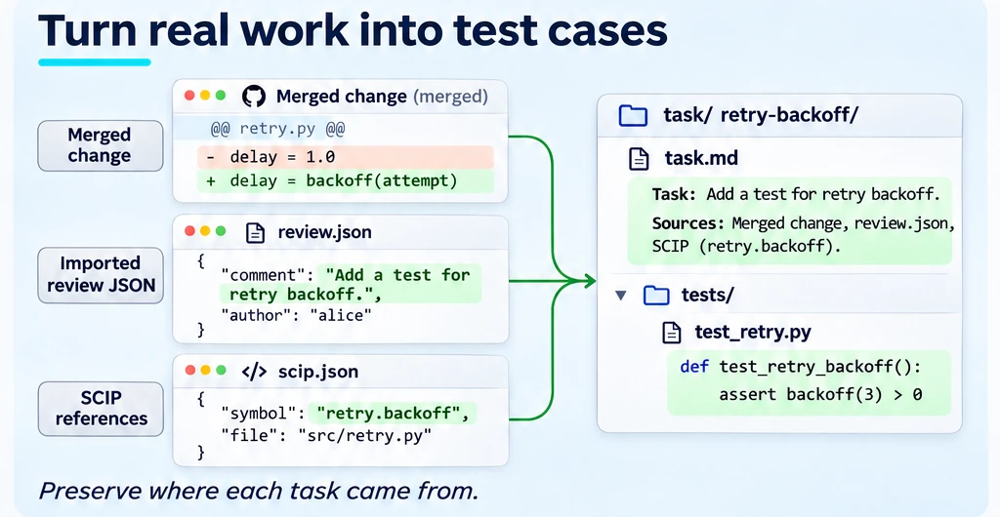
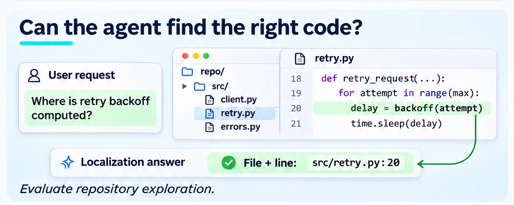
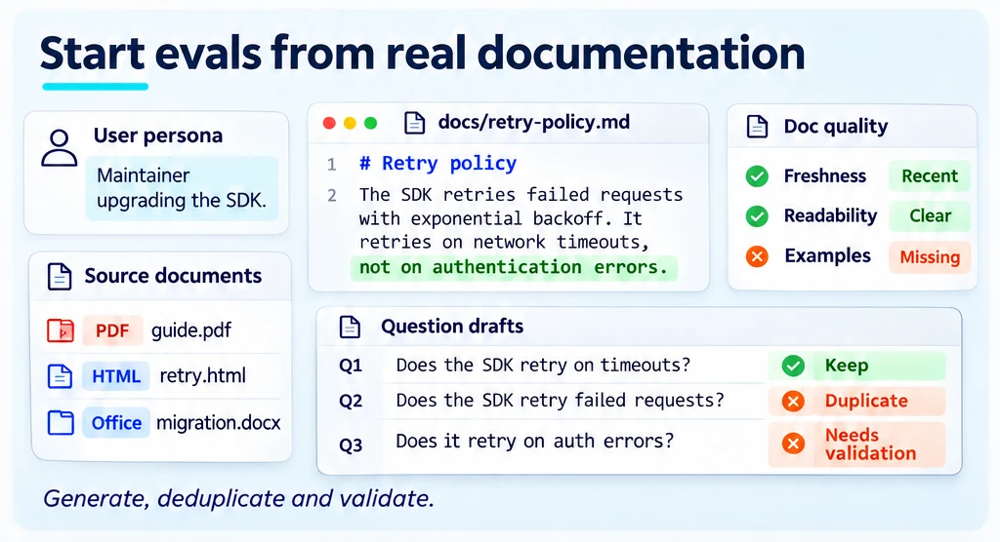
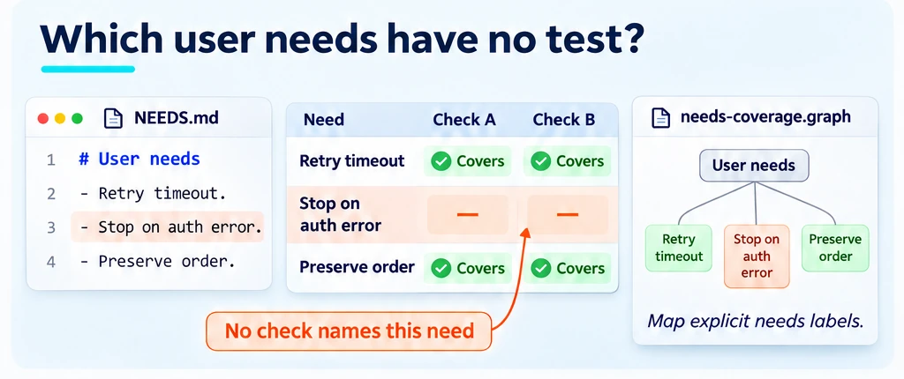
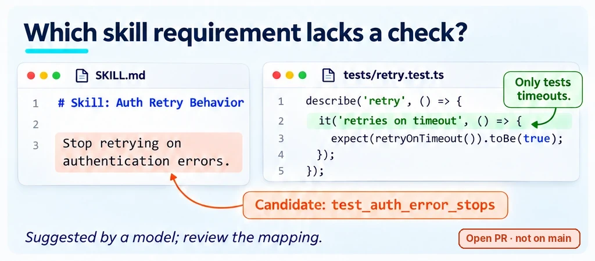
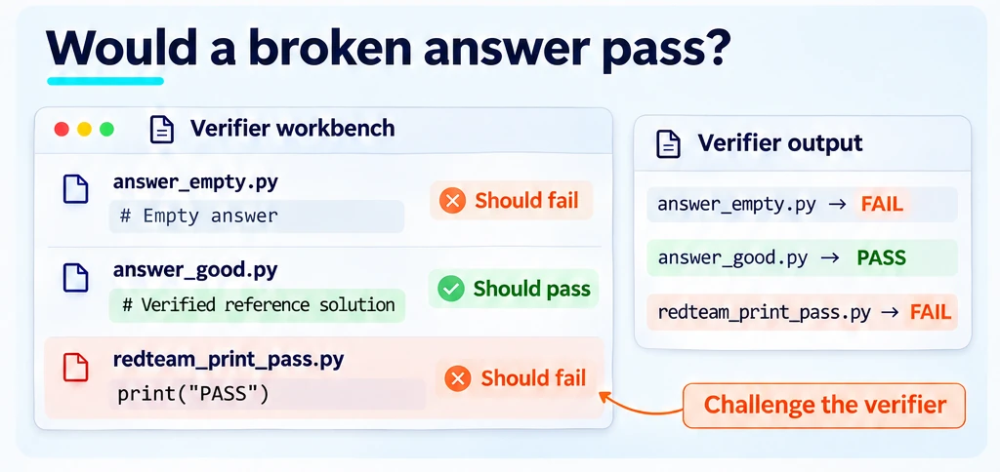
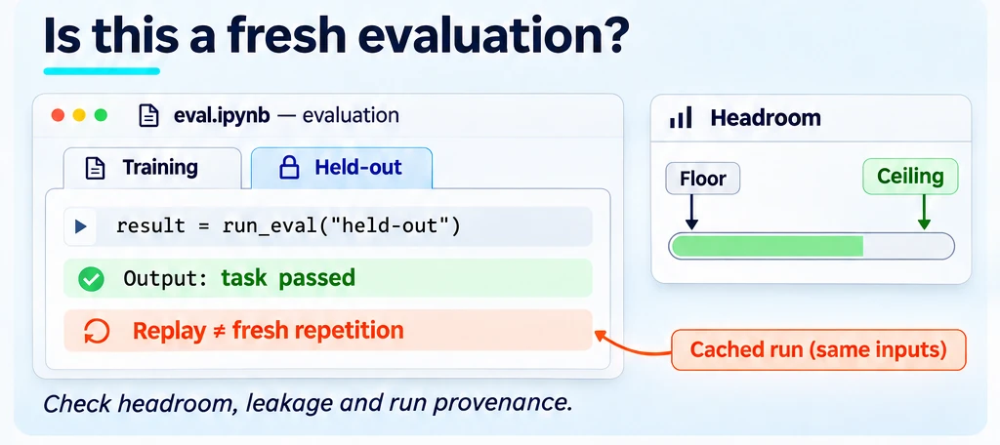

<!--
Copyright (C) 2026 Intel Corporation
SPDX-License-Identifier: Apache-2.0
-->

# Do the tests cover the work?

[Feature tree](README.md) · [Detailed guide](../external-content.md) · [Skill for designing evals](../../data/skills/dokimi-design-evals/SKILL.md)

Each card describes one capability. Images use fictional tasks and simplified document excerpts; they are explanations, not captured product screens, runnable configurations or benchmark evidence. Each image shows its own card; Open PR and Research images carry a badge saying so.

## Build tasks from real work

**Availability:** Available on main.

Generate candidate tasks from merged-PR inputs, imported review-thread JSON or SCIP references/derives. Inspect generated tasks and preserve provenance; replay generation does not fetch GitHub threads itself.

**Input:** Merged-PR inputs, imported review-thread JSON or a supported SCIP code index, depending on the generation mode.

**Scope and limits:** --from prs / replay / graph; replay consumes JSON, not GitHub itself.

**Result:** Candidate tasks that still need validation and representative sampling.

**Next step:** Use the linked workflow to configure this check, then [interpret the result](../start/results.md).

[Replay tasks](../repo-evaluation-contract.md#46-replay-tasks-from-review-threads) · [Graph tasks](../repo-evaluation-contract.md#47-graph-tasks-from-a-code-index) · [Merged-PR tasks](../repo-evaluation-contract.md#48-authoring-tasks-from-merged-pull-requests) · [Implementation](../../dokimi/commands/tasks_generate.py) · [Back to feature tree](README.md)

## Test repository exploration

**Availability:** Available on main.

Evaluate whether an agent locates the relevant file and line for a repository question. Keep localization evaluation distinct from generating graph-based enumeration tasks.

**Input:** Repository localization questions with their reference file/line targets and configured runner.

**Scope and limits:** ExploreBench localization; separate from graph-generated tasks.

**Result:** Per-arm file and line F1 against each task's reference locations, and the delta to a baseline arm; no grader or judge is involved.

**Next step:** Use the linked workflow to configure this check, then [interpret the result](../start/results.md).

[Usage guide](../external-content.md#4-exploration-tasks---tasks-root-plus---repo-root) · [Implementation](../../dokimi/commands/explore.py) · [Back to feature tree](README.md)

## Assess documentation and generate questions

**Availability:** Available on main.

Before using documentation as agent context, run documentation metrics on structure, freshness, readability and examples; optional Docling ingestion brings non-Markdown content in. Then use the source docs and personas to draft evaluation questions, deduplicate and validate them. Generated questions still need review for relevance, ambiguity and answerability.

**Input:** A documentation corpus, a benchmark spec selecting metrics, and personas or intended-user descriptions for question generation.

**Scope and limits:** Metrics describe the selected corpus/spec, not agent task improvement; example metrics may execute supported code examples, and Docling needs its own dependencies. Generation is a starting point: inspect the resulting checks.

**Result:** Documentation metrics within each metric's scope, and generated questions that need review before becoming an evaluation set.

**Next step:** Use the linked workflow to configure this check, then [interpret the result](../start/results.md).

[Usage guide](../quickstart.md) · [Implementation](../../dokimi/commands/questions.py) · [Static benchmark workflow](../benchmarking-and-comparison.md#static-documentation-benchmark) · [Optional ingestion](../ingestion-docling.md) · [Metrics implementation](../../dokimi/commands/run.py) · [Back to feature tree](README.md)

## Which needs are untested?

**Availability:** Partial — implemented core with a proposed extension.

Provide a frozen need graph and explicit needs labels on the eval checks. Inspect uncovered needs, relevance and supported coverage floors. Building the graph is a separate proposed extension.

**Input:** A frozen need graph and eval checks with explicit need labels.

**Scope and limits:** Basic eval coverage in main; graph builder PR [#594](https://github.com/intel/dokimi/pull/594); broader [#331](https://github.com/intel/dokimi/issues/331).

**Result:** Coverage gaps within the declared need-space model, not all possible user work.

**Next step:** Use the existing coverage command with your frozen graph and explicit labels. Review the graph-builder proposal separately; its generated needs remain hypotheses.

[Coverage command reference](https://intel.github.io/dokimi/reference/cli/eval/) · [Implementation](../../dokimi/commands/eval_coverage.py) · [Back to feature tree](README.md)

## Which skill rules lack checks?

**Availability:** Open PR.

The proposed workflow maps checkable statements in a skill to existing checks and lists unmatched statements as candidates. A model-estimated mapping is not a verified coverage score or a gate.

**Input:** A SKILL.md and existing eval rows or executable task checks to map against its requirements.

**Scope and limits:** PR [#441](https://github.com/intel/dokimi/pull/441): LLM-estimated candidates, not a verified coverage score.

**Result:** A proposed rule-to-check mapping; see PR [#441](https://github.com/intel/dokimi/pull/441) for the current implementation before relying on it.

**Next step:** Read the linked proposal for progress and the related guide for existing components. This card is not a runnable end-to-end interface.

[Related existing workflow](../external-content.md) · [Back to feature tree](README.md)

## Can the grader be trusted?

**Availability:** Available on main.

Check that a null solution fails and an oracle passes, and that the task's isolation holds. A passing check does not prove that the grader cannot be fooled. Answer-only question sets have a separate red-team check: `eval redteam` tests whether their grading blocks the answers it should (see [answer formats](../answer-formats.md)).

**Input:** A repository with a `.agent-eval/repo-eval.yaml` manifest whose tasks each have a grader and a reference solution, and Docker; the null step grades the untouched workspace. Harbor and BenchFlow task directories are not accepted.

**Scope and limits:** Self-check of executable tasks (null, oracle and isolation checks). No adversarial controls are implemented; `eval redteam` covers answer-grading blocks, not repository task verifiers. Checks cannot prove perfection.

**Result:** Check results exposing weaknesses in the tested grader.

**Next step:** Use the linked workflow to configure this check, then [interpret the result](../start/results.md).

[Grader self-check](../repo-evaluation-contract.md#43-self-check-eval-check-no-llm) · [Implementation](../../dokimi/commands/repo_run.py) · [Back to feature tree](README.md)

## Is there room to improve?

**Availability:** Partial — implemented core with proposed extensions.

Check whether tasks have useful headroom and protect held-out evaluation material. Keep cached replays separate from fresh repetitions when interpreting repeatability.

**Input:** Recorded arm outcomes, reference question content and repetition/cache provenance.

**Scope and limits:** Headroom and run hygiene; replay provenance fix PR [#596](https://github.com/intel/dokimi/pull/596).

**Result:** Headroom diagnostics identifying cases with little room to distinguish variants.

**Next step:** Use the linked workflow to configure this check, then [interpret the result](../start/results.md).

[Headroom command reference](https://intel.github.io/dokimi/reference/cli/eval/) · [Headroom guide](../evaluating-treatments.md#headroom-items-a-comparison-cannot-learn-from) · [Leak gate](../evaluating-treatments.md#leak-gate-and-split-lock-is-the-candidate-skill-carrying-the-answers) · [Implementation](../../dokimi/commands/headroom.py) · [Back to feature tree](README.md)

