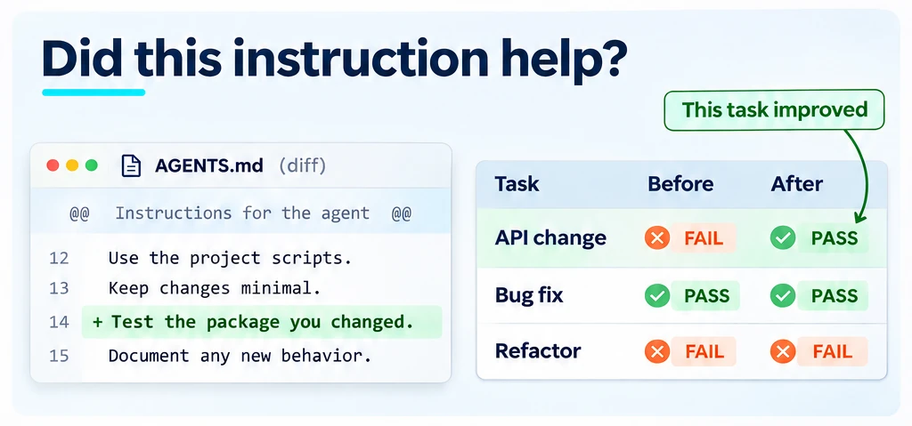
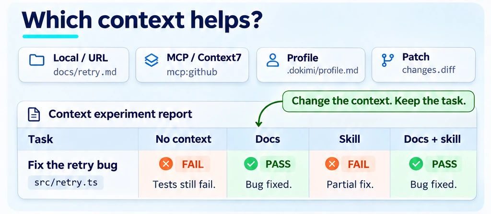
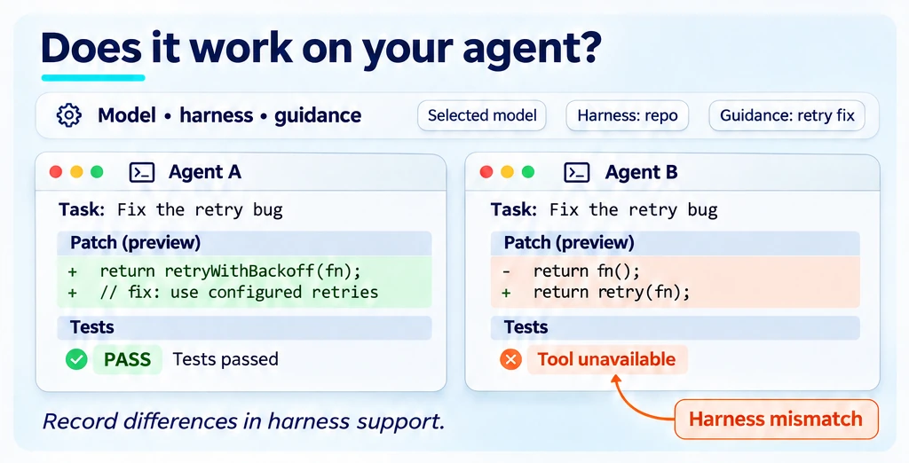
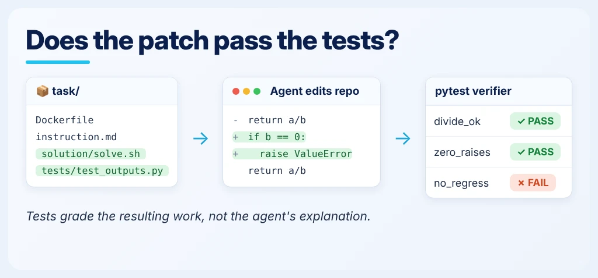
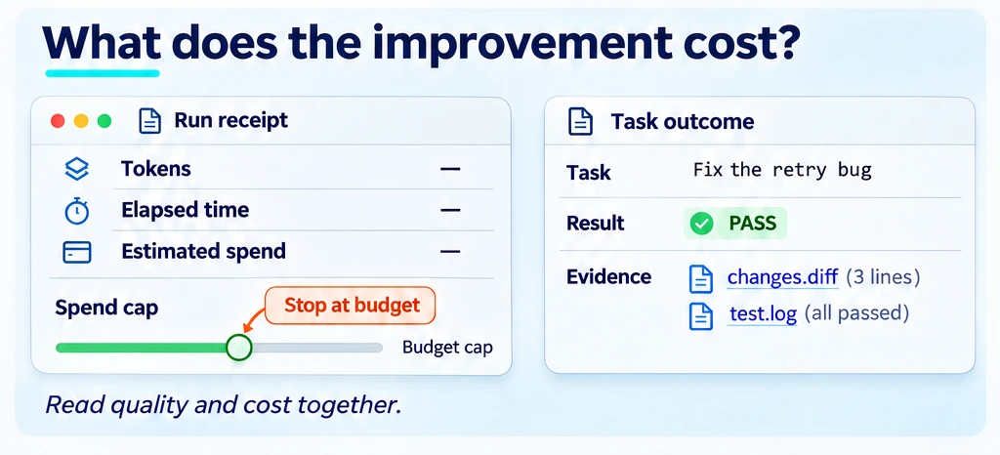

<!--
Copyright (C) 2026 Intel Corporation
SPDX-License-Identifier: Apache-2.0
-->

# Does the context help?

[Feature tree](README.md) · [Detailed guide](../evaluating-treatments.md)

Each card describes one capability. Images use fictional tasks and simplified document excerpts; they are explanations, not captured product screens, runnable configurations or benchmark evidence. Each image shows its own card; Open PR and Research images carry a badge saying so.

## Does the context help?

**Availability:** Available on main.

Run the same tasks, model and grader with and without one context change. Inspect paired outcomes and uncertainty before deciding whether to adopt it.

**Input:** The same question/task set, baseline and context variant, with fixed model and grader settings.

**Scope and limits:** A/B and N-way arms; controlled context experiments.

**Result:** Paired outcomes and reported differences between context conditions.

**Next step:** Use the linked workflow to configure this check, then [interpret the result](../start/results.md).

[Usage guide](../evaluating-treatments.md) · [Implementation](../../dokimi/commands/arms.py) · [Back to feature tree](README.md)

## Bring your agent context and combine treatments

**Availability:** Available on main.

Choose injected docs, a callable source, a skill, a catalog or a profile according to what the agent will actually receive; injection and agent-selected loading answer different questions. To learn whether two treatments help together, compare each alone and combined against the same baseline and inspect interaction contrasts where the report supports them.

**Input:** Your document source, MCP reference, skill directory or profile, a fixed evaluation set, and the baseline, single and combined treatment definitions.

**Scope and limits:** Local docs, Context7, persona/system prompts and combined treatments; support varies by track, and not every track supports every combination.

**Result:** Per-arm answers or task outcomes tied to each context condition and, where supported, interaction contrasts.

**Next step:** Use the linked workflow to configure this check, then [interpret the result](../start/results.md).

[Arm specs](../evaluating-treatments.md#arm-specs-in-detail) · [Doc and MCP sources](../adding-doc-source.md) · [Implementation](../../dokimi/commands/arms.py) · [Combining treatments](../evaluating-treatments.md) · [Back to feature tree](README.md)

## Compare models & harnesses

**Availability:** Available on main.

Hold the task and grading contract fixed, then compare supported models and harnesses. `tasks run` compares harnesses for one `--model`: run it once per model, or use `repo run`, where `--model` is repeatable. Check the harness support matrix before treating an experiment as deployment evidence: record unavailable tools, unsupported environments, MCP, sidecars or verifier arrangements as explicit limitations rather than scoring them as failures.

**Input:** Executable tasks with supported environments and graders, the model/harness configurations to compare, and the concrete harness version you deploy.

**Scope and limits:** Codex, Claude Code, Harbor, BenchFlow: capabilities differ. Harness-fidelity gaps (MCP, sidecars, verifier support) are tracked in issues [#354](https://github.com/intel/dokimi/issues/354)/[#355](https://github.com/intel/dokimi/issues/355).

**Result:** Comparable task outcomes for the supported runner/model cells, with fidelity limits stated.

**Next step:** Use the linked workflow to configure this check, then [interpret the result](../start/results.md).

[Usage guide](../coding-harnesses.md) · [Implementation](../../dokimi/commands/tasks.py) · [Back to feature tree](README.md)

## Run real coding tasks

**Availability:** Available on main.

Supply an executable task with an environment, reference solution and verifier. The agent edits the repository; tests grade the resulting work.

**Input:** Executable task definitions, container environment, reference solution and verifier.

**Scope and limits:** Container-backed tasks; grader quality still matters.

**Result:** Agent patches and executable grader outcomes.

**Next step:** Use the linked workflow to configure this check, then [interpret the result](../start/results.md).

[Usage guide](../coding-harnesses.md) · [Implementation](../../dokimi/commands/tasks.py) · [Back to feature tree](README.md)

## Make cost visible

**Availability:** Available on main.

Inspect recorded usage and estimated spend before committing to a batch. Use the budget controls exposed by the selected command; pricing and usage availability depend on the provider.

**Input:** The selected command's configuration and provider pricing/usage information or stored run usage.

**Scope and limits:** Cost controls and measurements are track-dependent.

**Result:** Recorded usage and cost estimates where the provider supports them.

**Next step:** Use the linked workflow to configure this check, then [interpret the result](../start/results.md).

[Usage guide](../quickstart.md) · [Implementation](../../dokimi/commands/novelty_budget.py) · [Back to feature tree](README.md)
