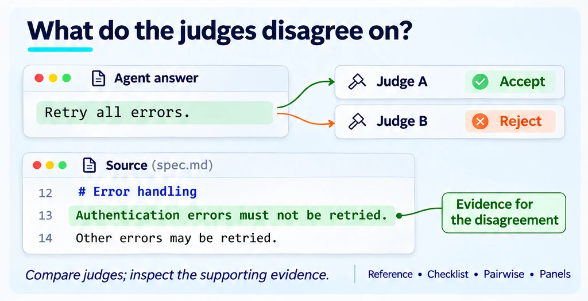
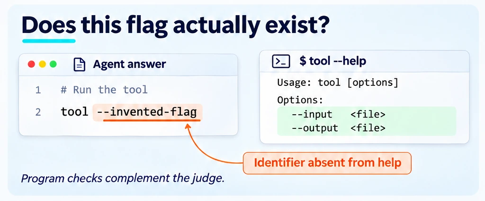

<!--
Copyright (C) 2026 Intel Corporation
SPDX-License-Identifier: Apache-2.0
-->

# Can the grades be trusted?

[Feature tree](README.md) · [Detailed guide](../methodology.md)

Each card describes one capability. Images use fictional tasks and simplified document excerpts; they are explanations, not captured product screens, runnable configurations or benchmark evidence. Each image shows its own card; Open PR and Research images carry a badge saying so.

## Choose the grading method

**Availability:** Available on main.

Choose reference, checklist, pointwise, pairwise or other supported scoring according to the task. Grounding and RAGAS signals supplement evaluation; lexical matches are not proof of truth.

**Input:** Answers or task results plus the reference/rubric and grading configuration for the selected method.

**Scope and limits:** Grounding includes lexical limitations; no universal correctness oracle.

**Result:** Scores and evidence produced by the selected grading method.

**Next step:** Use the linked workflow to configure this check, then [interpret the result](../start/results.md).

[Usage guide](../methodology.md) · [Implementation](../../dokimi/eval/grounding.py) · [Back to feature tree](README.md)

## Check the judges

**Availability:** Partial — implemented core with proposed extensions.

Probe judge validity with degraded answers and examine agreement, order and wording sensitivity. Existing answer panels and the proposed novelty panel have different entry points.

**Input:** Representative saved answers or control cases, judge identities and the reliability test configuration.

**Scope and limits:** Existing panels/calibration; novelty panel PR [#489](https://github.com/intel/dokimi/pull/489); integration [#407](https://github.com/intel/dokimi/issues/407).

**Result:** Judge reliability diagnostics for the tested cases and judges.

**Next step:** Use the linked workflow to configure this check, then [interpret the result](../start/results.md).

[Usage guide](../methodology.md) · [Implementation](../../dokimi/commands/judge_reliability.py) · [Back to feature tree](README.md)

## Ground novelty checks

**Availability:** Open PR.

The proposed identifier checks compare an answer with tool evidence such as help text, while retaining the judge as a separate signal. Broader execution and source checks remain proposals.

**Input:** Novelty probes, claimed identifiers and tool-help/reference evidence for the proposed grounding checks.

**Scope and limits:** PR [#472](https://github.com/intel/dokimi/pull/472): identifier checks; exec/source grading remain proposed.

**Result:** Proposed grounding evidence for novelty checks; not a general correctness guarantee.

**Next step:** Read the linked proposal for progress and the related guide for existing components. This card is not a runnable end-to-end interface.

[Related existing workflow](../skill-novelty.md) · [Back to feature tree](README.md)
