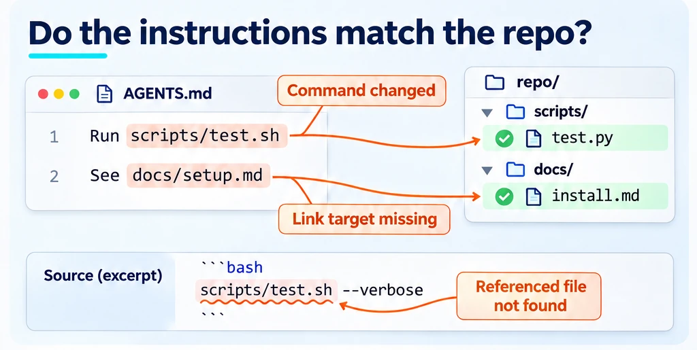
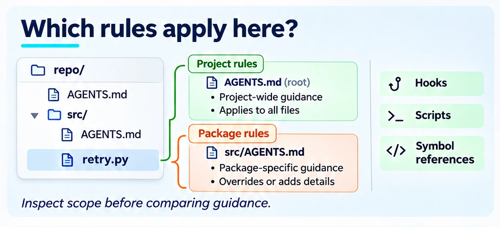
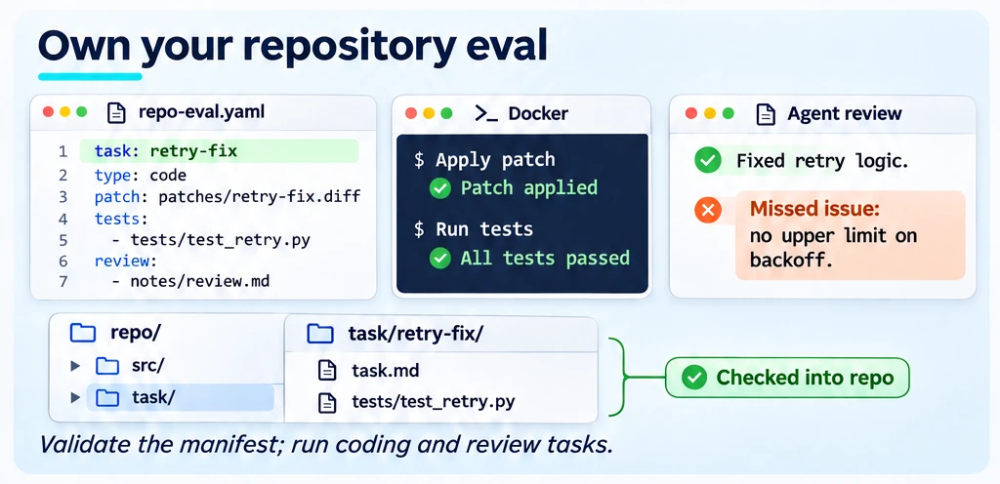
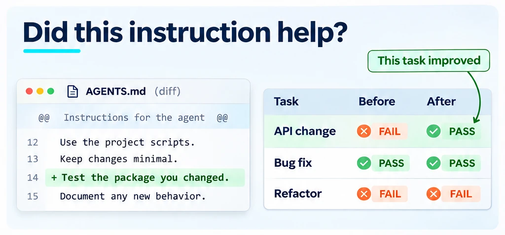
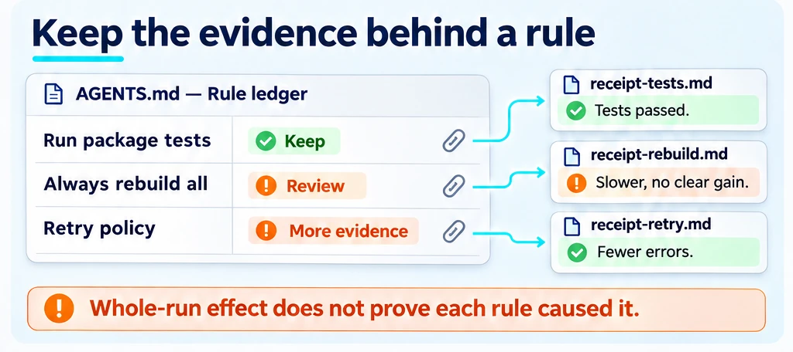
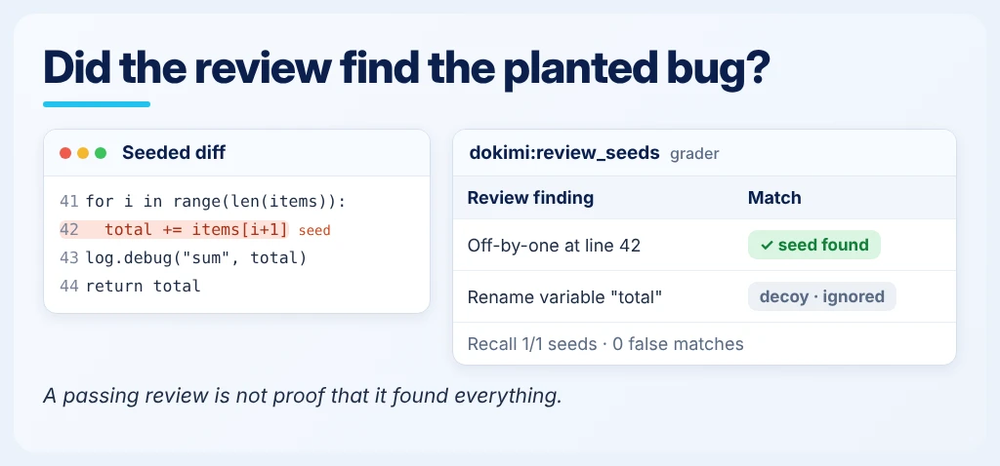

<!--
Copyright (C) 2026 Intel Corporation
SPDX-License-Identifier: Apache-2.0
-->

# Does repository guidance work?

[Feature tree](README.md) · [Detailed guide](../repo-evaluation-contract.md)

Each card describes one capability. Images use fictional tasks and simplified document excerpts; they are explanations, not captured product screens, runnable configurations or benchmark evidence. Availability applies to the working path described below, not everything depicted in a shared scene.

## Check repository claims

**Availability:** Partial — implemented core with proposed extensions.

Scan guidance claims against repository files, symbols, commands and build labels. Review a finding in its source context; a missing path is different from a syntax error.

**Input:** Your repository guidance and the paths, identifiers or commands it names.

**Scope and limits:** Static scans / fence checks; Claude rules and imports in PR [#593](https://github.com/intel/dokimi/pull/593).

**Result:** Static findings about guidance references and claims the scanner can check.

**Next step:** Use the linked workflow to configure this check, then [interpret the result](../start/results.md).

[Usage guide](../repo-evaluation-contract.md) · [Implementation](../../dokimi/commands/repo.py) · [Back to feature tree](README.md)

## Understand repository scope

**Availability:** Available on main.

Inspect instruction scopes, capabilities, checks, hooks and scripts. An optional SCIP index adds code structure; references and derives are not necessarily runtime calls.

**Input:** A repository revision and the environment/scope information to inspect.

**Scope and limits:** repo inspect; symbol references are not necessarily call edges.

**Result:** Repository scope information for planning the evaluation.

**Next step:** Use the linked workflow to configure this check, then [interpret the result](../start/results.md).

[Usage guide](../repo-evaluation-contract.md) · [Implementation](../../dokimi/commands/repo.py) · [Back to feature tree](README.md)

## Own a repeatable repo eval

**Availability:** Available on main.

Keep the manifest, tasks and graders with the repository. Validate it, run the chosen arms, and compare reports while preserving the task and source revisions.

**Input:** A repository-owned evaluation manifest, tasks, execution environment and grader contracts.

**Scope and limits:** Repository manifest workflow and executable review tasks.

**Result:** Validated repository-owned tasks and their recorded run outcomes.

**Next step:** Use the linked workflow to configure this check, then [interpret the result](../start/results.md).

[Usage guide](../repo-evaluation-contract.md) · [Implementation](../../dokimi/commands/repo_run.py) · [Back to feature tree](README.md)

## Compare guidance changes

**Availability:** Available on main.

Compare supported guidance revisions, removal, bridge, format or overlay variants and patches. Check the contract for the exact arm grammar and compatible harness.

**Input:** Matched repository task runs under baseline and candidate guidance conditions.

**Scope and limits:** Guidance variants, format/as-skill and overlays vary by harness.

**Result:** Comparison evidence for the tested guidance conditions.

**Next step:** Use the linked workflow to configure this check, then [interpret the result](../start/results.md).

[Usage guide](../what-it-measures.md) · [Implementation](../../dokimi/repos/arms.py) · [Back to feature tree](README.md)

## Keep a rule ledger

**Availability:** Available on main.

Record a rule hypothesis and the cases it is intended to help. Read keep/review/insufficient-evidence verdicts in light of whole-arm effects; isolate a rule to attribute causality.

**Input:** Guidance rules with linked hypotheses/cases and comparison evidence for those rules.

**Scope and limits:** repo compare --ledger; isolate rules before making causal claims.

**Result:** Per-rule evidence supporting keep, review or insufficient-evidence decisions.

**Next step:** Use the linked workflow to configure this check, then [interpret the result](../start/results.md).

[Usage guide](../rule-ledger.md) · [Implementation](../../dokimi/commands/repo_run.py) · [Back to feature tree](README.md)

## Review code with a grader

**Availability:** Available on main.

Use the built-in seeded-review or replay grader to evaluate review findings against the task evidence. Read recall, decoys and matching limits rather than assuming a passing review is complete.

**Input:** A task's review contract and candidate patch or answer, with review gold/rubric inputs as required by the grader.

**Scope and limits:** Built-in `dokimi:review_seeds` and `dokimi:review_replay` graders.

**Result:** Grader findings under the chosen review contract.

**Next step:** Use the linked workflow to configure this check, then [interpret the result](../start/results.md).

[Usage guide](../repo-evaluation-contract.md) · [Implementation](../../dokimi/repos/graders/review.py) · [Back to feature tree](README.md)
