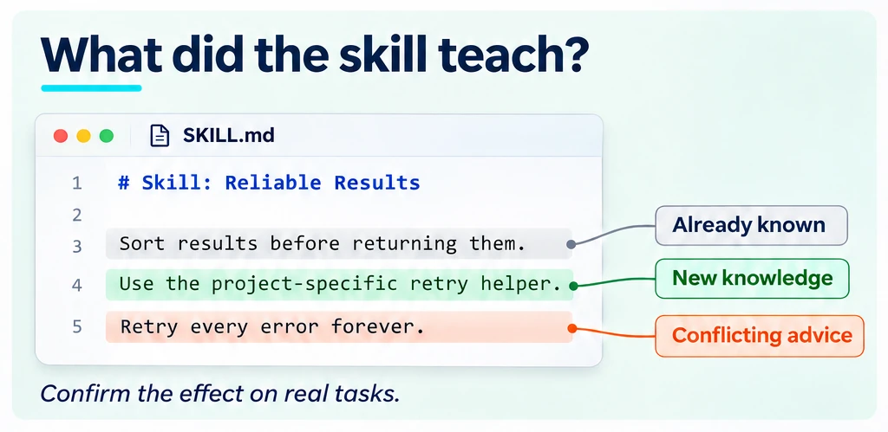
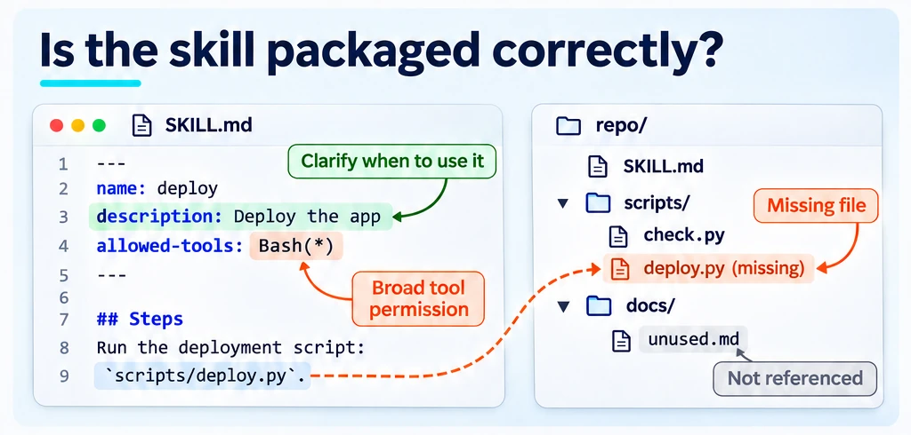

<!--
Copyright (C) 2026 Intel Corporation
SPDX-License-Identifier: Apache-2.0
-->

# Which parts of a skill matter?

[Feature tree](README.md) · [Detailed guide](../skill-novelty.md)

Each card describes one capability. Images use fictional tasks and simplified document excerpts; they are explanations, not captured product screens, runnable configurations or benchmark evidence. Availability applies to the working path described below, not everything depicted in a shared scene.

## What did the skill teach?

**Availability:** Available on main.

Extract knowledge atoms, probe with and without the skill, and inspect added, redundant, degraded and still-missing outcomes per model. Confirm useful knowledge on real tasks.

**Boundary:** Atoms and paired probes; knowledge gain is not task-level benefit.

[How to use it](../skill-novelty.md) · [Implementation](../../dokimi/novelty/atoms.py) · [Back to feature tree](README.md)

## Find the useful passages

**Availability:** Available on main.

Use the annotated source view to locate the passages associated with probe outcomes. Treat the annotation as a diagnostic lead, not a causal effect for each sentence.

**Boundary:** Span attribution and annotated HTML; not causal value per sentence.

[How to use it](../skill-novelty.md) · [Implementation](../../dokimi/commands/novelty_run.py) · [Back to feature tree](README.md)

## Read the whole bundle

**Availability:** Available on main.

Include the supporting reference files and scripts when analysing an artifact. A short entry file can delegate most of its useful content to the bundle.

**Boundary:** Whole-bundle analysis, not just the entry document.

[How to use it](../skill-novelty.md) · [Implementation](../../dokimi/commands/skill.py) · [Back to feature tree](README.md)

## Shorten without losing value

**Availability:** Available on main.

Compare shortening candidates on tokens, knowledge, task value, protection and routing. Preserve important constraints and remeasure the selected candidate on tasks.

**Boundary:** Five axes; known knowledge alone is not a reason to delete a clause.

[How to use it](../skill-novelty-walkthrough.md) · [Implementation](../../dokimi/novelty/shorten.py) · [Back to feature tree](README.md)

## Scan a skill collection

**Availability:** Available on main.

Scan a catalog with per-skill results, worker jobs and resumption. Use ignore rules to define the intended collection; inspect findings before treating them as defects.

**Boundary:** Jobs, ignore, resume; scaling gaps tracked in [#413](https://github.com/intel/dokimi/issues/413) and [#434](https://github.com/intel/dokimi/issues/434).

[How to use it](../external-content.md) · [Implementation](../../dokimi/commands/catalog_scan.py) · [Back to feature tree](README.md)

## Check skill structure

**Availability:** Available + proposed extensions.

Run the existing skill/catalog validation before paid evaluation. Structural warnings help locate packaging problems; proposed extra checks are described in the linked PRs.

**Boundary:** main checks; PRs [#454](https://github.com/intel/dokimi/issues/454), [#556](https://github.com/intel/dokimi/issues/556), [#557](https://github.com/intel/dokimi/issues/557), [#558](https://github.com/intel/dokimi/issues/558), [#559](https://github.com/intel/dokimi/issues/559) extend them.

[How to use it](../external-content.md) · [Implementation](../../dokimi/external/validate.py) · [Back to feature tree](README.md)

## Check bundled scripts

**Availability:** Open PR.

The proposed checks inspect Python/shell syntax, line endings and optional lint tools without running the bundled script. Warnings and notes are not a complete runtime test.

**Boundary:** PR [#455](https://github.com/intel/dokimi/issues/455); warnings / notes, optional bash, ruff and shellcheck.

[How to use it](../external-content.md) · [Back to feature tree](README.md)

## Check external references

**Availability:** Open PR.

The proposed opt-in network checks distinguish confirmed missing packages/links from unknown or skipped targets. Timeouts and refusals are not evidence that a resource is absent.

**Boundary:** PR [#459](https://github.com/intel/dokimi/issues/459); opt-in, warning-only checks; network errors are not absence.

[How to use it](../external-content.md) · [Back to feature tree](README.md)

## Find bundle packaging gaps

**Availability:** Open PR.

The proposed packaging findings identify missing bundle paths, unreferenced files and missing frontmatter. Confirm whether an unreferenced file is intentionally present before removing it.

**Boundary:** PRs [#556](https://github.com/intel/dokimi/issues/556), [#558](https://github.com/intel/dokimi/issues/558), [#559](https://github.com/intel/dokimi/issues/559); unrestricted Bash warning separately in [#557](https://github.com/intel/dokimi/issues/557).

[How to use it](../external-content.md) · [Back to feature tree](README.md)

## Relate skills to user needs

**Availability:** Available on main.

Build a need hypothesis from the artifact name and description, then relate content to that scope. Confirm user intent separately; stated relevance is not measured task success.

**Boundary:** Need relevance analysis; separate from measured task success and coverage.

[How to use it](../skill-novelty.md) · [Implementation](../../dokimi/novelty/needs.py) · [Back to feature tree](README.md)
