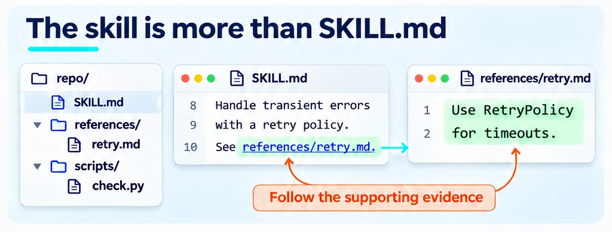
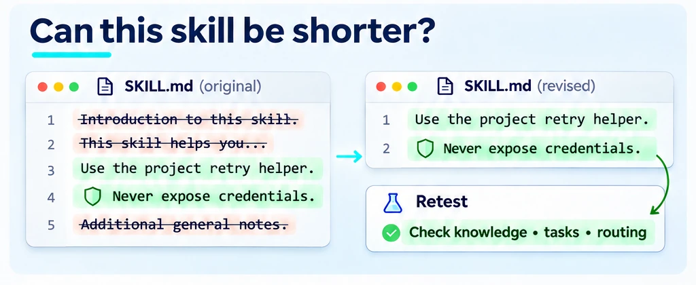
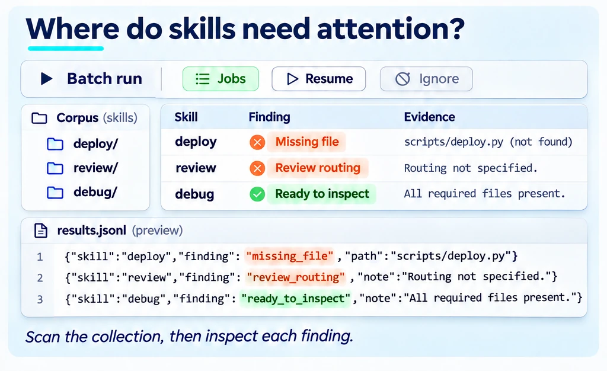
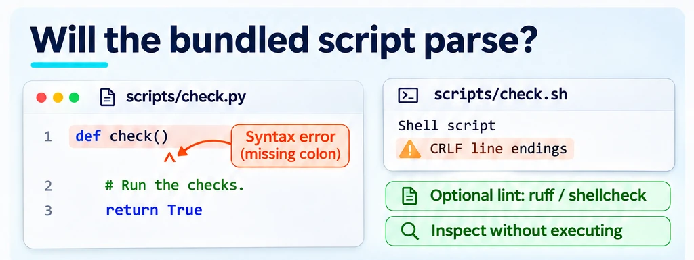
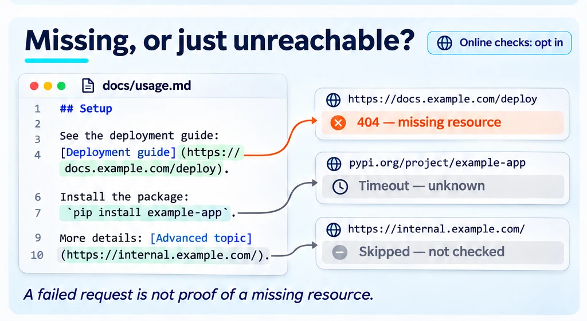
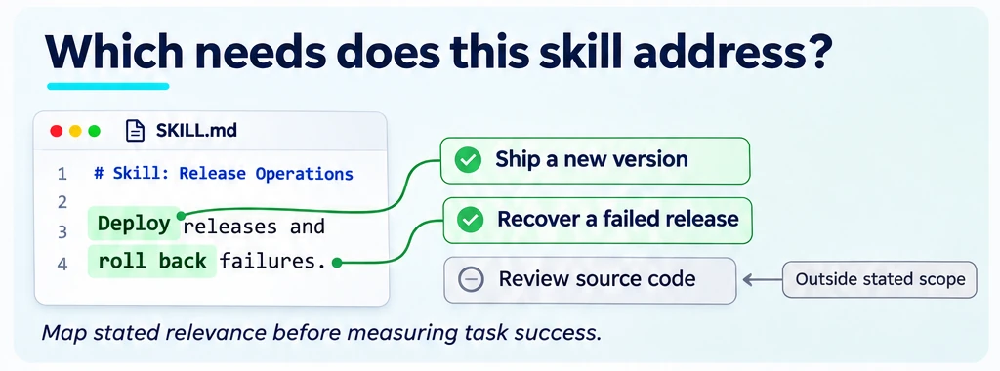

<!--
Copyright (C) 2026 Intel Corporation
SPDX-License-Identifier: Apache-2.0
-->

# Which parts of a skill matter?

[Feature tree](README.md) · [Detailed guide](../skill-novelty.md)

Each card describes one capability. Images use fictional tasks and simplified document excerpts; they are explanations, not captured product screens, runnable configurations or benchmark evidence. Each image shows its own card; Open PR and Research images carry a badge saying so.

## What did the skill teach?

**Availability:** Available on main.

Extract knowledge atoms, probe with and without the skill, and inspect added, redundant, degraded and still-missing outcomes per model. The annotated source view traces those outcomes back to the passages they came from; treat it as a diagnostic lead, not a causal effect for each sentence, and confirm useful knowledge on real tasks.

**Input:** A skill/document artifact, extracted knowledge probes, the configured answerer and judge, and the analysed source revision.

**Scope and limits:** Atoms, paired probes, span attribution and annotated HTML; knowledge gain is not task-level benefit or per-sentence causal value.

**Result:** Added, redundant, degraded and still-missing probe outcomes, and source annotations identifying passages to investigate.

**Next step:** Use the linked workflow to configure this check, then [interpret the result](../start/results.md).

[Usage guide](../skill-novelty.md) · [Implementation](../../dokimi/novelty/atoms.py) · [Annotated view](../../dokimi/commands/novelty_run.py) · [Back to feature tree](README.md)

## Read the whole bundle

**Availability:** Available on main.

Include the supporting reference files and scripts when analysing an artifact. A short entry file can delegate most of its useful content to the bundle.

**Input:** A skill entry file and supporting resources selected under explicit resource/word budgets.

**Scope and limits:** Supporting resources are subject to resource/word budgets and atom sampling; this is not exhaustive execution or inspection of every bundled file.

**Result:** Bundle-level diagnostics for the resources selected by the analysis.

**Next step:** Use the linked workflow to configure this check, then [interpret the result](../start/results.md).

[Usage guide](../skill-novelty.md) · [Implementation](../../dokimi/commands/skill.py) · [Back to feature tree](README.md)

## Shorten without losing value

**Availability:** Available on main.

Compare shortening candidates on tokens, knowledge retention, relevance/novelty-weighted knowledge value, protection and routing. The value axis is a knowledge-retention measure or coverage proxy, not measured task value. Preserve important constraints and separately remeasure the selected candidate on tasks.

**Input:** The original artifact, measured atoms and shortening strategies/token budgets; task evals are needed for outcome confirmation.

**Scope and limits:** Five axes; known knowledge alone is not a reason to delete a clause.

**Result:** Shortening candidates to compare and retest on tasks.

**Next step:** Use the linked workflow to configure this check, then [interpret the result](../start/results.md).

[Usage guide](../skill-novelty-walkthrough.md) · [Implementation](../../dokimi/novelty/shorten.py) · [Back to feature tree](README.md)

## Scan a skill collection

**Availability:** Available on main.

Scan a catalog with per-skill results, worker jobs and resumption. Use ignore rules to define the intended collection; inspect findings before treating them as defects.

**Input:** A local catalog and the skills selected for validation or analysis.

**Scope and limits:** Jobs, ignore, resume; scaling gaps tracked in [#413](https://github.com/intel/dokimi/issues/413) and [#434](https://github.com/intel/dokimi/issues/434).

**Result:** Catalog and skill findings for the selected collection.

**Next step:** Use the linked workflow to configure this check, then [interpret the result](../start/results.md).

[Usage guide](../external-content.md) · [Implementation](../../dokimi/commands/catalog_scan.py) · [Back to feature tree](README.md)

## Check skill structure and packaging

**Availability:** Partial — implemented core with proposed extensions.

Run the existing skill/catalog validation before paid evaluation; structural warnings help locate packaging problems. Proposed extensions add packaging findings such as missing bundle paths, unreferenced files and missing frontmatter. Confirm an unreferenced file is not intentional before removing it.

**Input:** Skill metadata, descriptions, paths and bundle structure in the catalog being checked.

**Scope and limits:** Checks on main; PRs [#454](https://github.com/intel/dokimi/pull/454), [#556](https://github.com/intel/dokimi/pull/556), [#558](https://github.com/intel/dokimi/pull/558), [#559](https://github.com/intel/dokimi/pull/559) add packaging findings, and [#557](https://github.com/intel/dokimi/pull/557) an unrestricted-Bash warning. These are not on main.

**Result:** Structural findings from existing checks; proposed packaging findings remain separate until merged.

**Next step:** Use the linked workflow to configure this check, then [interpret the result](../start/results.md).

[Usage guide](../external-content.md) · [Implementation](../../dokimi/external/validate.py) · [Back to feature tree](README.md)

## Check bundled scripts

**Availability:** Open PR.

The proposed checks inspect Python/shell syntax, line endings and optional lint tools without running the bundled script. Warnings and notes are not a complete runtime test.

**Input:** A skill's bundled Python/shell scripts and optional local syntax/lint tools.

**Scope and limits:** PR [#455](https://github.com/intel/dokimi/pull/455); warnings / notes, optional bash, ruff and shellcheck.

**Result:** Proposed script findings; see PR [#455](https://github.com/intel/dokimi/pull/455) for the current implementation before relying on them.

**Next step:** Read the linked proposal for progress and the related guide for existing components. This card is not a runnable end-to-end interface.

[Related existing workflow](../external-content.md) · [Back to feature tree](README.md)

## Check external references

**Availability:** Open PR.

The proposed opt-in network checks distinguish confirmed missing packages/links from unknown or skipped targets. Timeouts and refusals are not evidence that a resource is absent.

**Input:** Package references and external URLs in the selected catalog, with opt-in network access for the proposed checks.

**Scope and limits:** PR [#459](https://github.com/intel/dokimi/pull/459); opt-in, warning-only checks; network errors are not absence.

**Result:** Proposed reference checks; no shipped end-to-end path is promised here.

**Next step:** Read the linked proposal for progress and the related guide for existing components. This card is not a runnable end-to-end interface.

[Related existing workflow](../external-content.md) · [Back to feature tree](README.md)

## Relate skills to user needs

**Availability:** Available on main.

Build a need hypothesis from the artifact name and description, then relate content to that scope. Confirm user intent separately; stated relevance is not measured task success.

**Input:** A skill's identity/description and the user-need model used by the relevance analysis.

**Scope and limits:** Need relevance analysis; separate from measured task success and coverage.

**Result:** A mapping of skills to the user needs being evaluated.

**Next step:** Use the linked workflow to configure this check, then [interpret the result](../start/results.md).

[Usage guide](../skill-novelty.md) · [Implementation](../../dokimi/novelty/needs.py) · [Back to feature tree](README.md)
