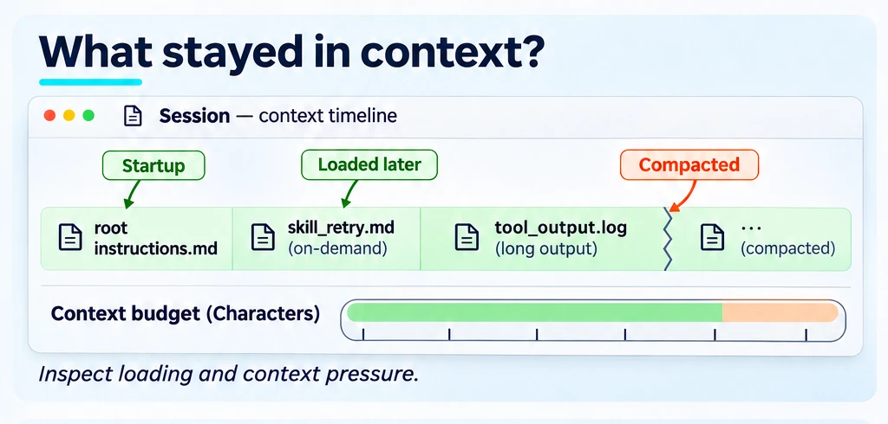
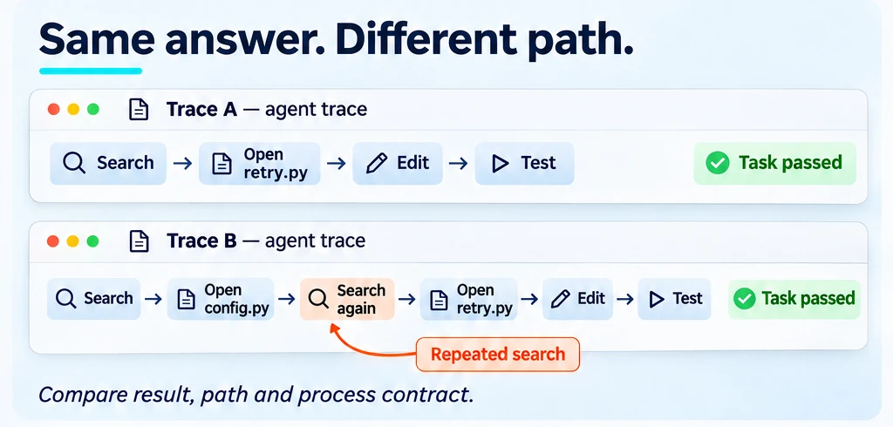
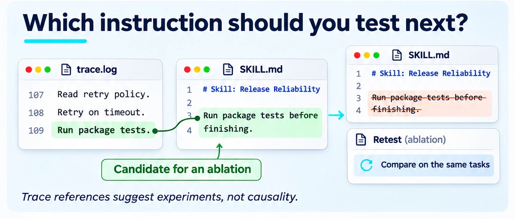

<!--
Copyright (C) 2026 Intel Corporation
SPDX-License-Identifier: Apache-2.0
-->

# What did the agent do?

[Feature tree](README.md) · [Detailed guide](../context-window.md)

Each card describes one capability. Images use fictional tasks and simplified document excerpts; they are explanations, not captured product screens, runnable configurations or benchmark evidence. Each image shows its own card; Open PR and Research images carry a badge saying so.

## Budget and inspect the context

**Availability:** Available on main.

Before a paid run, budget startup, lazy and on-demand guidance volume for the repository; the budget counts characters, not tokens. After a run, inspect supported Claude Code traces for startup load, growth, compaction and tool-result weight. The budget predicts loading volume; the trace describes one actual session.

**Input:** A repository/context configuration for the budget; `claude -p --output-format stream-json --verbose` output files for inspection.

**Scope and limits:** The repository budget is in characters, not a token invoice; compaction is a trace observation.

**Result:** Context growth, loading and compaction evidence available in the trace.

**Next step:** Use the linked workflow to configure this check, then [interpret the result](../start/results.md).

[Usage guide](../context-window.md) · [Budget guide](../repo-evaluation-contract.md) · [Implementation](../../dokimi/commands/context.py) · [Back to feature tree](README.md)

## Compare execution paths

**Availability:** Available on main.

Repeat one task and compare outcome stability, tool paths and declared process contracts. A stable final answer can hide unstable or wasteful execution paths.

**Input:** Stream-json traces of repeated runs of one task, a `--outcomes` file of verifier verdicts (without it a run passes when the harness ended cleanly, which is not task success), and an optional `--contract`.

**Scope and limits:** Trace consistency; process contracts are not universal adherence.

**Result:** Outcome and execution-path consistency measures across repeated runs.

**Next step:** Use the linked workflow to configure this check, then [interpret the result](../start/results.md).

[Usage guide](../run-consistency.md) · [Implementation](../../dokimi/commands/context.py) · [Back to feature tree](README.md)

## Find candidates for ablation

**Availability:** Available on main.

Use session observations to select instructions for an ablation experiment. A rule the sessions never brought up, or brought up in fewer than `--in-use-rate` of them, is a candidate (one seen in at most `--rare-max` sessions is listed as rare, not ranked); a rule triggered or acted on that often is `in_use`, and a protected rule is kept. A candidate is a rule to test by removing it, not proof that it is unused.

**Input:** Session logs and the guidance rules whose observed use you want to investigate.

**Scope and limits:** Session prefilter suggests candidates; it does not establish causality.

**Result:** Candidate instructions for controlled ablation, not automatic deletion decisions.

**Next step:** Use the linked workflow to configure this check, then [interpret the result](../start/results.md).

[Usage guide](../session-prefilter.md) · [Implementation](../../dokimi/commands/context.py) · [Back to feature tree](README.md)
