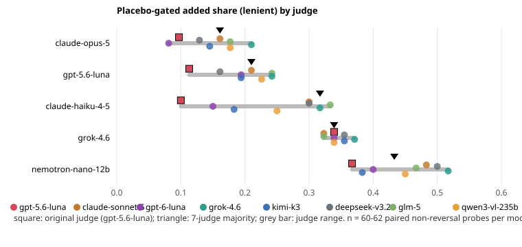

<!--
Copyright (C) 2026 Intel Corporation
SPDX-License-Identifier: Apache-2.0
-->

# How much the judge moves skill-novelty results

The skill-novelty study grades every probe answer with one LLM judge (gpt-5.6-luna) and
reports, per answer model, the share of claims a skill *added*, the share the model already
*knew*, the share the skill *degraded*, and the *placebo-gated* added share (added, and the
placebo arm is wrong too). This note re-grades a stratified sample of the same answers with
seven more judges from seven model families. It asks four questions:

1. How far does each headline number move when only the judge changes?
2. Do judges agree with each other, and do they favour their own family?
3. When the judges are a panel, how much do the conclusions depend on the aggregation rule,
   and how many judges are enough?
4. What can a Dokimi user configure today, and what is missing?

Short answer: judge choice moves the lenient added share by up to 0.23 for one answer model.
The original judge is the most lenient of the eight, so the published lenient added shares sit
at the low end of the panel. The ranking of answer models does not change. Majority, median
and Dawid-Skene give the same answers to within 1%. Three judges from three families get most
of the stability of seven.

## Setup

| | |
|---|---|
| Answers | 2,664 existing answers: 444 (probe, answer model) cells × 6 arms (`no_skill`, `root`, `routed`, `full`, `placebo`, `shuffled`). Plus 268 fresh repeats of `no_skill` for the noise floor. |
| Answer models | claude-opus-5, gpt-5.6-luna, grok-4.6 (88 cells each); claude-haiku-4-5, nemotron-nano-12b (90 each). |
| Sampling | Per model, cells drawn from those with all six arms, stratified by skill × reversal (adversarial) probe, proportional to stratum size. Seed 20261108. |
| Judges | gpt-5.6-luna (original grades, as recorded), claude-sonnet-5, gpt-6-luna, grok-4.6, kimi-k3, deepseek-v3.2, glm-5, qwen3-vl-235b. |
| Prompt | The study's grading prompt unchanged: 6 verdicts, answer truncated to 6,000 characters, max 1,200 output tokens, JSON repair by claude-haiku-4-5. |
| Temperature | 0, except gpt-6-luna and kimi-k3, which reject it and run at their default. |
| Coverage | 2,932 rows × 7 new judges, 1 unparseable verdict. The original judge has no grade on the repeats. |
| Noise floor | Repeat calls were possible only for haiku-4.5, grok-4.6 and nemotron-nano-12b. The other two answer models are no longer served. |
| Date | 2026-11-08 |

The headline categories follow the paper. Reversal probes are excluded, so the shares are over
60–62 paired probes per answer model. With n = 60 a share near 0.3 has a sampling SE of about
0.06. The judge-to-judge differences below are paired: the same answers, graded by a
different judge. They are therefore much less noisy than two independent samples of that
size would be. The confidence intervals in the paper are the right yardstick for the
sampling error.

Scripts: `research/judge-panel/judge_panel.py` (sample, repeat, grade), `analyze.py` (all
tables) and `fig.py` (figures). Tables: `docs/assets/judge-panel/*.csv`.

## 1. Per-judge headline numbers



**Placebo-gated added share, lenient** (correct = the first three verdicts):

| Judge | opus-5 | gpt-5.6 | haiku-4.5 | grok-4.6 | nemotron-12b |
|---|---:|---:|---:|---:|---:|
| gpt-5.6-luna (original) | 0.10 | 0.11 | 0.10 | 0.34 | 0.37 |
| claude-sonnet-5 | 0.16 | 0.21 | 0.30 | 0.32 | 0.48 |
| gpt-6-luna | 0.08 | 0.19 | 0.15 | 0.34 | 0.40 |
| grok-4.6 | 0.21 | 0.24 | 0.32 | 0.37 | 0.52 |
| kimi-k3 | 0.14 | 0.19 | 0.18 | 0.35 | 0.38 |
| deepseek-v3.2 | 0.13 | 0.16 | 0.30 | 0.35 | 0.50 |
| glm-5 | 0.18 | 0.24 | 0.33 | 0.32 | 0.47 |
| qwen3-vl-235b | 0.18 | 0.23 | 0.25 | 0.34 | 0.45 |
| **range** | **0.13** | **0.13** | **0.23** | **0.05** | **0.15** |
| 7-judge majority | 0.16 | 0.21 | 0.32 | 0.34 | 0.43 |

**Already known, lenient:**

| Judge | opus-5 | gpt-5.6 | haiku-4.5 | grok-4.6 | nemotron-12b |
|---|---:|---:|---:|---:|---:|
| gpt-5.6-luna (original) | 0.82 | 0.79 | 0.73 | 0.52 | 0.43 |
| claude-sonnet-5 | 0.65 | 0.66 | 0.47 | 0.45 | 0.15 |
| gpt-6-luna | 0.79 | 0.69 | 0.67 | 0.50 | 0.45 |
| grok-4.6 | 0.66 | 0.60 | 0.43 | 0.43 | 0.23 |
| kimi-k3 | 0.68 | 0.74 | 0.60 | 0.47 | 0.35 |
| deepseek-v3.2 | 0.74 | 0.69 | 0.48 | 0.47 | 0.20 |
| glm-5 | 0.66 | 0.56 | 0.42 | 0.43 | 0.20 |
| qwen3-vl-235b | 0.69 | 0.61 | 0.53 | 0.48 | 0.32 |

**Placebo-gated added share, strict** (correct = `correct_complete` only):

| Judge | opus-5 | gpt-5.6 | haiku-4.5 | grok-4.6 | nemotron-12b |
|---|---:|---:|---:|---:|---:|
| gpt-5.6-luna (original) | 0.23 | 0.27 | 0.32 | 0.34 | 0.40 |
| claude-sonnet-5 | 0.27 | 0.26 | 0.33 | 0.45 | 0.48 |
| gpt-6-luna | 0.26 | 0.19 | 0.23 | 0.29 | 0.28 |
| grok-4.6 | 0.26 | 0.29 | 0.40 | 0.42 | 0.38 |
| kimi-k3 | 0.27 | 0.31 | 0.35 | 0.40 | 0.48 |
| deepseek-v3.2 | 0.23 | 0.27 | 0.35 | 0.42 | 0.47 |
| glm-5 | 0.29 | 0.37 | 0.35 | 0.45 | 0.52 |
| qwen3-vl-235b | 0.29 | 0.31 | 0.42 | 0.43 | 0.52 |

Ungated added shares, degraded shares and the strict tables of every category are in
`per_judge_headline.csv`, and their min/median/max across judges in `headline_range.csv`.

What changes and what does not:

- **The original judge is the most lenient.** Its lenient rate over all graded rows is 0.76,
  against 0.62–0.72 for the other judges. It accepts more no-skill answers, so "known" goes up
  and "added" goes down. It sits at the bottom of the panel's lenient added share for opus,
  GPT-5.6 and Haiku. The paper's lenient added shares are therefore conservative. The extreme
  case is Haiku: the original judge says 0.10, the 7-judge majority 0.32. That moves Haiku
  from "the skill adds little" to the same level as Grok.
- **The strict scale moves less in relative terms.** Strict gated added varies by 0.06–0.20
  per model. gpt-6-luna is the outlier: it gives the lowest strict rate of any judge (0.27,
  against 0.34–0.53), because it marks dropped qualifiers more often. Its strict added share
  is the lowest for four of the five models.
- **Grok-4.6 answers are judge-proof.** Gated added is 0.32–0.37 under every judge. Its
  answers are the most clear-cut: only 11% of the rows lack unanimity, against 20–35% for
  the other answer models.
- **The ranking of answer models is stable.** Under every one of the eight judges, lenient
  gated added puts nemotron-12b first and opus-5 last. On strict, six of eight put
  nemotron-12b first and grok-4.6 second. gpt-6-luna swaps the two, and grok-4.6 ranks its
  own answers first and haiku-4.5 second. All eight put opus-5 or GPT-5.6 last. Statements of the form "the skill adds more for a weaker model"
  survive any choice of judge. A single number such as "13% added for opus" does not.
- **Degraded stays small under every judge**: 0.00–0.07 lenient and 0.00–0.07 strict, within
  the noise floor.

### Noise floor per judge

This is the added and degraded share between `no_skill` and a fresh repeat of the same call
(lenient):

| Judge | haiku-4.5 add / degr | grok-4.6 add / degr | nemotron-12b add / degr |
|---|---|---|---|
| claude-sonnet-5 | .02 / .02 | .03 / .02 | .05 / .05 |
| gpt-6-luna | .03 / .08 | .07 / .02 | .05 / .10 |
| grok-4.6 | .02 / .02 | .05 / .05 | .02 / .08 |
| kimi-k3 | .03 / .03 | .07 / .05 | .10 / .07 |
| deepseek-v3.2 | .03 / .03 | .05 / .05 | .10 / .05 |
| glm-5 | .02 / .03 | .05 / .07 | .03 / .05 |
| qwen3-vl-235b | .02 / .00 | .03 / .02 | .05 / .03 |
| 7-judge majority | .03 / .02 | .03 / .02 | .05 / .08 |

The floor is 0.00–0.10 for every judge, in line with the paper's 0.05–0.10. The judges
running at default temperature (gpt-6-luna, kimi-k3) are at the high end. The shift from the
original judge to the panel is larger than the floor for opus-5, GPT-5.6, Haiku and Nemotron.
For Grok it is not.

## 2. Agreement and self-preference

Cohen's kappa over all 28 judge pairs (full table: `pairwise_kappa.csv`):

| Scale | min | mean | max |
|---|---:|---:|---:|
| 6 verdicts | 0.46 | 0.61 | 0.72 |
| lenient (binary) | 0.70 | 0.79 | 0.88 |
| strict (binary) | 0.46 | 0.70 | 0.86 |

- The lenient range 0.70–0.88 matches the paper's two-judge kappa of 0.76–0.88. The 6-way
  scale is too fine to report as a single judge's call.
- **The highest pair is within one family**: gpt-5.6-luna and gpt-6-luna, κ = 0.88. Next
  come sonnet-5/grok-4.6 (0.86), glm-5/grok-4.6 (0.85) and gpt-5.6-luna/kimi-k3 (0.85), the
  last a pair of lenient judges. Two OpenAI judges are
  not two independent opinions. A panel needs different families, not just different
  models.
- Disagreement is not spread evenly across rows. A row lacks unanimity in 30% of `no_skill`
  rows (31% for the repeats), 21% of `placebo` rows and 17–19% of the with-skill arms. It
  also lacks unanimity in 27% of reversal-probe rows, and in 35% of nemotron's answers
  against 11% of grok's. The no-skill and placebo arms are the boundary that decides
  "known" against "added", so that is where the judge matters most.

**Self-preference.** For each judge and answer model we take the judge's lenient (strict)
rate minus the mean rate of the other judges on the same rows. That is the judge's offset.
The self-preference is the offset on its own family minus its mean offset on other families
(`self_preference.csv`):

| Judge | Graded own family | Lenient self-pref. | Strict self-pref. |
|---|---|---:|---:|
| gpt-5.6-luna | itself | +0.00 | −0.02 |
| gpt-6-luna | gpt-5.6-luna | −0.01 | −0.09 |
| claude-sonnet-5 | opus-5, haiku-4.5 | −0.01 | +0.00 |
| grok-4.6 | itself | +0.02 | +0.04 |

No judge favours its own family by more than 0.04. The raw offset of gpt-5.6-luna on its own
answers (+0.07 lenient) looks like self-preference, but it is the same +0.07 it gives every
model: general leniency, not favouritism. gpt-6-luna is if anything harsher on GPT-5.6
(−0.09 strict). Within this sample, family exclusion is a hygiene rule, not a correction for a
measured bias. The same-family kappa above is the stronger reason to mix families.

## 3. The judges as a panel

Each rule decides a row correct (lenient) from the seven new judges' verdicts. A row needs
verdicts from at least four of them. Placebo-gated added / known share:

| Rule | opus-5 | gpt-5.6 | haiku-4.5 | grok-4.6 | nemotron-12b |
|---|---|---|---|---|---|
| majority | .16 / .69 | .21 / .66 | .32 / .48 | .34 / .47 | .43 / .27 |
| median score ≥ 0.4 | .16 / .69 | .21 / .66 | .32 / .48 | .34 / .47 | .43 / .27 |
| Dawid-Skene (binary) | .16 / .66 | .21 / .66 | .33 / .45 | .34 / .47 | .43 / .25 |
| mean score ≥ 0.4 | .26 / .56 | .32 / .52 | .42 / .32 | .37 / .34 | .52 / .12 |
| unanimous | .21 / .56 | .26 / .52 | .32 / .38 | .32 / .40 | .52 / .12 |
| any correct | .08 / .85 | .14 / .81 | .12 / .68 | .37 / .52 | .33 / .52 |
| majority, strict scale | .29 / .45 | .27 / .37 | .40 / .15 | .48 / .18 | .50 / .05 |

Agreement of each rater with the 7-judge Dawid-Skene consensus, over all rows
(`agreement_with_ds.csv`):

| Rater | agree | | Rater | agree |
|---|---:|---|---|---:|
| majority | 0.993 | | grok-4.6 | 0.965 |
| median | 0.993 | | claude-sonnet-5 | 0.959 |
| mean ≥ 0.4 | 0.907 | | glm-5 | 0.949 |
| unanimous | 0.894 | | kimi-k3 | 0.938 |
| any correct | 0.889 | | qwen3-vl-235b | 0.935 |
| | | | deepseek-v3.2 | 0.926 |
| | | | gpt-6-luna | 0.917 |
| | | | gpt-5.6-luna (original) | 0.912 |

- **Majority, median and Dawid-Skene are the same rule in practice** here. They agree on
  99.3% of rows and give the same headline numbers to within 0.03. Dawid-Skene estimates
  that gpt-6-luna (specificity 0.79) and kimi-k3 (0.81) say "correct" too easily, while
  glm-5 (0.98) and grok-4.6 (0.96) rarely do. With seven judges that knowledge changes almost
  nothing. With two or three judges, one of them lenient, it could matter. That was not
  tested here.
- **The rule is as large a knob as the judge.** Unanimous and any-correct are not
  conservative choices. They push one arm and pull the other, because the same rule applies
  to `no_skill` and to `full`. "Any correct" calls more no-skill answers known, so added
  falls: Haiku 0.12. "Unanimous" and the mean score do the reverse: Nemotron 0.52. The spread
  between rules for one model (Haiku 0.12–0.42) is larger than the spread between judges.
  The rule must be fixed before a run and reported with the result.
- The mean score with the study's partial credit (0.4 for `partially_correct`) is not the
  same as a lenient majority. A row where three judges say partially correct and four say
  wrong has a mean of 0.17 but would need a 0.4 average, so the mean rule behaves almost like
  a strict vote on the lenient scale.

**How many judges are enough.** Subsets of the seven new judges vote by majority, with ties
counted as wrong. For each size we measure agreement with the 7-judge consensus and the spread
of the lenient gated added share between subsets of that size (`panel_size.csv`):

| Judges | subsets | mean agree | worst agree | SD of gated added | range of gated added |
|---:|---:|---:|---:|---:|---:|
| 1 | 7 | 0.941 | 0.917 | 0.039 | 0.115 |
| 2 | 21 | 0.943 | 0.924 | 0.026 | 0.105 |
| 3 | 35 | 0.966 | 0.947 | 0.025 | 0.095 |
| 4 | 35 | 0.969 | 0.949 | 0.021 | 0.079 |
| 5 | 21 | 0.980 | 0.970 | 0.021 | 0.069 |
| 6 | 7 | 0.982 | 0.973 | 0.011 | 0.029 |

Two judges are barely better than one, because a tie counts as wrong, so two judges act as a
unanimity rule. Three judges are the first real gain: the SD of the headline number falls from
0.039 to 0.025, below the noise floor. Five judges add little more. Recommendation: **three
judges from three families with majority vote** for routine runs, and **five** for a published
number. Report the per-judge numbers alongside either.

## 4. Judge panels in Dokimi today

The study above used its own scripts. This section is about the product, as of `main` on
2026-11-08.

What exists:

- **One judge per run.** `arms run` / `arms matrix-run` take `--judge`, `--judge-model`,
  `--judge-provider` and `--judge-temperature`. The default is `claude-sonnet-5-5` from
  `dokimi/defaults.py`.
- **Role panels.** `--judge-panel ROLES` (`eval/panel.py` `JudgePanel`) runs several role
  prompts (technical expert, developer advocate, doc reviewer) on **the same model**. Votes
  are combined by a role-weighted mean of the 0–100 dimension scores, with a quorum of a
  majority of the panelists. Disagreement is reported per answer as `std_aggregate`,
  `agreement_score = 1 − std/50` and `disagreement_flag` when std > `DISAGREEMENT_STD` (15, a
  constant). `gate/trust_gate.py` warns when the mean agreement is low.
- **Mixed models, one per role.** `eval score panel --judge-configs role:model:provider,...`
  is the only place where one panel mixes models, and each model is tied to a role.
- **Post-hoc judge robustness.** `eval judge agreement` (`commands/judge_reliability.py`,
  `eval/cross_judge.py`) re-scores an answers file with `--judges provider/model,...`. It
  computes each judge's per-arm delta as a separate measure with a sign test and Holm
  correction, and labels the arm `CONSISTENT`, `LEANING`, `JUDGE-DEPENDENT`, `NO DETECTABLE
  EFFECT` or `NOT MEASURED`. Judges that fail `--validity` do not vote. `--strict` makes
  `JUDGE-DEPENDENT` an error. This is the right shape, per-judge numbers rather than an
  average that hides the spread, and it already guards against "(one judge)" results.
- **Self-judging** is a warning on an exact model match (`utils.warn_judge_independence`).
  It never refuses, and a judge from the same family passes silently.

What is missing (each item was needed to produce this note):

1. **Naming N judge models for a run.** `arms run` cannot take a list of models. Panels are
   roles × one model, and robustness comes only from a second, after-the-fact command.
2. **Choosing the aggregation rule.** The weighted mean and quorum are hard-coded, and the
   disagreement threshold is a constant. Section 3 shows the rule moves headline numbers as
   much as the judge does.
3. **Family awareness.** Nothing knows that gpt-5.6-luna and gpt-6-luna are one family. The
   independence check is exact-match only and can't be made to refuse.
4. **Agreement statistics.** No kappa, Krippendorff's α or per-judge reliability is computed
   between answer judges. Cohen's kappa exists only for human labels in `repo hits`.
5. **Per-judge headline numbers in the arms report.** Per-role votes are in the JSON, but the
   report shows only the panel aggregate.
6. **Disagreement by arm.** The judges disagree most on the baseline and placebo arms, which
   decide every delta. No report breaks disagreement down by arm.
7. **No cost control for a panel.** A full panel costs N× the grading. Nothing grades with one
   judge and sends only the contested rows to more.

## 5. Proposal

All of the following reuse code that exists: the `--judges` spec parser of `eval judge
agreement`, `JudgePanel` / `_aggregate`, `cross_judge.label`, and `same_evaluator`.

**CLI**

```bash
python cli.py arms run ... \
  --judges anthropic/claude-sonnet-5-5,openai/gpt-6-luna,bedrock/kimi-k3 \
  --aggregate majority            # majority | median | mean | unanimous | any | dawid-skene
  --judge-family-policy refuse    # refuse | warn | allow  (judge vs answer model, and judge vs judge)
  --judge-escalate contested      # grade with judges[0]; send rows near the threshold, and
                                  # the baseline/placebo arms, to the rest of the panel
```

- `--judges` on `arms run` and `arms matrix-run` takes the same `provider/model` list as
  `eval judge agreement`. `--judge-model` / `--judge-provider` stay as the one-judge form.
  `--judge-panel ROLES` stays orthogonal: roles × judges, with roles averaged inside a judge
  first.
- `--aggregate` defaults to `majority` for verdict-style grading and to `median` for 0–100
  scores. The latter is the robust form of today's mean, and matches majority in section 3.
  `dawid-skene` needs ≥ 3 judges and ≥ 50 rows and falls back to `majority` with a warning
  below that. The rule, and the judges' estimated sensitivity and specificity, go into the
  run's provenance digest as `_aggregation_policy` does today.
- `--judge-family-policy`: one `family` field per model in `defaults.py`, next to
  `JUDGE_MODEL_FOR_PROVIDER`, covering the same table the novelty study keeps. `refuse` is
  the default for `--judges`. It refuses a judge from the answer model's family, or two judges
  from one family, unless `allow` is given, and records which policy was in force.
- `--judge-escalate contested` is the cheap panel. Its cost and accuracy are not measured
  yet. The case for it is that about 80% of rows are unanimous, and the contested ones
  concentrate in two arms. This study's data can simulate it before it is built.

**Config** (the `judge:` block in a product config, or a run YAML), so that a product fixes its
panel once:

```yaml
judge:
  judges:
    - {provider: anthropic, model: claude-sonnet-5-5}
    - {provider: openai,    model: gpt-6-luna, temperature: null}   # null = model default
    - {provider: bedrock,   model: kimi-k3,    temperature: null}
  aggregate: majority
  min_quorum: 2              # rows with fewer valid votes are insufficient_evidence
  family_policy: refuse
  disagreement_threshold: 15  # today's DISAGREEMENT_STD, now configurable
  escalate: contested
```

`temperature: null` is needed because gpt-6-luna and kimi-k3 reject `temperature=0`.

**Report** (arms report and `eval judge agreement`):

- A per-judge table of every headline number (arm means, deltas, added/known/degraded where
  applicable), with the panel row under it. That is section 1 of this note, generated.
- Pairwise Cohen's kappa and Krippendorff's α for the binary and full scales, plus a
  same-family flag on pairs.
- The share of rows that lack unanimity, per arm.
- A **judge-sensitive** flag on each headline delta, raised inline (not only post hoc) when
  either the sign differs between judges or the range across judges exceeds the noise floor.
  It reuses the `JUDGE-DEPENDENT` label, and `--strict` makes it an error as it does today.

**Order of work:** (1) `--judges` + `--aggregate` on `arms run`, with per-judge numbers in
the report. (2) The family table and policy. (3) Kappa/α and disagreement by arm. (4)
Escalation. Items 1–3 change no default output for a one-judge run.

## Limits

- 60–62 paired probes per answer model: enough to compare judges on the same rows, not to
  re-estimate the paper's numbers. Use the paper's intervals for those.
- The original judge and two answer models are no longer served, so the noise floor covers
  three answer models, and the original judge has no grades on the repeats.
- Two judges ran at default temperature. Their noise-floor rows include their own sampling
  noise.
- Dawid-Skene here is binary (lenient) and one-coin per class. A 6-class version would
  separate "lenient on qualifiers" from "lenient on wrong answers".
- No deterministic ground truth covers these skills. The grounded-grader pilot covers other
  skills, so there is no "true" label here: agreement is with the panel consensus, not with
  the truth. See `grading-tiers.md` when it lands.
