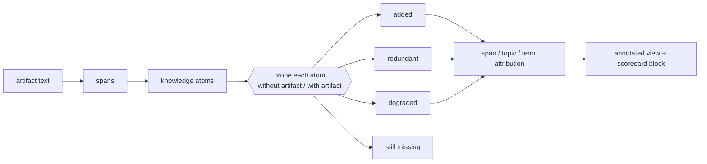

---
depends_on:
  - dokimi/dokimi/novelty/**
  - dokimi/dokimi/metrics/bundle_coverage.py
  - dokimi/dokimi/commands/novelty.py
  - dokimi/dokimi/gate/novelty_gate.py
  - dokimi/dokimi/schemas/novelty.v1.json
---
<!--
Copyright (C) 2026 Intel Corporation
SPDX-License-Identifier: Apache-2.0
-->

# Content novelty: what does this skill actually *add*?

The arm comparison answers *does this artifact help?* This layer answers the two questions an author
asks next: **which parts of it help, and which parts are the model repeating back to you?**

Both matter because a skill is not homogeneous. Measured on 33 skills (see
[skill-novelty-evidence.md](skill-novelty-evidence.md)): for `claude-opus-5`, **70% of what a skill
says is something the model already produces unprompted**, 21% is genuinely new, and 2% is knowledge
the model had and the skill destroyed. A single delta cannot separate those three.



## The four outcomes

Every knowledge atom in the artifact gets probed twice against the same model — once with no
artifact in context, once with it — and both answers are graded by a *different* model. The outcome
is one of four, and they are exhaustive:

| outcome | meaning | what to do about it |
|---|---|---|
| **added** | wrong without the artifact, right with it | this is the artifact's reason to exist — protect it |
| **redundant** | right both ways | delete it, for this model tier |
| **degraded** | right without, wrong with | a real defect: the text is overriding correct prior knowledge |
| **still_missing** | wrong both ways | the artifact says it but the model does not pick it up — rephrase or promote it |

Because the probes are paired per atom, the comparison is robust even when the judge's absolute
calibration is not. That distinction matters: two independent judges in the study agreed on a 6-way
verdict scale only 66% of the time, but 85% on the correct-ish binary collapse. **Trust the signs
and the rankings; do not trust the second decimal of a level.** Every number is therefore reported
twice, under a lenient and a strict grading.

## Reading the output: what each label is, and who decided it

Every label in a `novelty.v1` artifact is either **measured** (two answers to the same probe,
graded) or **judged** (one model's call about an atom). The two kinds fail differently, so each
entry below says which it is.

### Strict and lenient (measured)

The judge grades each answer on six verdicts (`VERDICTS` in `novelty/measure.py`):
`correct_complete`, `correct_missing_qualifier`, `partially_correct`, `wrong_other`,
`wrong_reversed`, `abstained`. The two scorings collapse them differently:

| scoring | counts as correct |
|---|---|
| strict | `correct_complete` |
| lenient | `correct_complete`, `correct_missing_qualifier`, `partially_correct` |

The gap between them is information, not noise, but the two `added` sets are not nested. An
answer that goes from wrong to `partially_correct` is lenient `added` and strict `still_missing`;
one that goes from `partially_correct` to `correct_complete` is strict `added` and lenient
`redundant`, the case where the model had the gist and the artifact supplied the exact qualifier,
value or ordering. Strict `added` is usually the larger (0.363 against 0.209 lenient on
`claude-opus-5`) but not always (0.266 against 0.293 on `nemotron-nano-12b`;
[evidence §3](skill-novelty-evidence.md)). **Prefer strict for any decision.** Strict `added`
ranks *models* inside one artifact in the order of their measured task delta: ρ 0.625 over 12
(artifact, model) cells grouped by their 4 artifacts, and +0.875 with all four artifacts positive
on the re-run; lenient gave 0.000 within an artifact ([§10.8](skill-novelty-evidence.md),
[§10.15](skill-novelty-evidence.md)). It does not rank *artifacts*: pooled over the 24 cells of
§10.15 ρ is −0.052, and 13 artifacts ranked inside one model give −0.446. §10.8's pooled 0.620,
over the same 12 cells, is superseded by that re-run. The two graders' bias also runs in opposite
directions under the two scorings (+7.7pp strict, −11.6pp lenient), so **quote no `added`
difference below 0.15** ([§10.21](skill-novelty-evidence.md)).

### Content categories (one axis measured, one judged)

| | needed for the task | not needed |
|---|---|---|
| **new to the model** | `novel_useful` | `novel_inert` |
| **already known** | `known_useful` | `known_inert` |

plus `scaffolding` (structure, navigation, restated headings, workflow framing: text that cannot
be right or wrong) and `harmful_conflicting` (below), which overrides the other five.

- **Known vs new is measured.** It comes from the atom's paired probes under lenient grading,
  taking the worst outcome in the order `degraded` → `added` → `still_missing` → `redundant`.
  `redundant` or `degraded` means known. An atom that was never probed counts as new, which is
  the direction that does not claim the model knew something nobody asked it. The model is never
  asked whether it knew something.
- **Needed vs inert is judged.** The extractor model sees the task and answers, per atom, *"can
  acting on this task go wrong, or be much slower, without knowing it?"* The task is built from
  the artifact's `name` and `description` plus the need graph's `core` and `rare_critical` nodes,
  never from the body, so an artifact cannot make itself relevant by containing a sentence.
  Eval files are not part of it either.
- **Reliability.** In the study both axes were judged, and an independent reviewer agreed with
  71.6% of assignments (853 atoms), with useful-vs-inert at ±3 points and known-vs-novel at ±2;
  `scaffolding` was the most stable share ([§4](skill-novelty-evidence.md)). Here only the ±3
  carries over. Known vs new is read off the paired probes instead, so its error is the probe
  grading's: two judges agreed on 85% of verdicts on the correct-ish binary collapse (above).
- **Inert is not "safe to delete".** The `drop-inert 0.60` candidate, which cuts inert text under
  a 0.60 token budget (the suffix is a budget, as for every §10.6 candidate, not "all inert atoms
  at once"), was non-inferior on pooled data (+0.005, CI [−0.045, +0.057]) and *worse* on
  `nemotron-nano-12b` for `dpnp-quickstart` ([§10.6](skill-novelty-evidence.md)).
- An atom the value judge did not answer for gets no category. The artifact says how many
  (`N of M atoms got no need/scaffolding verdict`, split into calls that failed and rows the reply
  skipped), rather than counting them as inert, and its span is labelled from what was measured
  (`still_missing`, or `unscored` when nothing was) rather than `redundant` or `inert`.

### `harmful_conflicting` (judged)

The extractor model is shown batches of 40 atom statements and asked for pairs that *"cannot both
be true, or give incompatible instructions for the same situation"*. Both atoms of a pair are
marked. Read it as a review queue:

- **Internal only.** It says the two statements disagree, not which is wrong. That needs a
  primary source, which this layer does not consult.
- **Lower bound.** Only atoms in the same call are compared. `analyze` sends the whole
  extracted atom set (at most `max_atoms`, 120 by default) in one call, so every pair is compared
  unless a call fails or its reply has to be split. The artifact records the share as
  `conflict_coverage` (`pairs_compared`, `pairs_total`) and warns `the conflict check compared X of
  Y atom pairs` when it is short. `pairs_total` is over the extracted atoms, which is a sample when
  `spans.capped_atom_set` is true. The `harmful_atoms` gate check reads a count of 0 as cleared only
  when the share reaches `min_conflict_coverage` (1.0 by default) and the atom set was not capped;
  otherwise it is `measured: false`, as it is when `conflict_coverage` is present but malformed. A
  conflict that was found is always reported.
- **Unchecked atoms.** A call whose reply does not parse is split and re-asked only while both
  halves keep two atoms, since one statement has no pair to look at; a chunk of two or three whose
  reply does not parse fails with its error. Atoms in a call that failed, and an atom left alone in
  a chunk (the 41st, say), are counted in `N of M atoms were not checked for conflicts`, split by
  cause (`K in calls that failed (last error: …)`, `K alone in a batch, with no pair to check`).
  Their ids are not written to the artifact.
- **False positives (anecdotal, not a rate).** Spot-checking 7 of the 31 pairs one run reported
  ([mattpocock/skills](https://github.com/mattpocock/skills) @ `49dd158`) found 4 real, 1
  ambiguous and 2 false positives: steps of one procedure read as alternatives ("watch it fail"
  … "watch it pass", `diagnosing-bugs`), and two compatible options read as exclusive (`grilling`).
  A rule next to an exception the text did not mark as one was a real finding. Check each pair
  against the text before editing.

It is reported first because it is the only category that can make an artifact worse than no
artifact. `degraded` (right without the artifact, wrong with it) is the measured counterpart.

### Atom kinds and tags (judged, at extraction)

The extractor labels every atom with one `kind` (`proposition`, `edge`, `motif`, `contract`,
`example`) and any number of tags (`local`, `public`, `procedural`, `routing`,
`negative_constraint`, `version_bound`, `rare_critical`, `temporal`, `evidence`). The per-tag
tables slice the same 2×2 by label. Tags overlap, so their rows do not sum, and an atom may carry
neither `local` nor `public`. Relabelled by two other models ([§10.9](skill-novelty-evidence.md)):

| labels | κ against the reference |
|---|---|
| `routing`, `negative_constraint`, `version_bound` | 0.61–0.73 |
| `procedural`, `evidence` | 0.60–0.65 |
| `local`, `public` | 0.52–0.62 |
| `temporal` | 0.40 and 0.64; one labeller assigned it at 2.7× the reference rate. Not gate-grade |
| `rare_critical` | 0.39–0.45, the lowest tag. Not gate-grade |
| `kind` (5-way) | 0.32–0.38 |

So gate on `routing`, `negative_constraint` and `version_bound` (the top three by mean κ and
under grok; under luna `evidence`, 0.650, edges out `routing`, 0.606 — the "protection tags" of
[§10.9](skill-novelty-evidence.md)) or on nothing, and quote the other tag splits as labels,
except `temporal` and `rare_critical`, which are not quotable either. These are not the span protection flags the shortener pins (negation, version
gate, ordering, threshold), which are lexical and involve no model. A high `added` on `local`
atoms means the artifact transmits its own conventions (names, layouts, the next step to take),
which models mostly lack: strict `local` K0 is 0.000–0.259 across five models, against
0.227–0.545 for `public` ([§10.1](skill-novelty-evidence.md)). It does not mean those
conventions beat the model's default; only the task arm can say that.

## Novelty is a property of the pair, not of the file

The same artifact is worth very different amounts to different models:

| model | added | already knew | degraded |
|---|---|---|---|
| claude-opus-5 | 0.209 | 0.700 | 0.019 |
| gpt-5.6-luna | 0.131 | 0.775 | 0.030 |
| grok-4.6 | 0.307 | 0.537 | 0.024 |
| nemotron-nano-12b | 0.293 | 0.498 | 0.076 |

Consequences for authoring:

- A skill that looks bloated against a frontier model may be correctly sized for a small one. Decide
  which tier you are writing for, and record it.
- `degraded` rises as the model weakens (0.019 → 0.076). Weak models copy your errors; strong models
  overrule them. A stale line in a skill is a bigger risk to a small model — **except** for reversed
  or out-of-date claims, where the opposite holds: strong models resisted planted inversions *less*
  often (0.787–0.811) than weak ones (0.890), because a weak model abstains and thereby dodges the
  trap.

## Where "relevant" comes from: the need graph

`added` says the model learned something. It does not say the artifact should have taught it. That
second question needs a scope definition, and the scope must not come from the artifact — otherwise
every sentence is relevant by construction, because it is in the file.

So relevance is scored against a **need graph** built from the artifact's `name` and `description`
only. Nodes are the things a reader actually needs: `intent`, `decision`, `constraint`, `action`,
`evidence`. Each node gets a path class, and the class sets its weight:

| path class | weight | meaning |
|---|---|---|
| `core` | 1.0 | on the main path of the artifact's own task |
| `rare_critical` | 1.0 | fires rarely, prevents a bad outcome when it does |
| `branch` | 0.7 | a specific variant or configuration |
| `supporting` | 0.4 | helps, but nothing breaks without it |
| `out_of_scope` | 0.0 | a real need — for a *different* artifact |

`rare_critical` deliberately weighs the same as `core`. Frequency and criticality are separate axes,
and collapsing them is the mechanism by which safety text gets deleted: *"only triggers on driver
1.0, cut it"*.

**Why not just use embedding similarity to the topic?** Measured: graph-derived relevance correlates
with top retrieval similarity at only **0.368**, the two rankings disagree on 57% of the atoms they
each call most relevant, and 1.3% of atoms best-match an `out_of_scope` node — text answering a
question the artifact is not responsible for. Similarity can say *on-topic*. Only the graph can say
*in-scope*, and only in-scope licenses spending tokens.

**What the graph must not be asked to do.** It organizes the question space; it is a retrieval and
exploration layer, not the scorer. It cannot tell you whether a claim is true, how often the need
arises, what your model already knows, which span caused a behaviour change, or whether the knowledge
helps downstream. Those are five separate measurements — probes, arms, task suite — which is why the
output of this layer is a dashboard and not one graph score.

**The edges are where the value hides.** The highest-value content found in the study was not
propositions but *negative edges*: one-clause blocks on an inference the model would otherwise make —
"a successful import does not mean the array is on the GPU", "seeing MKL in `threadpool_info()` does
not mean NumPy's BLAS is wired to it", "fits in VRAM does not mean it will launch now". Cheap in
tokens, invisible to any frequency or perplexity ranking, expensive to lose. That is what the
`protection` axis and the amber colour exist for.

## Using it as an authoring tool

The commands in order, with the costs and the three free steps that come first, are in
[skill-novelty-walkthrough.md](skill-novelty-walkthrough.md). This section is the reference
for what each output means.

### 1. Whole-artifact triage

```bash
python cli.py novelty analyze --artifact skill:path/to/skill \
    --model claude-opus-5-5 --provider anthropic \
    --judge-model gpt-6.1-sol --judge-provider openai [--include-resources]
```

With no `--judge-model`/`--judge-provider`, the judge is `anthropic/claude-sonnet-5-5`
whatever `--provider` is; a Bedrock-only run adds `--judge-provider amazon-bedrock`.
`--judge-provider` alone takes the default judge that runs on that provider; when none
does (measuring `claude-sonnet-5-5` with `--judge-provider amazon-bedrock`, or the
default `gpt-6.1-sol` with `--judge-provider openai`) the run exits and asks for
`--judge-model`.

Without `--include-resources` this measures `SKILL.md` alone and prints, before spending
anything, what share of the artifact that leaves out — see
[the artifact is the bundle](#the-artifact-is-the-bundle-not-the-file).

Reports the 2×2, `K0`, the five-category content breakdown, the span statistics (how many tokens
carry no knowledge at all, how many spans are the sole carrier of something, how many are
protected), and the control arms.

Read it in this order:

1. **`routing` first.** If the artifact is not selected, content work is unrecoverable
   spend. In the study six of thirteen skills routed below 0.50, one at 0.146. `novelty
   analyze` holds the frontmatter fixed so the two are never confounded — selection is its
   own command, [below](#can-the-artifact-be-selected-at-all).
2. **`harmful_conflicting` next.** Conflicts are the only category that can make the artifact worse
   than nothing.
3. **`frac_carrying_nothing`.** Tokens that carry no extractable knowledge. Measured against the full
   extracted atom set this was ≤0.14 on every artifact in the study. **Only trust it when the atom
   set behind it is complete:** the study's two apparent outliers (0.50 and 0.74) turned out to be
   artifacts of a 250-atom-per-artifact judging cap on the two largest artifacts, whose real figures
   are 0.068 and 0.064. Always read this metric next to its judged/extracted atom ratio.
4. **`added` last** — it tells you whether the artifact is worth its tokens, but the three checks
   above tell you what to do.

### 2. Span attribution — where in the file

Each span of the artifact is annotated with the atoms it carries, their outcome, and its token cost,
then rendered as the artifact's own text with colour:

| colour (label) | meaning |
|---|---|
| green (`added`) | carries `added` knowledge — the artifact's value |
| grey (`redundant`, `inert`) | `redundant`: an atom the model already answered without the artifact (this wins over `still_missing`); or `inert`: no atom has a measured outcome and one is judged inert or scaffolding (this wins over an unprobed atom judged useful) — candidate for deletion |
| red (`harmful`, `degraded`) | carries a `harmful_conflicting` or `degraded` atom |
| amber (`protected`) | **protected**: expresses a negation, version gate, ordering constraint, or threshold |
| blue (`still_missing`) | states something the model got wrong with and without it, and nothing it already knew — rephrase or promote it |
| plain (`unscored`) | carries atoms with no measured outcome and none judged inert or scaffolding: unprobed atoms judged useful (including atoms whose probe runs all errored), or atoms the value judge did not answer for — so no colour is claimed |
| hatched (`unread`) | no extraction call could read it, so what it carries is unknown — not dead weight |
| dim (`empty`) | carries no extracted atom at all |

The colours are applied in a fixed order, worst first: red, green, hatched, amber, dim, then grey
(`redundant`), blue, grey (`inert`), plain. A span takes the first that applies, so a span with one
`added` atom is green whatever else it carries.

Two derived views an author acts on directly:

- **Dead weight**: the dim spans, sorted by token cost. The largest single win in most artifacts.
  Unread spans are not listed.
- **Sole carriers**: spans that are the only source of some atom. These are what a careless edit
  silently deletes; the shortener pins them.

`views.topics` rolls the spans up by their first two headings, with the label counts per section,
`dead_tokens` (the dim spans' tokens) and `unread_tokens` (the hatched spans' tokens), so a
section's waste and its extraction loss read apart.

Going finer than a span — highlighting the *words* that carry an atom — was measured before being
built, by masking them and masking the same number of other words from the same span: the attributed
words cost 0.34–0.39 more retention than the control (95% CI 0.31–0.47, 47 of 48 decided cells), so
the highlight is load-bearing. Three measured constraints ship with it:

- **Do not attribute by lexical overlap** with the atom statement. It misses negation — negation words
  are function words — so its extra loss on `negative-constraint` atoms is +0.143 against an LLM
  attributor's +0.392. The cheap attributor is weakest on exactly the knowledge that matters most.
- **Carry the heading path** wherever a span is checked. Atom recovery from a bare span is 0.833 and
  rises to 0.907 with the heading path prepended, for about 16 tokens: a span reading "Use 4 for most
  workloads" is not a bad citation, it is a sentence whose subject lives in its heading.
- **Render an unlocated state.** 19% of atoms are not recoverable from their cited *file* at all —
  syntheses inferred while reading the whole document, which the faithfulness check calls supported.
  Their span pointer is a fiction, and colouring a span for them is worse than saying nothing.

### 3. Shortening, with five separate scores

```bash
python cli.py novelty shorten --artifact skill:path/to/skill --atoms atoms.json --budgets 0.75 0.5
```

Never one "retention" number, because a single score hides the one failure that matters. A measured
example from the study: a candidate at **21% of the original tokens** retained **0.916** of the
knowledge — and only **0.158** of the protected spans. Knowledge said "success"; the negations,
version gates and ordering constraints had been thrown away, because their value is conditional on a
failure the atom statement does not encode.

| axis | what it protects |
|---|---|
| `tokens` | the budget |
| `knowledge` | the atoms survive somewhere in the text |
| `value` | the *relevant and novel* atoms survive, weighted |
| `protection` | negations / gates / versions / orderings survive |
| `routing` | the description still claims the artifact's own queries |

**Read `value` next to its `value_coverage`.** The weight is relevance × novelty, and novelty needs a
measured `K0`, which only probed atoms have. In the study that left per-model value defined on 148 of
2422 atoms — 3 of 279 on the largest artifact — so both the reported rate and the `greedy_value`
ranking were, in practice, atom *coverage* per token. Candidates therefore ship `value_coverage` and a
`value_is_coverage_proxy` flag, and `pick_best` tie-breaks on `knowledge` rather than `value` when the
flag is set. Coverage per token is a fine selection rule; it is just not a relevance claim.

Rule of thumb from the measurements: a safety-pinned strategy at 0.60 token fraction held
`protection = 1.000` with knowledge 0.81–0.96, and pooled across the behavioural sweep every
shortener tested was non-inferior to the full package at a 0.05 task-score margin.

**Is any of this better than a generic prompt compressor?** Measured against LLMLingua-2 at the same
achieved token count on four artifacts, with both sides scored by the same retention oracle: span
selection is +0.03 on bulk knowledge (7 of 8 cells), +0.07 on strict knowledge (8 of 8), and **+0.12
lenient / +0.20 strict on the atoms carried by protected spans** (8 of 8). The knowledge-aware
selector's advantage is small on prose and large on negations, gates and thresholds — a token-level
compressor drops a `not` for one token's saving. Retention only; neither side was run behaviourally.

That gap is not a mis-configured baseline. LLMLingua-2 takes a `force_tokens` list, and re-running the
comparison with up to 40 protection terms mined from each artifact's own protected atoms — negations,
gate words, flags, versions, limits — moves protected-atom retention by **+0.0003 lenient and −0.0009
strict, 4 cells up and 4 down**, while span selection keeps its full +0.20 strict lead in 8 of 8 cells.
Pinning a token keeps the *word* and not the clause it governs: the compressor retains a `not` whose
sentence is gone, which is worse than dropping both. **Do not substitute a token-level compressor for
the protection axis at any configuration.**

Two limits on that rule, both measured:

- **Per artifact it is unproven.** With 7–8 tasks per (artifact, model) cell the 95% interval is
  ~0.32 task-score points wide, so 44 of 60 individual cells were inconclusive. Pooled evidence
  licenses a shortening *policy*; it does not license a specific cut without running that cut.
- **The verdict does not transfer across model tiers.** Of 20 (artifact, candidate) pairs measured on
  three models each, only 9 agreed; the smallest model was the worst-hit in 9 of 20, and the same
  candidate was non-inferior on a frontier model and *worse* on a small one. Small models need the
  redundancy you can take away from large ones, so a shortening decision must name the tier it was
  measured on and include the weakest deployed tier.

### 4. What the artifact should *not* teach

Two content patterns were measured as actively harmful, independent of topic:

- **Deferral phrasing.** "Consult `references/X` before answering" cost one model its answer
  entirely: it replied with a preamble promising to look things up and scored 0.047, against 0.537
  with no skill at all. Skill bodies should be answerable standalone; progressive disclosure is a
  loading strategy, not a sentence to write.
- **Investment in prose order.** An arm with the same spans in shuffled order scored *higher* than
  the intact artifact on four of five models. Ordering, transitions and narrative framing carried no
  measurable knowledge. Spend the effort on facts, qualifiers and exact values — that is where the
  strict-grading `added` lives. A probe asks one atom at a time and so cannot punish a scrambled
  document, so this was retested behaviourally on the 71 generated tasks whose graded requirements
  themselves name an ordering: the two arms stay level there too, on the whole task (+0.003) and on
  the ordering items alone (+0.022, 95% CI −0.027 to +0.072, 213 paired cells). Read with its
  resolution — a cost of scrambling smaller than ~0.07 is not excluded, and each artifact was
  scrambled with one seed.

Third pattern, and it is the one with the largest measured effect in the study:

- **Every exact value you write will be believed, so anchor it.** Planting a false numeric value at
  every occurrence in an artifact makes three model families state it **0.942** of the time when it is
  plausible and **0.846** of the time when it is wrong by 64× — a `32768 MiB` scratch allowance, a
  `>95%` regression threshold. They flagged the conflict in **3 of 93 adoptions**, and two of the three
  families never flagged anything. Where the model's own prior was correct (6 cells of 52), it abandoned
  that prior **6 times out of 6**. Absurdity does not protect and the reader will not catch it for you.

  Three values out of twenty ever survived a plant, and what they had in common was not being
  implausible — it was an **independent anchor**: a hardware SKU the model already knows, an arithmetic
  identity it can recompute, or a second unmutated correlate in the same document (the OS release number
  resisted because the codename sat next to it). So when you write a threshold, a capacity or a version,
  **write the checkable correlate beside it** — the part name, the formula it derives from, the codename.
  That is the only mechanism observed to make a stale value detectable, and it is the one property under
  the author's control rather than the model's.

### 5. Which *kind* of knowledge to write

A single `added` number tells an author the artifact is worth its tokens but not what to write more
of. Re-cutting the same probes by what the atom is — a fact the model could know from public
material, versus a local contract, versus an ordered procedure — splits the average in a way that is
directly actionable. Strict grading, measured across five models:

| atom kind | models already knew it | artifact supplied it |
|---|---|---|
| `public` — concepts, general technique | 0.23–0.55 | 0.17–0.23 |
| `local` — this stack's specific contract | 0.00–0.26 | 0.32–0.43 |
| `motif` — ordered procedure, gate, halt | 0.07–0.17 | 0.23–0.56 |
| `proposition` — a standalone claim | 0.14–0.46 | 0.16–0.31 |

Prior knowledge of public material is roughly **double** that of local contracts on every model, and
the artifact's contribution runs the other way. The weakest model knew *no* local contract at all
(strict `K0` 0.000). Two authoring consequences:

- **Conceptual prose is the first thing to cut.** It is the half the model already has. Explaining
  what a cache miss is spends tokens; stating this stack's exact flag, threshold or ordering does not.
- **Write the procedure down, precisely.** `motif` and `contract` atoms — gates, orderings, flags,
  output formats — are where the artifact is least replaceable, and they are also the atoms a greedy
  token-budget shortener discards first (their value is conditional on a failure the sentence does
  not mention). That is why `protection` is a separate axis.

Two caveats belong next to the table. The judge is *least* reliable on exactly these content types
(κ 0.558 on `motif`, 0.605 on `edge`, against 0.714 on `proposition`). Judge noise inflates both arms
of a paired comparison and therefore shrinks the measured difference rather than inventing it, so the
direction holds and the magnitudes are soft. And the rows are labels, not measurements: the tag rows
re-derive under two independent labellers to within 0.08, but the `motif`-vs-`contract` boundary does
not (κ 0.32–0.38 on the shape vocabulary), so read the shape rows as "ordered/required content" versus
"standalone claim" rather than as four distinct classes.

## The artifact is the bundle, not the file

A skill is a thin `SKILL.md` plus `references/`, `scripts/`, `patterns/` and sometimes
`evals/`. Measured over the 33-skill study corpus with the framework's own loader and
segmenter:

| | value |
|---|---|
| skills with bundled resources | 33 / 33 |
| corpus words in `SKILL.md` | 36,188 |
| corpus words outside it | 93,773 (**0.72**) |
| per-skill outside share | min 0.005, median 0.433, max **0.988** |

The worst case carries 375 words in its body and 30,567 in 30 bundled files. Measuring the
entry point alone would judge that skill on 1.2% of itself, and its "dead tokens" share
would be dominated by spans whose only job is to name a file nobody read.

```bash
python cli.py novelty analyze --artifact skill:path/to/skill --model M --judge-model J \
    --include-resources                       # measure the bundle
    # --resource-roles reference pattern      # or only some of it
    # --max-file-words 4000 --max-resource-words 20000
```

Things to know before reading a bundle result:

- **It is an upper bound.** Injecting the whole bundle measures what the artifact *could*
  deliver if the agent read all of it. Whether the agent chooses to load `references/x.md`
  at runtime is the agentic track's question (`skill-agent:`), not this one.
- **The two modes are different cells.** `include_resources` is recorded in `run_config`;
  an entry-point run and a bundle run of the same skill are not comparable numbers, and an
  entry-point run whose *measurable* outside share is ≥ 0.5 says so in `warnings`
  (`measurable_outside_share` nets out the role decisions below; `outside_share` is the
  on-disk figure, and the two differ for a skill whose only resources are its evals).
- **A skill's own `evals/` are not content.** They are the question/answer keys for
  testing the skill, so extracting atoms from them would credit the skill with delivering
  its own test set. Excluded by default (10 of the 33 corpus skills ship them), with the
  reason naming the opt-in; `.git/`, `__pycache__/`, `venv/`, hidden files and friends
  are never walked at all.
- **Exclusions are reported, never silent.** A file over `--max-file-words` is skipped
  whole rather than truncated, because a cut reference would be attributed as if complete;
  every skip, role filter, budget overrun and non-text file appears in `bundle.excluded`
  with its reason, and a skipped text file's words still count in `resource_words_on_disk`.
  Whether a file is text is decided by its content (UTF-8, no NUL bytes), not by its
  suffix: extension-less guides, `.mjs` scripts and `Makefile`s are measured like any other.
  A file that is mostly printable text but does not decode as UTF-8 (latin-1, cp1252, UTF-16)
  is reported `unreadable` whatever its suffix, and the coverage check then says `measured=False`;
  only a NUL-bearing non-UTF-16 file, or a blob that is not mostly printable, is silently "not text".
- **One rule decides what an exclusion means.** Every row's `kind` has one class
  (`metrics/bundle_coverage.py`, `EXCLUSION_CLASS`): `budget` and `not_requested` are a *gap* — the words
  in `unmeasured_words`, the files a warning calls "excluded"; `policy` is a *decision*, never
  charged as unread; `unreadable` is *unknown*; `symlink` and `not_text` are *not content*. An
  exclusion is a *file* the run did not select; text it selected that no extraction call could
  read is an *unread span* (`spans.n_unread`, below), which narrows the dead-token figure and
  not coverage.
- **Coverage has one basis, and the record says which.** The CLI note, the analyzer's
  warnings, the gate's `artifact_coverage` and the report all read the record through the same
  `Coverage`, over *readable* words: role decisions are left out of the denominator, so for an
  entry-point run the gate judges `measurable_outside_share`, the figure the warning quotes.
  The record carries `bundle.coverage_basis: "readable"`, and the gate's check carries it as
  `basis`. Records written before the stamp were gated over *all bundled words*, role decisions
  included (26% instead of 56% for 400 entry words, a 500-word reference and 1,000 words of
  evals), and are still read that way, so re-gating a stored artifact does not move its value.

The payoff is `bundle.by_source`: the paired 2×2 cut by the file that carried each atom. A
reference whose atoms are all `redundant` is a file the model already knows; one full of
`added` is knowledge that may belong where the agent will actually read it; one with zero
atoms is pointers and prose. A file with spans extraction could not read says how many
(`n_spans_unread`, `tokens_unread`), and a file it read none of has `n_atoms: null` and `unread:
true` (rendered `not read`), not zero atoms. **Pointer spans** — spans whose content is just a path into
the bundle (53 of 2,600 spans in the corpus, 19 of 33 skills), and the per-file headings
the renderer injects — are named in
`bundle.pointer_spans` rather than scored, since they carry no knowledge by design. A span that also pins a
value, a flag, a negation, a version gate or a threshold is knowledge, not a pointer; an
*ordering* word is not enough, because "read `references/x.md` before editing" orders the
loading rather than the work.

## Probe wordings are checked before they are asked

Two of the three probe kinds are written by a model: `paraphrase` rewords the atom's
question, `reversal` turns the atom's statement into a false leading question whose correct
answer is a refusal. Both can fail silently — a rewording that drops `driver 2.1`, or a
"reversal" that restates the rule instead of inverting it — and either one corrupts the
answer key the judge then grades against. Asking a model to check its own rewording
re-introduces the same error, so the check is mechanical: anchor tokens (versions, numbers
with units, CLI flags, env vars, letter-and-digit tokens such as `bf16` or `B60`, underscored
and dotted names such as `dpnp.asnumpy`, file names — with or without backticks) must survive the rewording, a paraphrase
must not flip polarity or leak the answer into the question, and a reversal must actually
reverse — it must not be the statement with interrogative scaffolding bolted on
(`Is it true that <statement>?` asserts a *true* premise while the answer key still says
"refuse", which marks a correct model wrong), and it must either move a negation — change
the count, or put it on a different word of the statement — or widen the claim the way the
prompt asks for. A negation written as its synonym counts as the negation itself, so
`X rather than Y` and `non-deterministic` restate `X, not Y` and `not deterministic`
rather than inverting them. An opening `Doesn't` / `Isn't` is question phrasing and is not counted, so
`Doesn't X support Y?` restates `X supports Y`, while `Is it true that X supports Y?`
inverts `X does not support Y`. A reversal may run up to 15 words past the 2.5x length cap,
the size of a leading frame such as `Isn't it true that ... NOT ..., but rather ...?`.

Known gap: the paraphrase polarity check only asks whether a negation is present, so a
faithful paraphrase that drops one (`Can you run X without root?` to `Is root required to
run X?`) is rejected and counted in `malformed_rate`. The error inflates the rate; it never
lets a corrupted wording through. The reversal check is lexical too: an inversion made by a
plain antonym (`faster` to `slower`, `off` to `on`) is rejected and inflates the rate, while a
restatement whose verb carries the negation (`does not support` to `lacks support for`) is
not detected and is probed with a true premise.

Rejected wordings are dropped, never probed, and the rate ships with the result:

```json
"probes": {"n_probes": 81, "malformed_rate": 0.12,
           "by_kind": {"paraphrase": {"generated": 27, "kept": 24, "rejected": 3,
                                      "reasons": {"anchor_dropped": 3}}}}
```

Read it as a budget statement, not a quality score. The denominator is **atoms asked for**,
not rows the generator returned, so a failed or truncated generation counts: a
`malformed_rate` of 0.12 on paraphrases means that kind probed 24 of 27 atoms, and a
`redundant` verdict that was supposed to be confirmed under reworded phrasing was not
confirmed for three of them. Above
0.2 the run says so in `warnings`. The checks reject on evidence only, so a rate of 0.0 is
the absence of detectable corruption — not proof that the wordings are faithful.

## Can the artifact be selected at all

```bash
python cli.py novelty routing --artifact skill:path/to/skill \
    --competitors skill:sibling-a skill:sibling-b ... \
    --queries queries.json [--model M]
```

`--catalog <dir>` takes the competitors from a skill directory instead: every `SKILL.md`
under it except the artifact itself.

Two numbers, reported side by side and never merged:

- **Lexical** — BM25 over each candidate's `name + description`, which is exactly the text
  a tool schema shows. Free, deterministic, and a floor.
- **Model** (`--model`, optional) — a model picks from the same cards, with the card order
  a **seeded random permutation per query** (`--seed`), so a model that always picks the
  first option tends to `1/N` rather than to a figure set by how the query count lines up
  with the candidate count. It *tends* to it: at five queries the realised rate is a fixed
  offset from `1/N`, so read small query sets as such. Each permutation and the position
  the gold card was shown at are recorded per query. **An abstention counts against
  `selection_rate`** — not picking anything is the routing failure — with
  `selection_rate_among_answered` beside it; a failed call is excluded from both and
  counted, and one failed query does not lose the rest.

`recall_at_3` comes back `null` with three or fewer candidates, where every rank is `<= 3`
and the figure would be a structural 1.0. The lexical arm also reports `n_queries_given`
next to `n_queries_scored`, since a query with no content words is dropped rather than
counted as a miss.

Three properties worth knowing before quoting either:

- **Competitors are mandatory.** The existing `skill-agent:` arm offers one skill, which
  makes selection a binary did-it-load question. The real failure is picking the wrong
  *sibling*: measured lexically over the 33-skill corpus, every `dpnp-*` skill scored
  **0.0** recall@1 against its siblings.
- **The queries must come from outside the artifact**, or it defines both the problem scope
  and its own relevance. `--queries-from-headings` exists for triage, warns, and stamps
  `queries_self_derived: true` into the result; corpus-wide those self-derived queries gave
  recall@1 0.225, and a skill's own bundled `evals/` questions gave 0.667. Headings inside
  fenced code blocks are not offered as queries. A run with no usable query exits non-zero,
  says why, and still writes the result with `"status": "no_queries"`. Every rate line
  prints its `n_queries` (and `triage: self-derived` when it is self-derived), and fewer
  than five scored queries draw a warning.
- **The model figure is an upper bound on harness behaviour.** A harness whose own skill
  listing truncates or omits descriptions selects on less text than this command shows —
  which has been observed. Only a run inside the harness settles it.

Measured example, `linux-perf` against the other 32 corpus skills with five independently
written user requests: **recall@1 0.0**, recall@3 0.8, MRR 0.43. It lost every query, three of
the five to an `xpu-*` skill whose description is phrased the way a user phrases the problem. The content
is fine; the card is not winning.

## Do the probes measure anything

Two LLM-free item-analysis checks, answering different questions.

**Kind agreement**, inside one run. An atom asked twice — its own question and a reworded
one — should get the same verdict in the same arm. When it does not, that atom's outcome
is a property of the wording: prior knowledge that holds only under the artifact's own
phrasing is not prior knowledge, which is the whole reason the `paraphrase` kind exists.
Reversal probes are excluded (their key is "refuse", so disagreeing with the others is
their job). The figure is the share of multi-kind *atoms* that were unanimous — an atom asked three
ways where two agree counts as a disagreement, since one of its three answers is wrong
either way. Reported per arm in `items.kind_agreement`, warned below 0.8 in **either** arm,
and checked by the gate as `probe_kind_agreement`, which takes the worse arm, names it, and
reports without judging when there are fewer than five multi-kind atoms. Read
the baseline arm first: a low figure there means the `redundant` share is wording-matched
recall rather than prior knowledge.

**Discrimination**, across runs. Corrected (rest-score) point-biserial with the *models* as
the respondents: an atom every model gets right separates nothing, and one the weaker models
pass more often than the stronger ones is measuring something other than the knowledge it
names. Each atom is correlated against the models' scores on the **other** atoms — a total
containing the item correlates it with itself, which at three respondents is enough to
report a perfect `r` on no evidence.

```bash
python cli.py novelty probe --artifact skill:s --atoms atoms.json --model M1 --out m1.json
python cli.py novelty probe --artifact skill:s --atoms atoms.json --model M2 --out m2.json
python cli.py novelty probe --artifact skill:s --atoms atoms.json --model M3 --out m3.json
python cli.py novelty items --probes m1.json m2.json m3.json
```

Three **distinct models** is the minimum; below that — including three runs of one model,
which are repeated measurements of one respondent — the command says the statistic is not
computable rather than printing one. Runs of one model are folded into one respondent
before the count, and the count is of models with usable runs. Runs of different
artifacts, or of one artifact at different revisions (`artifact` or `ref_digest`
differ), are refused. Three is also too few for the floor: enumerating every
3×6 pass matrix under a uniform null puts 30% of atoms above `r = 0.2` and 32% below zero
by chance, and the attainable values are a lumpy set that 0.2 does not land on. So the
0.2 floor is **not applied** below 12 cells (`min_discrimination` comes back `null`,
`floor_applies` `false`), the `r` column is a ranking until then, and the result's own
`note` says which regime it is in. `r` is `None` — with the reason named — when an item or the
totals have no variance, or when nothing is left to correlate against. Only atoms **every**
cell scored are correlated (the rest are reported in `atoms_dropped`): counting a missing
probe as a failure would manufacture a correlation, and leaving a one-cell atom in the rest
score moved the shared atoms' totals and could flip their sign. The correlation itself
lives in `eval/stats.py`, next to the other statistics, so the next caller finds it instead
of writing its own.

Read the output as a statement about the *measurement*, not the atom: a non-discriminating
atom can be true and simply universal. A **negative** `r` is the one to treat as a defect.

## Comparing knowledge: which matcher is allowed to answer

Two steps ask "is this the same knowledge?" — the retention oracle ("does the shortened text still
carry atom `A`?") and the atom↔need match ("does `A` answer need `N`?"). Measured on 714 constructed
pairs (restates / entails / unrelated / **reverses**):

| approach | macro-F1 | LLM calls | catches a reversal? |
|---|---|---|---|
| llm_direct | 0.953 | 100% | yes |
| **hybrid — retrieval → NLI → LLM band** | 0.848 | **25.6%** | yes |
| nli only | 0.732 | 0% | sometimes |
| graph structure matcher | 0.551 | 0% | — |
| lexical overlap | 0.446 | 0% | **no (recall 0.00)** |
| embeddings (potion / bge) | 0.444 / 0.438 | 0% | **no (recall 0.00)** |

The hybrid ships. Two consequences worth remembering when reading a `knowledge` number:

- **Never accept an embedding-only retention score.** Both cheap matchers scored 0.00 recall on the
  contradiction label: they cannot tell *restates* from *reverses*, so a rewrite that inverted a rule
  would be reported as faithfully retained.
- **The oracle fails safe.** With no adjudicator configured, the ambiguous band resolves to *absent*,
  so reported `knowledge` is a floor — a shortening can look worse than it is, never better.

**Which cheap scorer fills the first stage was measured separately, and the answer is not NLI.** Scoring
every candidate on the 3972 pairs that actually escalated — reference labels being the adjudicator's own
cached verdicts, so this is approximation of the adjudicator and not truth — a cross-encoder NLI stage
lands at AUC 0.576, κ −0.001, balanced accuracy 0.500 against a 0.896 majority baseline: chance at its threshold.
HHEM-2.1-open reaches **0.804 at the same cost** (59 vs 57 CPU s/1000, 946 vs 856 MB), and the score
decay as more surrounding context is supplied (−0.046 heading→whole file, 50.8% of atoms, p = 0.005)
reverses to +0.047. Two things not to conclude from that:

- **It buys accuracy, not cost.** An ends-only shortcut at ≥0.90 agreement removes **0.003** of
  adjudications, ≤0.0072 even at 0.80 agreement, and replacing per-pair verdicts with a calibrated
  aggregate collapses to a constant. The escalation *is* the oracle. Shortcut only at `hhem ≥ 0.995 AND
  top_sim ≥ 0.6 AND the atom carries no number or version`, and never shortcut the "no" end.
- **No cheap matcher may score a protected atom.** Agreement against the band mean falls −0.18 to −0.25
  on numeric atoms, −0.07 to −0.10 on version-bound ones, −0.03 to −0.05 on negations, because a
  similarity score reads topic and not value: `_mm512_reduce_add_epi64` scores mid-scale against an atom
  about `_mm512_reduce_add_pd`. The same blindness defeats a prompt compressor told to pin the words
  (above) and a reader model shown a wrong number (below).

The graph matcher's 0.551 is not an argument against the graph. Structural overlap is the wrong
instrument for semantic equivalence; the graph's job is the step before, deciding which question is
being asked at all.

## Tracking it on a subject scorecard

A novelty run is attached to a subject run, not produced by one — the measurement is
`atoms × probes × arms × (answer + grade)` and would dominate a subject's cost. Produce it with
`novelty analyze`, then name the artifacts by path:

```bash
python cli.py subjects run subject.toml \
  --novelty-artifact results/novelty/accel-tuning-on-opus.json \
  --novelty-artifact results/novelty/accel-tuning-on-haiku.json
```

The scorecard (`subject_scorecard.v2`) then carries a `novelty` block with **one cell per
`(artifact, model)` pair and no aggregate**: a strong model has both a smaller `added` and less
headroom, so a mean over cells mixes two effects, and ranking artifacts by `added` inside one model
correlated with the measured task delta at ρ −0.446. The block states `status: not_run` when nothing
was attached, so an unmeasured subject never reads as a subject with no novelty. The rendered report
gets a `## Novelty` section with the same per-cell rows plus the caveats.

Each cell carries a soft-gate verdict (`dokimi/gate/novelty_gate.py`): `added_floor`,
`harmful_atoms`, `dead_tokens`, `protection_invariant`, `span_citations_confirmed`,
`value_is_measured`, `order_independence`. **Every one of them is soft and none blocks a build** —
a threshold on `added` flipped its verdict on up to 24% of artifacts at a 0.25 probe budget, so a
blocking novelty check would be a blocking opinion about probe count. Checks whose input a run did
not produce are marked `measured: false` at `info` severity and listed in the verdict's `not_measured`
(rendered as `PASS (k not measured)`) rather than passed silently, so a skipped stage never reads as a
cleared one.
A cell with no check measured at all is `NOT MEASURED`, not `PASS`.
Failing `warn`-severity checks and the artifact's own `warnings` also surface in the
scorecard's top-level `warnings`.

## Cost, and how it is kept down

The measurement is LLM-call bound, and the probe term is predictable: **every probe costs an
answer and a grade in every arm**. Counted with a stub client over three real skills at all
three tiers, the projection in `novelty/tiers.py` landed within 1–3% of the counted total at
all nine points — on a corpus whose atoms the **retention oracle resolves locally**.

That caveat is the one to carry. The oracle escalates its ambiguous band to a model, once
per atom for carrier confirmation and once per atom per shortening candidate, so its cost
is a range rather than a number: on a corpus engineered to escalate, the real total came to
1.4–1.6× the no-escalation projection, and the oracle was 35% of the calls. `estimate_calls`
therefore reports `total_calls` (nothing escalates) *and*
`total_calls_if_every_pair_escalates`; the truth is between them and depends on your
content, not on the tier.

| tier | atoms | probe kinds | stages | calls on a 1,700-word skill |
|---|---|---|---|---|
| `triage` | 25 | direct | none | **103** |
| `standard` | 60 | direct + paraphrase | verify, shorten, carriers | **549** |
| `study` | 120 | direct + paraphrase + reversal | all | **1,078** |

```bash
python cli.py novelty analyze --artifact skill:s --tier triage          # ~10x cheaper
python cli.py novelty analyze --artifact skill:s --tier study --estimate-only
```

`--estimate-only` prints the projected bill and exits without constructing a client, so
the decision costs nothing. Pricing imports litellm, which tries to fetch its price map
from the network before it falls back to the copy bundled with the package; on a host
with no network that is a pause of a few seconds and a warning. Setting
`LITELLM_LOCAL_MODEL_COST_MAP=True` skips the fetch and uses the bundled prices.

The estimate payload has `expected_calls`, the point figure between
the two totals (stages, every probe, and half the oracle pairs, split by `by_role`), and
`expected_usd`: those calls priced at list prices by role, `null` when a model has no
price. The constants were fitted on 13 of the 25 measured runs; the other 12 are held out.
On those 12 every projection landed within 35%: calls within 13%, atoms within 11%, dollars
within 33%. The dollar projections ran high on 5 runs (up to +29%) and low on 7 (down to
-33%), so `expected_usd` is not a ceiling; the triage projection ran lower the larger the
artifact was (-4% at 1,153 tokens, -33% at 6,723). The largest artifact measured has 6,723
tokens: above that the dollar figure extrapolates, and the payload says so
(`usd_extrapolated: true`, with a note on stderr). The answerer's artifact term is priced per
arm that carries the artifact (every arm but `no_artifact`), so a three-arm run costs more
per answerer call than a two-arm one; a `--placebo-text` of another length is not read. Only
three of the 12 are standard runs, so the standard profile rests on little data. An explicit flag always beats the tier,
and the override is recorded — a `--tier triage --max-atoms 90` run is not a stock triage
run and does not get to be read as one.

Each tier carries the **claims it forfeits**, and those strings are written into
`run_config.tier` *and* appended to the artifact's warnings. They follow the settings the
run used and the atoms it extracted, not the tier's name: `--no-verify` adds the
faithfulness forfeit, and `--all-atoms` or a skill with fewer atoms than the cap drops the
sampled-rate ones. `--estimate-only` cannot know the atom count yet, so it lists them:

> tier `triage` forfeits: no paraphrase probe, so a `redundant` verdict is unprotected
> against the model matching the artifact's own wording

That is the point of naming tiers at all. The cheap run is useful; a cheap run quoted as a
sweep is not.

Two further savings are orthogonal to the tier. Atoms are model-independent, so extraction
amortizes across models:

```bash
python cli.py novelty atoms --artifact skill:path/to/skill --extract-model E \
    [--include-resources] --out atoms.json        # once
python cli.py novelty probe --artifact skill:path/to/skill --atoms atoms.json --model M1
python cli.py novelty probe --artifact skill:path/to/skill --atoms atoms.json --model M2
```

`atoms.json` records which files it was extracted from, and `probe` rebuilds exactly that
file set rather than trusting flags: probing bundle-derived atoms against an
entry-point-only context would score every atom from a reference file `still_missing` for
the wrong reason. If the artifact's files changed since extraction — edited, removed, or a
new text file added — `probe` refuses instead of mis-scoring (a new image or symlink is not
text any mode reads, so it does not). The entry point alone may
change (that is the re-measure step); the result's `ref_digest` and `bundle` then describe
the text that was probed, and `atoms_ref_digest` the text the atoms came from. Every novelty
`ref_digest` is the bundle's `measured_digest` (the measured files' paths and text digests);
the subject scorecard's `subject.ref_digest` is a different hash, of every file under the
subject path, and the two are not meant to match. `shorten`
rewrites one file, so with a bundle-derived atom set it scores only the entry point's spans
and says so.

And the retention oracle runs retrieval → NLI locally, escalating to an LLM only for the
ambiguous band, with a disk cache (`--cache-dir`) keyed on (atom, text). Full sweeps stay opt-in
(`--all-atoms`).

The cache key carries a version (`retention-cache-v3`). Entries written before failed
adjudications were kept out of the cache can hold a failure stored as `absent`, and entries written
before a hedged verdict (`retained?`) counted as no verdict can hold it stored as `retained`; both
look like real ones, so none of them is read. The old files stay in `--cache-dir` and can be deleted. The
first run after upgrading therefore pays one adjudication call per pair the old cache held, unless
`DOKIMI_RESPONSE_CACHE` replays it: the prompt is unchanged, so its entries still hit.

**Pass `--max-tokens` when the provider has a low default output ceiling.** litellm sends
4096 to Bedrock-hosted Claude when none is given, and on a dense skill a 25-span extraction
batch can need more than that: in the run below, replies came back with `finish_reason=length`
at exactly 4096 tokens, cut mid-array. Extraction recovers by splitting an unparseable batch (or one whose rows are
all unusable) in half and re-asking, down to one span per call, so a truncation costs extra calls rather than
atoms: up to 2n−1 calls for an n-span batch that never parses. The artifact's `extraction`
block counts them (`calls` against `batches`, the calls the run would make with no splitting; a
capped run counts only the batches it reached), and a warning (`atom extraction re-asked N
unparseable batches as halves`) says what they cost; `--max-tokens 16000` avoids the truncated ones, not those with unusable rows. A call
that fails or returns an empty reply is not split, since half a batch fails the same way.

Spans that still cannot be read are *unread*, not text that carries nothing. The warning
(`atom extraction could not read N of M spans`) gives their count and token cost, and separates
four causes: spans whose reply never parsed, even alone (raise `--max-tokens`); spans whose call
came back empty, which is what a reasoning model returns when it spends the output ceiling before
answering (raise `--max-tokens` too); spans whose reply parsed to rows none of which is a usable atom
(wrong keys, strings, span ids outside the document; an empty array is a result, not this); and spans
lost to a failed call (with its error). The
`extraction` block, in the artifact and in `atoms.json`, records:

| field | meaning |
|---|---|
| `unread_span_ids`, `unread_tokens` | spans no call read, in document order, and their token cost |
| `unparseable_span_ids` | the subset whose reply arrived and never parsed, even alone |
| `unusable_span_ids` | the subset whose reply parsed to rows none of which is a usable atom |
| `retried_batches` | batches whose reply did not parse, or had no usable atom, and were split and re-asked |
| `calls`, `batches` | calls made, splits included, against the calls the run would make with no splitting |
| `last_error` | the error behind the unread spans (a failed call first); errors a split recovered from are not recorded |

`probe`, `shorten` and `view` read `atoms.json` and repeat the warning. Unread spans are left out
of `frac_carrying_nothing` (numerator and denominator) and dead weight, reported as
`spans.n_unread` / `spans.tokens_unread`, labelled `unread` in the span views, and kept by every
shortening candidate, since a cut could not be scored. Below 80% of the tokens read
(`min_frac_read` in the gate's `DEFAULTS`), the `dead_tokens` check is not judged (`measured:
false`): the fraction then describes a remnant of the text. The scorecard's `dead tok` column
marks any unread share, as `0.000 (98% unread)`. Before this check, a run over 38 skills lost at least
one batch in 17 of them, silently, with ~33k of 62.8k tokens never extracted.

Two more warnings come from the oracle and the judged stages. `N of M retention adjudications got
no usable verdict` counts adjudicator calls that failed, did not parse, or parsed without naming a
verdict (`retention.llm_errors`); each is answered `absent` for that decision and is not cached,
on disk or in `DOKIMI_RESPONSE_CACHE`, so carrier confirmation and shortening scores under-count
retention by up to that many decisions. A hedged verdict (`"retained?"`) counts as no verdict.
`analyze` and `shorten` both print it, and `shorten` repeats it beside its best candidate
(`knowledge under-counted: N adjudications got no usable verdict`). The value judge and the conflict check split an
unparseable batch the same way as extraction, and say so (`content classification re-asked N
unparseable batches as halves`). Every novelty call passes a test of a usable reply to the
response cache, so a reply that fails it is never stored or replayed: extraction, the batched
judges and the oracle pass their parse test; the probe grader, the faithfulness check and the
need graph also require the field they read (a named verdict, a node), so `{"verdict": null}`
or `{"nodes": []}` parses and is still asked again; routing requires a `pick`; and the answerer
requires the closing `confidence:` line it was asked for, so an answer cut at the ceiling is
re-asked, and its truncation warning logged, on every run. An empty answer is a failed probe run
(its pair is dropped), not a wrong answer.

## Limits to state when quoting these numbers

- **Extractor coverage reproduces; atom *granularity* does not.** Three extractors over the same
  artifacts cited the same spans (Jaccard 0.87–0.99, each one's blind spot ≤2.4% of union tokens),
  including one with no exposure to the reference atom set at all, so "which text carries knowledge"
  is stable and `frac_carrying_nothing` is not hiding unformalizable knowledge. But the other two
  produced 17–19% more, ~30% shorter atoms, and at statement level the recovery rate is asymmetric and
  far from 1 (0.629 one way, 0.851 the other, over 1134 oracle comparisons, and 0.733/0.876 with a third extractor that never saw the reference set). **An atom count is
  extractor-conditional; an `added` rate is a ratio over whatever inventory the extractor produced and
  is far more robust.** Quote counts with the extractor named.
- **Tag labelling reproduces; the `type` vocabulary does not.** Holding extraction fixed and having two
  other models re-label the same 2640 atoms under the same glossary, six of nine tags reach κ 0.52–0.73
  and the knowledge-type table above re-derives to within 0.08 under every labeller — so the
  cut-conceptual-prose recommendation is a property of the knowledge, not of one labeller. Three
  exceptions to respect: `rare-critical` (κ 0.39–0.45) and `temporal` (one labeller tagged it at 2.7×
  the reference rate) are not gate-grade, and the 5-way `type` vocabulary agrees at only κ 0.32–0.38,
  with both labellers moving `contract` and `edge` atoms into `motif`. Gate on the protection tags
  (`routing`, `negative-constraint`, `version-bound` — the top three by κ); report shape slices without
  gating on them.
- **Judge calibration — and a 0.15 band on `added` differences.** Signs and rankings, not second decimals.
  Quantified: the two graders' fine-scale κ is 0.576 (the 0.664 figure is raw agreement), and they differ
  by +7.7pp under strict grading and −11.6pp under lenient — opposite directions, which is the bias shape
  that survives paired differencing. Measured delta-of-deltas across graders is **0.149, CI
  [0.106, 0.194]**, so **no `added` difference below 0.15 may be quoted**, and for one model that band
  covers almost the entire between-artifact spread. Narrowing it needs more dual grading (only 25 probes
  have both arms dual-graded), not more probes.
- **Retention is not monotone in the text you supply.** The matcher retrieves its top chunks before it
  entails, so a longer text can score *lower* than a subset of itself: atom recovery from a cited span
  is 0.833, rises to 0.907 with the heading path, then falls to 0.809 when the whole file is supplied.
  Compare retention only between texts of similar length — which the shortening candidates are, by
  construction — and never read a retention figure across a large length gap.
- **The need graph has a 14% noise floor** (author/critic path-label agreement was 86%), which
  propagates into relevance-weighted `value`.
- **Need frequency is assumed uniform.** Nothing here measures how often each need actually arises,
  so `value` ranks atoms *within* one artifact and must not be compared across artifacts. Real query
  or issue traffic is what closes that, not another judge.
- **Category boundaries are partly judged.** In the study, where both axes were judged, an
  independent reviewer agreed with the five-category assignment on 72% of atoms; the
  disagreements concentrate on useful-vs-inert (±3 points) and known-vs-novel (±2 points). The
  scaffolding share is the most robust of them. Here useful-vs-inert is still judged and the ±3
  applies; known-vs-novel is measured by the paired probes, so it carries the probe grading's
  error instead.
- **Per-artifact `added` is a profile, not a ranking.** Paired probes per artifact were 12–29 in the
  study, and subsampling shows the cross-artifact ranking destabilizing below a 0.75 probe budget
  (Spearman ρ 0.43–0.63 at 0.10). Correlating `added` against the measured task delta says the same
  thing from the other side: across 12 (artifact, model) cells, strict `added` ranks *models* inside
  one artifact at ρ 0.625 with the same sign in all four artifacts, and ranks *artifacts* inside one
  model at ρ −0.105 with the three per-model correlations at +1.0, −0.32 and −1.0. Re-run at the
  planned artifact count — 13 artifacts ranked inside one model, 24 cells — the artifact ranking gets
  *worse*, not better: ρ **−0.446**, signs still disagreeing across models (+0.60 / −0.30 / −0.45), and
  in that group the two validity checks flip as well, because comparing artifacts varies task
  difficulty along with the artifact. So the cross-artifact ranking is refuted, not just unproven.
  Compare an artifact
  to itself over time, use `added` to choose the tier an artifact is for, and keep any `added` gate
  soft. Two validity checks come with it: `K0` and `degraded` both predict the delta negatively in
  every group, as designed. All of it under **strict** grading — lenient `added` correlates at 0.126
  pooled and 0.000 within-artifact, so partial credit does not survive to task outcomes.
- **A topic-level verdict is a distribution, never a label.** No whole artifact in the study had
  unanimous atom outcomes under strict grading, on any model; at heading level unanimity was 0.39–0.44
  and roughly one atom in four disagreed with its own section's majority. "This section is redundant"
  is not a statement this instrument can make.
- **Loading an artifact lowers resistance to a reversed premise.** Paired on the same planted
  inversions, 45 probes got worse and 14 better across five models, every model pointing the same way.
  In-context text raises willingness to commit, including to a false premise in the question, so
  correctness of content gates before volume of content. Measured directly for a false premise *inside*
  the artifact: a planted wrong value is stated 0.942 of the time when plausible, 0.846 when absurd, and
  flagged 3% of the time. `degraded` is the visible tip of that; the channel underneath it transmits at
  85–94%.
- **A cell can stop being re-measurable.** Two of the models behind most of these numbers no longer
  resolve, and one that does no longer accepts `temperature=0`. A novelty figure is quotable only with
  the served model named and the date attached; a cell whose model is gone is a dead cell, not a cell
  to re-point at a successor model.

## See also

- [skill-novelty-evidence.md](skill-novelty-evidence.md) — the 33-skill study these numbers come
  from, with its method and its caveats.
- [evaluating-treatments.md](evaluating-treatments.md) — the arm framework this layer consumes.
