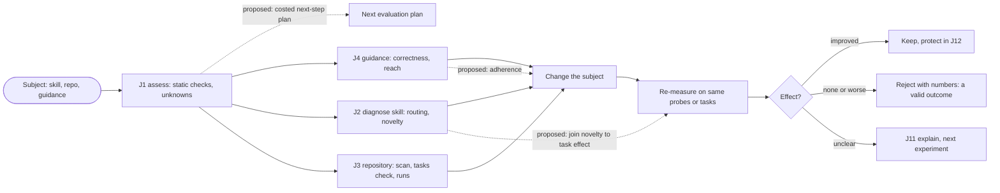
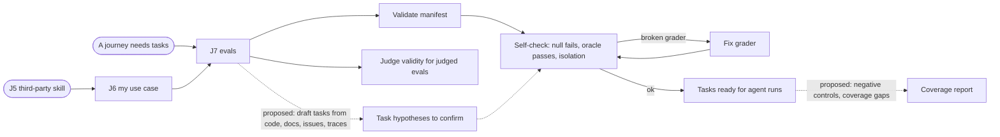
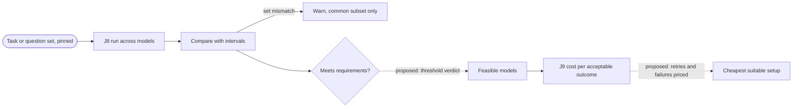
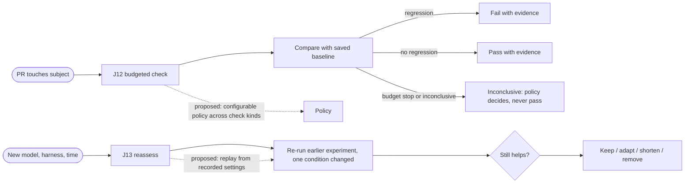
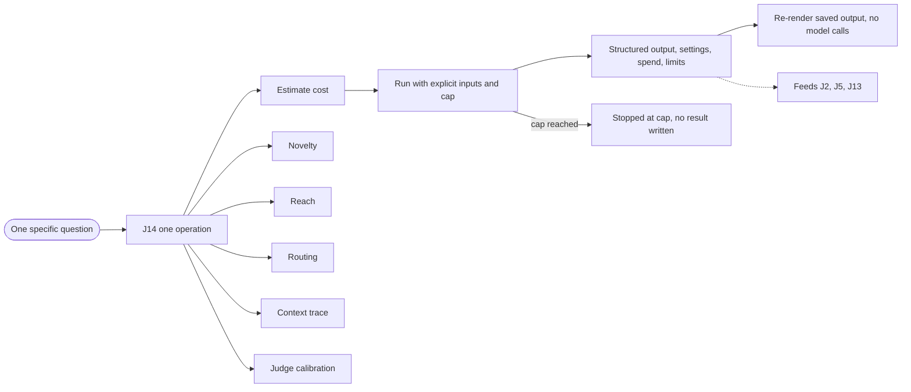
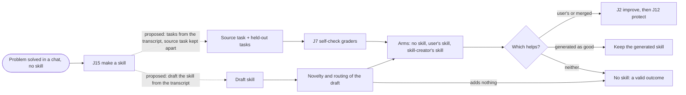

<!--
Copyright (C) 2026 Intel Corporation
SPDX-License-Identifier: Apache-2.0
-->

# Flow map

How the [journeys](journeys.md) connect. Solid arrows are transitions a user can
make with today's commands; dashed arrows labelled *proposed* need a capability
that does not exist yet. Nodes name what the user gets, not a command: the
commands for each step are in the journey's own section.

None of these is a fixed sequence. A user can enter at any node that matches
what they already hold.

## Assessment and improvement

## Eval authoring

## Model and cost selection

## Recurring checks

## Direct entry

## From a solved chat to a skill

